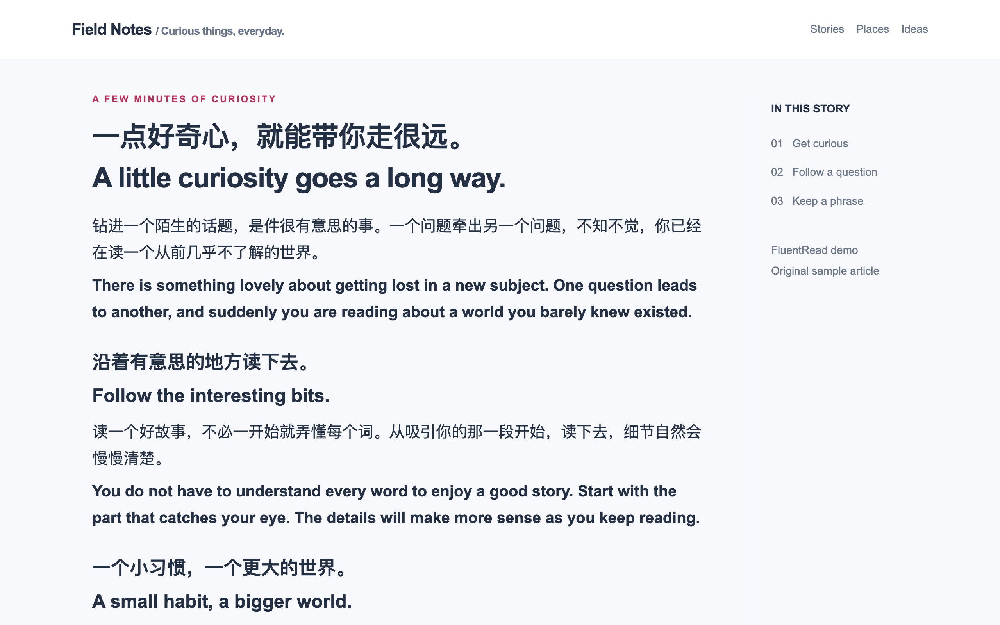

<div align="center">


# FluentRead

**Closer languages. A bigger world.**

An open-source browser extension for bilingual translation.

[Install](#installation) · [Website](https://read.thinkstu.com/en/) · [User guide](https://read.thinkstu.com/en/guide/) · [Sponsorship](#sponsorship) · [Privacy policy](https://read.thinkstu.com/en/guide/privacy) · [简体中文](./misc/README_ZH.md) · [LINUX DO Community](https://linux.do) · [GPL-3.0](./LICENSE)

</div>

FluentRead is an open-source, privacy-first reading, translation, and language-learning workspace for the web. It displays translations alongside original webpages and brings together local offline AI models, PaddleOCR + LaMa manga & image translation, 17-format document translation with scanned PDF OCR, video & meeting subtitles with local Whisper/Qwen3 ASR, offline dictionaries with AnkiConnect & re-encounter review, a writing assistant, and a keyboard-first global command palette.

We began developing FluentRead in January 2024. Since then, FluentRead has remained open source and free to use.

<div align="center">

[](https://read.thinkstu.com/videos/fluentread-promo-en.mp4)

[▶ Watch the 56-second introduction](https://read.thinkstu.com/videos/fluentread-promo-en.mp4)

For a closer look, [watch the full official introduction (4+ minutes, in Chinese on Bilibili)](https://www.bilibili.com/video/BV1qhHJ6uEiF/).

</div>

<table align="center"><tr><td>
<a href="./docs/public/screenshots/en/translation.webp"></a>
</td></tr></table>

## Features

| Feature | Description |
| --- | --- |
| Webpage translation & Smart Highlighting | Full-page bilingual or translation-only reading, hover/selection/section translation, original-text restoration, per-site rules, and surprisal-based smart highlighting. |
| Global Command Palette & Scenario Onboarding | Press `Alt+K` (customizable) from any page to search and run actions with Chinese/English/Pinyin matching, or jump-start with 5 scenario presets (Academic, Developer, Language Learning, Media & Manga, Cross-border Work). |
| Local offline AI & translation engines | Free engines, DeepL, OpenAI/Claude/Gemini/DeepSeek, local Ollama / LM Studio, and on-device browser translation, with glossaries, custom prompts, translation styles, and 8 UI languages (`简体中文`, `繁體中文`, English, 日本語, 한국어, Français, Русский, Español). |
| Manga, image & area translation | PaddleOCR text detection and LaMa background inpainting for seamless continuous manga reading, webpage image translation, and area screenshot translation. |
| 17-format document translation | Translate PDF (including scanned PDF OCR), ePub, DOCX, PPTX, Markdown, HTML, TXT, SRT/VTT/ASS subtitles, and more — with side-by-side bilingual reading, inline revision editing, and export. |
| Video & meeting subtitles + local ASR | Bilingual subtitles for YouTube, X, Bilibili, and online meetings, with local Whisper and Qwen3-ASR offline transcription when native captions are unavailable. |
| AI reading card & learning loop | Contextual meaning, sentence analysis, and follow-up Q&A; built-in offline dictionaries, vocabulary book, AnkiConnect sync, and "Re-encounter" passive review when saved words reappear on the web. |
| Writing assistant & privacy protection | Input-box translation and polishing directly inside web editors, paired with automatic redaction of sensitive data before cloud translation requests. |
| E2EE cloud sync & ecosystem | End-to-end encrypted configuration backup via Google Drive and WebDAV; available across Chrome, Edge, Firefox, Safari, Userscript, and companion [integrations](./integrations/) for Obsidian, Zotero, and Thunderbird. |

See the [user guide](https://read.thinkstu.com/en/guide/) for instructions and supported formats. AI explanations require a configured AI service. Third-party pricing and availability depend on the provider.

## Installation

[Chrome](https://chromewebstore.google.com/detail/djnlaiohfaaifbibleebjggkghlmcpcj) · [Edge](https://microsoftedge.microsoft.com/addons/detail/kakgmllfpjldjhcnkghpplmlbnmcoflp) · [Firefox](https://addons.mozilla.org/en-US/firefox/addon/%E6%B5%81%E7%95%85%E9%98%85%E8%AF%BB/) · [Safari](./docs/maintainers/releases.md#本地打包) · [Userscript](https://greasyfork.org/en/scripts/482986) · [Integrations (Obsidian / Zotero / Thunderbird)](./integrations/)

1. Install the extension and refresh the webpage.
2. Open FluentRead, pick your interface language (8 languages including Simplified & Traditional Chinese), and optionally apply a scenario preset (Academic, Developer, Language Learning, Media & Manga, or Cross-border Work).
3. Click “Translate page” or press `Alt+K` anytime to open the Global Command Palette.

Store updates may arrive at different times. The userscript provides core webpage translation features. See the [installation guide](https://read.thinkstu.com/en/guide/getting-started) for browser and feature availability.

## Sponsorship

The project is currently funded mainly out of pocket, with a few hundred US dollars spent each month on maintenance. We believe FluentRead can make the world a little better.

Thank you to [**bilibili Index-Translate**](https://index-translate.bilibili.com/) for becoming FluentRead’s first sponsor.

[Become a sponsor](https://read.thinkstu.com/en/guide/support#sponsorship) · [Email us](mailto:a1914493943@gmail.com?subject=FluentRead%20sponsorship) · [Add on WeChat](https://read.thinkstu.com/support/wechat-contact.jpg)

## Local development

Use the Node.js version in `.nvmrc` to match CI. Run pnpm through Corepack to use the version pinned in `package.json` even when your shell has an older global pnpm.

```sh
nvm install
corepack pnpm install --frozen-lockfile
```

- `corepack pnpm dev` starts local development.
- `corepack pnpm zip` builds and packages the Chrome extension.

[Extension code](./src/) · [Integrations](./integrations/) · [Documentation source](./docs/) · [Component previews](./docs/development/storybook/) · [Tests](./tests/)

[Other browsers](./docs/maintainers/releases.md#本地打包) · [Firefox source review](./scripts/amo/README.md)

## Contributing

Report bugs and propose changes through [Issues](https://github.com/FluentRead/FluentRead/issues). Pull requests for code, documentation, interface translations, and [website adaptation](./docs/contributing/site-adaptation.md) are welcome.

## Support

FluentRead is an open-source project whose continued development is made possible by the generous support of its community. Voluntary contributions are welcome through either service.

<table>
<tr><th>WeChat Support</th><th>Ko-fi · International</th></tr>
<tr>
<td align="center"><a href="./misc/approve.jpg"></a><br />Scan with WeChat. Click the image to enlarge.</td>
<td align="center"><a href="https://ko-fi.com/thinkstu"><strong>Support thinkstu on Ko-fi ↗</strong></a><br /><br />ko-fi.com/thinkstu</td>
</tr>
</table>

## Acknowledgments

FluentRead grows alongside a vibrant open-source community. We are grateful to the following projects and their contributors for their openness and generosity:

- [Read Frog](https://github.com/mengxi-ream/read-frog)
- [KISS Translator](https://github.com/fishjar/kiss-translator)
- [Duo Translator](https://github.com/linuxscreen/duo-translator)
- [InfoLens](https://github.com/dqy08/InfoLens) — Smart Highlighting is inspired by its surprisal heatmap idea (Apache-2.0)

<!-- contributors:start -->
<a href="https://github.com/FluentRead/FluentRead/graphs/contributors">
  <table>
    <tr>
      <th>
        <br>
        <br>
        <br>
      </th>
    </tr>
  </table>
</a>
<!-- contributors:end -->

Thank you to everyone who has contributed to FluentRead, including the many we couldn't name here, and to every user for embracing a product that is still far from perfect. We hope to keep building together with you, and to bring a little more good into the world.

## License and privacy

FluentRead is released under [GPL-3.0](./LICENSE). See [third-party notices](./public/third-party-notices/) for component attribution and licenses.

Settings and learning records stay local by default; cloud translation uses your selected provider. Optional cloud configuration backup supports Google Drive and [WebDAV](https://read.thinkstu.com/en/guide/webdav), including service credentials while excluding wordbooks, conversations, and usage statistics. See the [privacy policy](https://read.thinkstu.com/en/guide/privacy) for permissions, encryption, and deletion details.

## Star History

<table align="center"><tr><td>
<a href="https://star-history.com/#FluentRead/FluentRead&amp;Date"></a>
</td></tr></table>
