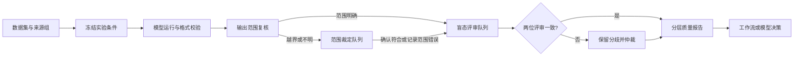

# 翻译质量评测产品设计

日期：2026-11-20  
状态：可评审的产品方案；尚未实现评测工作台，也没有外部用户验证。

## 设计决定

把用户的“阅读翻译”和团队的“质量评测”作为两个相连但不同的体验：

1. 阅读界面帮助用户完成当前页面、文档或漫画的翻译任务。
2. 内部评测工作台管理数据集、实验、盲审和质量证据。

翻译中心适合快速比较服务，但它不是基准实验：数据来源、分区、提示、上下文、参考译文审批和盲审状态都不能只靠临时输入框表示。翻译统计面板记录请求、耗时、缓存和失败等运行数据，也不应被呈现为语义质量排名。

因此先把评测工作台作为独立的内部产品设计，复用 FluentRead 的数据契约与请求实现；当评测流程和评分规则经过试标，再把经过证据支持的模式提示与工作流能力带入阅读界面。

## 现有产品基础

| 现有界面 | 当前工作 | 产品设计中的定位 |
| --- | --- | --- |
| [TranslationCenter](../../src/features/translation-center/ui/TranslationCenter.vue) | 粘贴文本、选择服务、并列查看结果、重试和复制 | 保留为快速文本比较入口；需要数据快照、受控实验或盲审时进入评测工作台 |
| [TranslationStatsDashboard](../../src/features/translation-stats/ui/TranslationStatsDashboard.vue) | 请求量、耗时、缓存、错误和服务表现 | 保留为运行健康视图；不显示为语义质量分或默认模型推荐 |
| [PdfReader](../../src/features/document-translation/ui/PdfReader.vue) | 原版布局/重排阅读、OCR 原文核对、双栏与逐段译文 | 作为论文和长文档的阅读端；增加本次提取、范围、上下文来源的可见性设计 |
| [MangaReadingPanel](../../src/features/image-translation/ui/MangaReadingPanel.vue) | 选择当前可见页或区域，查看文字及原文对照 | 作为漫画原文校验入口；评测工作台另外记录 OCR、区域和译文标签 |

目前在这些产品界面目录中未找到基准集管理、盲态双评审或仲裁工作台。产品设计应沿用现有阅读与统计能力，避免把请求可用性直接包装成翻译质量。

## 信息架构

### 阅读端

- **网页**：一般网页仍是默认模式；文章、FAQ、技术指南可建议具体流程，但由用户确认。
- **论文**：展示标题、摘要、目录和抽取风险；用户选择摘要、章节或全文。
- **技术文档**：展示产品与版本；可选同版本关联页面和明确选择的项目术语库。
- **漫画**：先核对 OCR、区域、阅读顺序和说话者；图像是否发送给模型是独立选项。
- **含公式漫画/图解**：在对白 OCR 外单列公式和关系图抽取。原图、可编辑文字、符号转录候选、表格轴和答案键要分开存；模型输出需分别核对公式抄写、结构恢复和基于证据的解释。Comixplain《Mathematical Thinking》第 5–6 页可作为工作台离线样例：一个既有 image-only 输出中 3/8 个公式候选有字面命中，但这不是准确率，只显示模型读回的覆盖有限。图像 OCR 请求有 5/6 超时；视觉任务仍需单独报告运行可靠性与转录质量。[视觉数学候选与读回观察](../../../workspace-data/evidence/translation-benchmark-comixplain-math-thinking-bilibili-api-20261115/visual-math-expansion-v1/summary-v1.md)
- **扫描教育文档**：先确认逐页 OCR、章节树、目录和脚注/图注归属；低置信页修订后才进入翻译，目录上下文由用户单独启用。书目、URL、出版信息和鸣谢单独标为“原样保留/待翻译策略”，不默认送进翻译。
- **翻译依据**：当前文档工具栏用一行状态说明上下文与记忆，例如“当前章节上下文 · 术语命中 2 项 · 仅本项目”；展开后可以查看、关闭或更改本次使用范围。

### 内部评测端

建议导航包括：

| 区域 | 用户要完成的决定 | 主要内容 |
| --- | --- | --- |
| 基准集 | 哪些材料可用于某个任务？ | 轨道、来源组、许可、语言方向、文档版本、数据分区、结构覆盖、参考审批状态 |
| 实验设计 | 这次比较改变了什么？ | 数据快照、模型、提示、分段、上下文、术语作用域、图像/文本输入、重复次数、输出格式合同 |
| 运行记录 | 请求是否按设计完成？ | 冻结计划哈希与计划来源、计划格/尝试格/未发送格、HTTP 与规范化运行结果、严格格式、复本/重试/恢复、延迟和费用；不评分语义 |
| 覆盖矩阵 | 哪些轨道和来源组已有哪个模型的可评阅输出？ | 按轨道/模型显示尝试、非空输出、响应失败类别和有输出的独立来源组；显式计划格与无计划字段的历史运行分开呈现，不做质量排名 |
| 输出范围复核 | 回复实际覆盖了哪些来源单元？ | 冻结的目标单元、仅作上下文的单元、遗漏/多译单元、顺序与结构证据；与翻译质量分开 |
| 评审队列 | 哪个译文更准确、完整或合适？ | 随机 A/B、盲态模型标签、两份独立评审、争议项和仲裁 |
| 结果对比 | 哪些证据足以改变产品决策？ | 分任务指标、独立文档数、错误严重度、区间、失败率和成本 |
| 记忆与上下文 | 某个依据是否帮助或污染译文？ | 词条命中/采用、作用域泄漏、上下文块相关性、条件对照 |

### v88 模型×轨道运行覆盖矩阵

总览只显示清单规模、独立来源组和质量准入数；下钻页再按“内容轨道 × 模型”显示实际尝试、HTTP 200 非空输出、失败类型以及有输出的来源组数。轨道的来源组不互斥，所以页面明确列出跨轨道组，并且不把段落/面板行数作为独立样本数。

分区表把显式计划、含计划字段记录的实际运行、没有计划字段的历史运行、计划未尝试格分列。v88 的 challenge 有 474 条观测运行，其中 462 条来自无计划字段记录、12 格有显式计划；页面不从这两个数推导完成率。分区表同时显示轨道来源组数：当前 challenge 只有 3 个漫画组，科技论文和技术文档尚无 challenge 组。全页可滚动表格在窄屏变为每轨道纵向模型卡；非空率只标成“运行可用性”，不使用领先/落后排名视觉，也不把 HTTP/解析失败混进翻译质量。静态实现见[模型×轨道运行覆盖](../../../workspace-data/product-assets/translation-evaluation-lab-prototype-20261116/model-track-run-coverage-v88.html)，数据和计算口径见[审计摘要](../../../workspace-data/evidence/translation-benchmark-candidate-manifest-v88-echarts-translation-20261119/model-track-run-coverage-v1.md)。

2026-11-19 Bilibili 官方网页 UI 的单句 canary 为 2B、9B、35B-A3B preview 各留存一条输出，并捕获 UI 回显的 `index-mt-2b`、`index-mt-9b`、`index-mt-35b`。该 canary 与清单及公开 API 批次分开：不能用网页 UI 成功推断 API DNS/端点可用，也不并入 219 格 React API 计划、清单运行数、盲评池或模型排名。产品应把“通道/模型 ID 已确认”与“输出质量已评审”分开展示；目前模型 ID 可见、人工评审与质量评分均为 0。[canary 摘要与原始观察](../../../workspace-data/evidence/translation-benchmark-candidate-manifest-v88-echarts-translation-20261119/bilibili-ui-canary-v1/summary-v1.md) · [产品覆盖卡片](../../../workspace-data/product-assets/translation-evaluation-lab-prototype-20261116/model-track-run-coverage-v88.html)

随后在同一官方网页 UI 上完成 React 四篇技术文档的独立矩阵：44 个源段共 132 次提交，131 格回显模型 ID 与计划匹配，1 格计划 2B 实际回显 9B，保留为错配；零未提交单元、零自动重试。另有 1 次预提交控件引用失效事件，确认未触发翻译请求，单独留档。四篇文档属于同一个来源组。之后另完成 API 的 219 格运行并入 v91，v92 将该组随其他完整技术组分配到 challenge 候选 split：45 格单次技术专用提示、174 格双重复 segment-only，每模型 73 格；UI 和 API 通道仍分开展示，后续分析按文档/条件/重复分层，不合成一项 React 排名。译文尚未人工评审，无质量分或排名。[前两篇 UI 矩阵](../../../workspace-data/evidence/translation-benchmark-candidate-manifest-v88-echarts-translation-20261119/react-technical-web-ui-matrix-v1/summary-v1.md) · [后两篇 UI 矩阵与逐格审计](../../../workspace-data/evidence/translation-benchmark-candidate-manifest-v88-echarts-translation-20261119/react-technical-web-ui-matrix-v2/summary-v2.md) · [219 格 API 与 v91 并账摘要](../../../workspace-data/evidence/translation-benchmark-candidate-manifest-v91-react-api-20261121/summary-v1.md) · [v92 challenge 分区审计](../../../workspace-data/evidence/translation-benchmark-candidate-manifest-v92-cross-track-challenge-20261121/summary-v1.md) · [逐次 UI 译文](../../../workspace-data/evidence/translation-benchmark-candidate-manifest-v88-echarts-translation-20261119/react-technical-web-ui-matrix-v2/ui-run-attempts-v2.jsonl) · [v92 覆盖页](../../../workspace-data/product-assets/translation-evaluation-lab-prototype-20261116/model-track-run-coverage-v92.html)

2026-11-19 eLife 101208.4 的 3 条图注也各有 2B、9B、35B-A3B preview 网页 UI 输出，共 9/9 模型 ID 匹配。该 sidecar 只覆盖文字图注，不含图像输入，因此不能当作 OCR 或图表理解结果；它与公开 API 9 格计划分开保存。页面显示 9/9 的运行覆盖，但仍需后续盲态评审，不能呈现为“翻译质量通过”。[图注 UI 矩阵](../../../workspace-data/evidence/translation-document-understanding-elife-odonate-range-phenology-20261117/figure-caption-expansion-v2/web-ui-matrix-v1/summary-v1.md) · [产品覆盖卡片](../../../workspace-data/product-assets/translation-evaluation-lab-prototype-20261116/model-track-run-coverage-v88.html)

同一篇论文的 11 个摘要句随后各由三模型提交一次，网页 UI 矩阵 33/33 返回模型 ID 匹配；与图注矩阵合计 42 条 UI 输出，但仍只有一个独立来源组。摘要句只带当前句和专用指令，没有前后句、术语候选、参考译文、答案键、图像或 QA 输入；这组数据不能验证长上下文一致性或文档理解。公开 API 的 141 格计划仍未提交，盲态双语评审按用户要求暂缓，质量分与排名为 0。[摘要句 UI 矩阵](../../../workspace-data/evidence/translation-document-understanding-elife-odonate-range-phenology-20261117/abstract-web-ui-matrix-v1/summary-v1.md) · [逐格审计](../../../workspace-data/evidence/translation-document-understanding-elife-odonate-range-phenology-20261117/abstract-web-ui-matrix-v1/ui-run-audit-v1.json) · [产品覆盖卡片](../../../workspace-data/product-assets/translation-evaluation-lab-prototype-20261116/model-track-run-coverage-v88.html)

## 阅读端任务流程

共同路径是“识别内容—核对原文结构—选择范围—检查本次依据—翻译—恢复结构—阅读与修订”。模式只改变本次可选流程，不自动扩大文本范围、启用图片、加载全局记忆或发送整篇文档。用户能在开始前确认本次的模型、目标语言和上下文；运行后能区分请求成功、格式通过和语义是否经过评审。

### 论文

1. 先看标题、摘要、章节目录、公式/表格数量和抽取风险。
2. 选择摘要、当前章节或全文；逐项确认章节上下文、术语库和前置定义是否加入。
3. 公式、数值、单位、引文和表格结构作为单独可检查项；含义、否定、因果、作者立场和缓和/增强语分别评审。
4. 错误分到 PDF 抽取、分段、翻译或排版阶段；不能把上游抽取错误记作模型翻译错误。

### 技术文档

1. 显示产品、文档版本、当前页面和步骤结构；用户可以切换版本。
2. 关联页上下文只有在用户选定后加入，并显示标题、版本和段落数量。
3. 代码、行内标识符、API 名称、命令行、配置键、路径和版本号在翻译前后并列核对。
4. 质量复核分别检查前置条件、步骤顺序、警告强度、代码字面量和跨页术语一致性。

### 漫画

1. 先显示页图、识别文字、区域类别、阅读顺序和识别置信度；可编辑识别结果后再继续。
2. 把页面上下文、同页已核对文字和图像输入做成独立开关；明确列出实际送给模型的部分。
3. 文字结果按区域回填；区域 ID、说话者字段和绘制状态与对白文本分开处理。
4. 单独记录 OCR 文字、区域/顺序/说话者、译文语义/口吻和版面适配。纯文本输入不能得到视觉理解结论。
5. 对已有面板文本可以显示与未审简中出版候选的长度差异，作为“优先打开本地预览”的排序信号；不推断真实溢出，不用字符比替代渲染或可读性评审。Soldering Is Easy 的 126 条输出中，78 条更长、6 条等长、42 条更短；各模型的中位长度比分别为 1.004、1.028、1.049。[长度诊断与边界](../../../workspace-data/evidence/translation-benchmark-soldering-is-easy-comic-20261118/v1/panel-region-v1/panel-text-expansion-audit-v1/summary-v1.md)

### 一般网页

1. 说明正文、标题、列表、链接文字、表格和图片说明哪些会进入范围。
2. 用户可以选整页、正文或当前段落；可查看并排除导航、广告和重复区域。
3. 结果检查正文覆盖、列表层级、专名/数字、否定/警告和链接目标保留。
4. 对图片的说明只有在模型实际收到图像时才评视觉理解；其余情况只报告文本结构与翻译。

## 实验设计与盲审

### 新建实验

按固定顺序选择：

1. **数据集快照**：来源版本、许可用途、文档/作品分组、train/dev/test/challenge 状态。
2. **任务与条件**：内容模式、文本范围、提取版本、提示版本、上下文块、术语策略、是否发送图片。
3. **模型矩阵**：提供方、模型 ID、模型版本、语言方向、重复次数；只对一个主变量做配对消融。
4. **运行与留存**：计划调用数、最大预算、预检状态、失败恢复策略、原始请求/响应的留存期限与访问范围。
5. **执行前摘要**：显示哪些字段相同、哪些字段会变化；检查未来段落、参考译文和未批准术语是否误入请求。

任何来源文本、模型/提示版本、分段或任务范围变化都生成新实验身份，不覆盖旧结果。每条运行保存源文哈希、输入块顺序、条件、请求/响应结构状态、模型 ID、时间和成本；只把真正返回的输出计为运行，计划调用和 DNS 预检不计为模型运行。

### 盲审页面

- 先看原文和完成任务所需的上下文，再看随机标记为 A/B 的译文；隐藏模型名、自动分数和运行状态。
- 两个译文先分别评分，再做偏好选择；提供“平局”和“无法判断”。不要求逐字贴合某条候选参考。
- 评审按文档/作品分配；段落、句子、表格单元和漫画区域只作问题定位单位。
- 每个严重错误允许标出源文和译文跨度，记录错误类别、影响和置信度。
- 两位评审独立提交后才比较分歧；仲裁保留两份原始标签和仲裁标签，不覆盖历史。
- 评审看过的上下文必须与“模型是否收到该上下文”分开记录；漫画图像可按研究问题提供，但要标出与模型输入的差别。

## 结果页面与评分口径

结果页默认分成四个面板，不把它们相加成单一总分：

| 面板 | 例子 | 可以回答 |
| --- | --- | --- |
| 运行可靠性 | HTTP 成功、严格 JSON 通过、超时、重试、延迟、费用 | 请求与输出合同是否按设计工作？ |
| 提取与结构 | 文本覆盖、OCR 字符/区域、阅读顺序、代码/公式/表格结构 | 输入材料是否被正确抽取和恢复？ |
| 自动参考诊断 | BLEU、chrF 等指标、精确签名、参考版本/许可/审定状态 | 译文和指定参考在字面层面有多接近？ |
| 人工翻译质量 | 含义准确、信息完整、自然度、语域、术语、关键错误 | 译文是否适合当前任务？ |
| 产品使用效果 | 用户修改、接受、撤销、重试、完成耗时 | 流程是否帮助用户完成任务？ |

产品使用行为不能替代语义质量；HTTP 200、格式合规或翻译被复制也不能证明译文正确。评审分数按文档/作品与来源组分层汇总，显示独立样本数、输出成功数、评审数、置信区间和失败分母。句段数量不能代替文档样本数。默认不合成总分；需要作出单一产品选择时，先显示各维度与关键错误，再由明确的决策规则决定。

运行面板保留原始供应方状态，并以 HTTP 状态和哈希证据生成统一运行类别。HTTP 非 200 归为 `provider_http_error`，无 HTTP 状态的网络失败归为 `network_transport_error`；HTTP 200 的解析失败和结构失败分别显示，不与语义质量合并。计划矩阵未显式保存的历史记录显示“计划未记录 / 仅观测运行”，不得把实际已见运行格反推成完整计划；`replicate_index` 与 `attempt_number` 分开展示，重试不算新的独立复本。

评估维度沿用[人工标注指南](./translation-benchmark-annotation.md)：一般语义维度共用，论文增加立场/论证保留，技术文档增加约束与代码字面检查，漫画增加 OCR/区域/口吻/字数适配。篇章一致性单列，不并入段落级准确度。

没有双人评审或足够独立文档时，人工质量区显示“证据不足”。有可追溯参考时可以单独显示自动参考诊断，但要标明官方/候选来源、语言方向、数据分区、参考是否审定及指标签名；自动分数不能冒充语义正确率，也不能单独触发模型排名。样本量、评审一致性和关键错误阈值先经试标估计，当前不设任意固定数字。

### 指标定义与分母

主结果保留维度，不把翻译质量折成一个总分。人工评审到位后，优先展示三项：

| 指标 | 定义与分母 | 用途与限制 |
| --- | --- | --- |
| 严重错误率 | 散文按每 1,000 个源文词、漫画按每 100 个源区域，计算经双人标注并仲裁为重大或致命的错误数；同时报受影响任务比例和错误类型 | 直接揭示会改变结论、操作或人物/情节理解的风险；源文长度与内容类型仍须分层，不能把段落、调用当独立样本 |
| 盲态偏好净胜率 | 同一来源句、范围和任务条件的有效 A/B 对中，`(A 胜数 − B 胜数) ÷ 已裁决配对数`；平局与无法判断另报，不混入分母 | 用于模型/流程的成对选择；需隐藏模型与条件标签，且成对样本按文档/作品聚类计算不确定性 |
| 独立来源覆盖 | 按不同作品、论文或上游文档计数；分别报告每类已有可用输入、可用参考和双评输出的来源组数 | 判断数据是否足以支持跨内容结论；句段、表格行、问答题和模型调用数只表示任务规模，不增加独立来源数 |

每项结果旁边同时显示来源组数、任务数、成功输出数、双评数、仲裁数和区间估计。诊断指标包括完整性、数字/否定/限定语错误、术语准确采用与误用、跨段不一致，以及抽取/结构恢复；这些指标按科技论文、技术文档、漫画等流程分开展示。上下文实验将“译文改变率”与“盲审质量差”分开；术语记忆实验将正确采用、漏用、错作用域注入和质量净变化分开。证据问答使用证据支持、事实正确和拒答质量，不计入翻译得分。HTTP 成功率、延迟、成本、源文覆盖与用户修改量作为运行或产品护栏，不可代替语义结果。

当前双语评分仍为 0；TICO-19 dev 的 36 个目标句、12 个来源文档已生成 chrF2 自动参考诊断，并按文档成簇估计上下文差值。结果随模型和上下文条件变化；例如 9B 的完整文档条件相对邻接行条件低 2.24 chrF2，但其参考未由本项目双语审定，样本也不在 TICO 论文列出的第二轮 QA 文档中。界面应把它显示为待审参考上的字面相似度，不能推导语义质量或模型排名。[自动指标与区间报告](../../../workspace-data/evidence/translation-benchmark-tico19-dev-full-document-corpus-20261116/automatic-reference-diagnostics-v1/context-reference-diagnostics-v1.md) 完成首批双人试标后，先检查评审一致性、不同领域的错误基线和文档级区间，再决定目标阈值与扩大评测的最小样本量。

## 术语记忆、上下文和文档理解

### 术语记忆

显示词条的来源、语言方向、作用域、状态和本次命中理由。词条状态分为“候选、已审、已启用、本次停用”；未审候选永不自动进入模型请求。用户只有在确认译法和适用范围后才能保存；已保存条目可撤销、停用和删除。评测分别测检索召回、错作用域命中、正确采用、同词异义迁移和译文质量变化。

eLife 生态论文补充了 24 组 source-only 词面候选及 175 个块内跨度，适合作为记忆界面的待审状态样例。界面应显示候选类别、所在证据块、邻近句和记录坐标的文本版本；没有目标译法时禁用“批准记忆”和“本次输入”操作。位置出现次数只能支持评审排队，不能充当术语准确率或记忆覆盖率。

技术文档候选列表还要分开保存英文来源跨度、目标页面出现的候选表面、源译对齐状态、目标页面修订与许可状态。FastAPI 的同提交简中页面仍只是未裁定本地化；OpenTelemetry 的简中页面存在版本漂移，界面应明显显示“版本不匹配/未对齐”，不能把它的目标词面当作同句译法。v9 的 20 组新增观察适合作为候选工作台样例；精确字符串命中仅支持跳转定位，批准前必须由双语领域评审确认词义、变体和作用域。候选状态与“已审可用记忆”应有独立过滤器；memory/no-memory 评测还需排除建立记忆时用过的来源组。[registry v9 与跨度审计](../../../workspace-data/evidence/translation-memory-candidate-registry-20261116/v9/summary-v9.md)

Ant Design 的现有 84 条输出提供了未使用词表的代码字面量基线：138 个源词面/运行对照中，108 个计数相同、30 个多出一次、0 个少于源文。`dependencies` 出现次数在 30/45 条输出中多一次，`shouldUpdate` 60/60 与源文相同；两者的 42 组成对上下文条件计数均未变化。这只能说明字符串出现次数，不能作为语义一致、译法正确或上下文无影响的分数。评估台应把该信号标作机器诊断，并保留来源词项、次数和条件筛选；未来只有在术语双评后才开放记忆条件。[审计摘要](../../../workspace-data/evidence/translation-benchmark-ant-design-form-reference-candidate-20261116/term-observation-v2-model-output/summary-v1.md) · [逐运行记录](../../../workspace-data/evidence/translation-benchmark-ant-design-form-reference-candidate-20261116/term-observation-v2-model-output/model-output-literal-observations-v1.jsonl)

### 上下文一致性

把“无上下文、邻段、同章节、关联页面/前页、完整文档”作为可审计的条件，而不是隐式提示。每块上下文显示来源标题、版本、范围和是否发送；实验中记录稳定来源 ID 与哈希。评审先标 `required`、`helpful`、`irrelevant`、`contradictory` 或 `sensitive/out-of-scope`，再检验模型是否利用了正确证据以及是否传播了旧译文错误。

### 文档理解

把翻译与“总结、跨章节问答、术语/实体关系、论点变化、文档间比较”分成不同任务。回答应能跳回原文证据块；评测检查事实支持、覆盖、遗漏、矛盾、引用准确和拒答边界。文档理解的事实错误不能混入翻译分数；翻译正确也不能证明模型理解了整份文档。

通过 Bilibili 模型做 source-evidence 问答时，必须标为“直接 API 的探索性问答能力测试”：提示词是问答任务，不是 FluentRead 的内置翻译请求。内置 [Bilibili provider](../../src/providers/translation/bilibili-free.ts) 发送固定翻译提示，并通过分块与结构恢复翻译文本。两条路径的运行记录和结果不得混报；即使模型能答题，也不据此宣称它是已验证的通用问答模型。

## 上线顺序与决策门槛

| 阶段 | 交付 | 进入下一阶段的证据 |
| --- | --- | --- |
| 0. 数据准备 | 版本化基准集、许可范围、来源组与指标合同 | 来源/结构检查通过；目标参考可追溯；明确不能评分的格子 |
| 1. 内部评测工作台 | 实验配方、运行状态、双盲队列、仲裁和分层结果 | 评审者能独立复核；运行状态与质量结果不会混淆；内容留存符合来源许可 |
| 2. 阅读流程试点 | 论文、技术文档、漫画模式建议与本次依据检查 | 与一般流程做同文档配对；错误类别可追到提取、翻译或排版阶段 |
| 3. 产品推荐 | 按任务给出模型/上下文/术语建议 | 人工质量有优势且关键错误不恶化；样本按文档/来源组计算；成本和延迟可接受 |
| 4. 默认策略 | 将通过证据的流程设为默认 | 小规模真实用户验证有净收益、可撤销、失败可恢复，并持续监控分领域退化 |

历史设计快照 v61：当时主清单有 205 条 candidate-only 记录、1,072 个文本/页面单位、2,514 条模型运行记录；132 个来源组中 7 个仍未分区。571 条参考候选对应 562 个不同文本哈希，全部待审；准入记录、人工质量分和模型排名仍为 0。dev 有 47 条记录、102 个单位、83 条参考候选，分属 45 个来源组。FLORES-200 官方 dev 的 30 条句级样本完成 Bilibili 三模型 90/90 次调用，但不能代表完整网页结构或上下文。TICO-19 dev 的 12 篇文档、36 条目标对齐行新增 432 格无上下文/相邻对齐行上下文矩阵：431 次 HTTP 200、1 次 35B HTTP 504，无自动重试。上下文使模型输出变化的有效配对为 2B 68/72、9B 54/72、35B 62/71；这只是敏感性诊断，不是质量提升结论。TICO 行级 `translator_ID` 均为 TOFILL，来源页 revision 未逐项固定；一条选中源文的 `b'` 序列化前缀仅在本地候选输入中移除并留有前后哈希。术语候选 registry v8 为 254 条：187 条有目标表面、67 条 source-only；其中 21 条来自 Kubernetes 与 TypeScript 双语技术文档，均待审。v61 对重复的 COVID-19、SARS-CoV 做了未审候选表面的出现诊断，不是术语准确率；批准进入持久记忆和模型输入资格仍均为 0。AbortSignal 的 108 格上下文矩阵与教育文档的 96 格正文/目录上下文矩阵仍未发送；后者等待 OCR 校对。书目与未编号封底帧另作候选，不默认翻译。盲态双评审、仲裁与实验配方界面仍未实现。[本地交互原型](../../../workspace-data/product-assets/translation-evaluation-lab-prototype-20261116/index.html) · [原型说明](../../../workspace-data/product-assets/translation-evaluation-lab-prototype-20261116/README.md) · [v61 上下文运行与校验](../../../workspace-data/evidence/translation-benchmark-tico19-dev-context-ablation-20261116/summary-v1.md) · [v8 术语候选索引](../../../workspace-data/evidence/translation-memory-candidate-registry-20261116/v8/summary-v8.md) · [教育文档正文与尾页候选](../../../workspace-data/evidence/translation-benchmark-funmilayo-end-matter-expansion-v1-20261116/summary.md) · [按内容类型的翻译流程](./translation-specialized-workflows.md) · [文档上下文评估](./translation-document-context-evaluation.md) · [术语记忆评估](./translation-memory-evaluation.md)

当前 v88 增量清单沿用 474 条记录、1,531 个文本单位和 343 个来源组，内部准入仍为 0。累计运行尝试 3,427 格、2,827 条 HTTP 200 非空输出；v88 的 28 个新增 ECharts 格均为 DNS 失败且无译文。ECharts 文档理解侧车扩至 16 题候选、48 个计划格、0 次提交；答案键仍待审。状态数字不代表译文质量。PLOS Biology 同篇双文体为 24 格；TypeScript Handbook 90 格、Astro Routing 36 格完成 source-only 输入。Ant Design 的技术提示基线 24 格和上下文消融 60 格均已运行并通过逐格完整性审计；来源组总计 84/84 完成。两个盲态池合计 84 条单译文，另有 27 组成对项；评审、质量分和排名仍为 0。30 个上下文配对中 27 个输出字符串变化，API 报告 prompt token 中位数 123→532；这些是敏感性与调用成本诊断，不是质量提升证据。[v87 总览和校验](../../../workspace-data/evidence/translation-benchmark-candidate-manifest-v87-ant-design-context-20261119/summary-v1.md) · [一致性审计](../../../workspace-data/evidence/translation-benchmark-candidate-manifest-v87-ant-design-context-20261119/snapshot-consistency-audit-v1.json) · [基线盲态池](../../../workspace-data/evidence/translation-benchmark-ant-design-form-reference-candidate-20261116/base-translation-v1/execution-v1/blind-review-pool-v1/summary-v1.md) · [上下文盲态池](../../../workspace-data/evidence/translation-benchmark-ant-design-form-reference-candidate-20261116/context-ablation-v1/execution-v1/blind-review-pool-v1/summary-v1.md) · [数据用途记录](../../../workspace-data/evidence/translation-benchmark-ant-design-form-reference-candidate-20261116/base-translation-v1/execution-v1/data-use-review-v1.json)

TICO-19 全文 sidecar 已补齐 v61 选择的 12 篇文档全部 934 条对齐源文；模型运行仍只覆盖其中原有的 36 个目标。完整上下文配对 v2 对这 36 个目标为三个模型各增加一次全文上下文输出（108/108 HTTP 200），与 v61 r1 逐字比较后，三模型相对无上下文分别有 33/36、31/36、30/36 输出变化；相对邻接行分别为 30/36、30/36、27/35。35B 有一个邻接基线失败。每模型 API 报告输入 87,132 tokens（三模型共 261,396），中位延迟 0.40/0.88/1.52 秒；这使全文条件的上下文成本在实验配方和结果页中有明确位置。请求未包含来源页定位 URL 元数据，但会保留并发送英文源文中的链接字符串：本轮 27/108 个请求含内嵌 URL。模型输出仍未评分，故工作台应将这组显示为“上下文敏感性/未审译文”，而非质量结果。COVID-19、SARS-CoV 的精确词面另作诊断，registry v8 没有新增批准条目。[全文语料](../../../workspace-data/evidence/translation-benchmark-tico19-dev-full-document-corpus-20261116/summary-v1.md) · [完整上下文实验](../../../workspace-data/evidence/translation-benchmark-tico19-dev-full-document-corpus-20261116/full-document-context-paired-summary-v2.md) · [传输边界说明](../../../workspace-data/evidence/translation-benchmark-tico19-dev-full-document-corpus-20261116/transmission-boundary-clarification-v1.md) · [术语记忆评估](./translation-memory-evaluation.md)

## TICO-19 全文上下文覆盖扩展对工作台的影响

全行批量首轮完成 363 次调用，可映射覆盖 855/934（2B）、817/934（9B）、857/934（35B）；273 个缺口另作单目标修复，其中 271 条响应通过哈希核验。合并后覆盖为 933/934、933/934、934/934。2B/9B 批量输出包含格式偏离，且一条修复响应哈希不匹配被排除。工作台应分别展示计划调用、有效响应、严格格式通过、可恢复候选、哈希异常和逐模型覆盖；不得将这些字段合并成质量分。v3 批量提示与单目标修复提示另列实验，批量首轮 108 个请求和修复 84 个请求含源文内嵌 URL；来源页定位 URL 元数据没有发送。译文仍未评分，人工评审按用户安排暂缓。[覆盖报告](../../../workspace-data/evidence/translation-benchmark-tico19-dev-full-document-corpus-20261116/full-document-context-coverage-v3/full-document-context-coverage-summary-v3.md) · [修复及哈希异常审计](../../../workspace-data/evidence/translation-benchmark-tico19-dev-full-document-corpus-20261116/full-document-context-coverage-v3/single-target-repair-and-combined-coverage-audit-v2.json) 针对剩余两格的第三次尝试因 DNS ENOTFOUND 未发出 HTTP，也没有新增候选；工作台应把这种本机网络阻断与模型运行失败分别显示。[末两格补采审计](../../../workspace-data/evidence/translation-benchmark-tico19-dev-full-document-corpus-20261116/full-document-context-coverage-v3/final-two-cell-repair-audit-v3.json)

## 漫画评审队列与数据覆盖

当前 v61 漫画轨道有 69 页、8 个来源组、386 个文字区域，全部 69 份页面图像和来源记录哈希通过核对。产品评审页应把源图/转录/区域/阅读顺序/说话者审定队列与译文质量盲审分开；171 个 Pepper&Carrot 参考区域仍未审定，不能当作金标准。30 页 Funmilayo 页面现在已有 360 次 Bilibili 输出，形成 630 条安全连接的单译文刺激和 296 组同片段、同模型、同复本的上下文 A/B 对照；25 次输出无法安全恢复，90 个预期槽位保持空白。源文转录仍待复核，整部同书来源组必须整体冻结；人工评审尚未分配，评分和排名为 0。[30 页盲态池与限制](../../../workspace-data/evidence/translation-benchmark-funmilayo-comic-review-pool-v2-20261118/summary-v2.md) · [池完整性复核](../../../workspace-data/evidence/translation-benchmark-funmilayo-comic-review-pool-v2-20261118/pool-integrity-recheck-v2.json) · [v71 清单与校验](../../../workspace-data/evidence/translation-benchmark-candidate-manifest-v71-funmilayo-comic-20261118/real-en-zh-hans-candidate-manifest-v71.jsonl) / [验证报告](../../../workspace-data/evidence/translation-benchmark-candidate-manifest-v71-funmilayo-comic-20261118/manifest-validation-v71.json) · [当前漫画覆盖](../../../workspace-data/evidence/translation-benchmark-manga-readiness-20261116/summary-v2.md) · [69 页审阅队列](../../../workspace-data/evidence/translation-benchmark-manga-readiness-20261116/annotation-queue-v2.jsonl)

跨轨道覆盖页按一般网页、论文、技术文档、漫画和教育文档并列展示记录、独立来源组、翻译单元和参考候选数；独立来源组按工作/项目聚类，轨道之间可能重叠。参考候选与语义质量状态分开展示，避免候选数量多被误读成覆盖已审定。[v61 跨轨道覆盖审计](../../../workspace-data/evidence/translation-benchmark-data-coverage-v61-20261116/cross-track-coverage-report-v1.md) · [机器可读审计](../../../workspace-data/evidence/translation-benchmark-data-coverage-v61-20261116/cross-track-coverage-audit-v1.json)

## v69 Bilibili 模型运行覆盖快照

截至 2026-11-18，v69 主清单有 218 条候选记录、139 个来源组和 1,208 个文本单元；结构检查通过且 0 条内部准入。清单记录了 2,649 次 Bilibili 请求，其中 2,149 次返回 HTTP 200 且具有非空输出哈希，500 次属于网络、HTTP 或响应结构失败。运行量按模型×内容轨道拆分，但同一轨道还混有不同提示、上下文、输入范围与结构条件，故仅用于覆盖与运行可靠性盘点，不构成质量比较。

运行覆盖表同时显示实际请求、非空成功响应、失败类型和有输出的来源组数；多页、多句、多格均聚类在来源组下。未分区数据有 1,212 次计划调用、135 次实际尝试、127 个非空成功输出和 8 次失败；计划数与 DNS 预检不会计入实跑。当前仍是 0 条人工质量评审、0 个模型质量分、0 个排名。v69 的 Soldering 漫画矩阵为单一作品中的 42 个区域候选、三模型各一轮，共 126 个非空输出；区域边界与参考对齐尚未审定，图片未进入模型输入，因此不能作为视觉漫画质量证据。[模型运行覆盖盘点](../../../workspace-data/evidence/translation-benchmark-model-run-coverage-v1-20261118/summary-v1.md) · [机器可读覆盖](../../../workspace-data/evidence/translation-benchmark-model-run-coverage-v1-20261118/coverage-v1.json) · [交互式运行覆盖页](../../../workspace-data/product-assets/translation-evaluation-lab-prototype-20261116/run-coverage-v69.html)
交互页从机器可读覆盖 JSON 生成，仅含汇总计数与实验条件，不内嵌源文或译文。筛选状态可用版本化查询参数分享；桌面表格在手机端转为卡片，计划表支持横向查看。此页是离线快照，重新生成后以页面显示日期为准。
Soldering Is Easy 漫画的 126 条候选译文已整理成单条盲态刺激预览：模型映射与展示包分离，A/B/C 标签按模型均衡；中文出版参考隐藏，英语页面图像仅为评审者补充核对上下文。预览没有评分控件或评审分配，且未实现“本条评分提交后再放行同源下一译文”的正式门控，因此不是可执行评审器。[匿名刺激预览](../../../workspace-data/evidence/translation-benchmark-soldering-is-easy-comic-20261118/v1/panel-region-v1/blind-stimulus-preview-v1/blind-stimulus-preview-v1.html) · [准备状态与限制](../../../workspace-data/evidence/translation-benchmark-soldering-is-easy-comic-20261118/v1/panel-region-v1/blind-stimulus-preview-v1/summary-v1.md)
本地评审工作台 v1 将同一 packet 接入本机代号隔离、单条六维评分、完成后源文核对与匿名配对偏好流程；每一步都是用户操作后才本地保存，并允许导出。当前没有评审代号、评分或评审导出。工作台不验证评审身份，且客户端包含全部匿名候选，因此只适用于受控内部试点；它不提供自动总分或排名；币种本地化候选与源文/面板归属问题为非评分观察，不进入模型译文错误严重度。[本地评审工作台](../../../workspace-data/evidence/translation-benchmark-soldering-is-easy-comic-20261118/v1/panel-region-v1/review-workbench-v1/review-workbench-v1.html) · [回应数据 schema](../../../workspace-data/evidence/translation-benchmark-soldering-is-easy-comic-20261118/v1/panel-region-v1/review-workbench-v1/review-response-schema-v1.json) · [构建状态与限制](../../../workspace-data/evidence/translation-benchmark-soldering-is-easy-comic-20261118/v1/panel-region-v1/review-workbench-v1/summary-v1.md)
评审导出在进入仲裁前由独立校验器检查盲态 item ID、文本哈希、六维评分、错误标签、来源诊断和 pairwise 覆盖；报告只给完整性计数，不计算模型质量分。当前无导出文件，因此真实导出尚未通过实证验证。[校验器](../../../workspace-data/evidence/translation-benchmark-soldering-is-easy-comic-20261118/v1/panel-region-v1/review-workbench-v1/validate-review-export-v1.py) · [校验合同](../../../workspace-data/evidence/translation-benchmark-soldering-is-easy-comic-20261118/v1/panel-region-v1/review-workbench-v1/review-export-validation-v1.md)

## 科技论文摘要上下文试验的产品状态

工作台新增的 PLOS One 试点配方应显示：单篇材料科学论文、10 个摘要句段、无上下文/同摘要上下文、3 模型×2 条件×双重复、120 计划调用、0 已提交。请求和提示隔离检查为 120/120；Bilibili DNS 未解析是执行阻断，不应标成模型 API 失败。未审术语和无中文参考需显示在数据状态区；无人工审评时只展示运行/格式/输出敏感性，不能呈现质量分或排名。[配方和执行状态](../../../workspace-data/evidence/translation-benchmark-plos-stance-markers-source-only-candidate-20261116/context-ablation-v1/summary-v1.md) · [机器审计](../../../workspace-data/evidence/translation-benchmark-plos-stance-markers-source-only-candidate-20261116/context-ablation-v1/execution-audit-v1.json)

公开 API 的 120 格上下文消融仍为 DNS 阻断、0 HTTP；另有独立网页 UI 配对矩阵 60/60 返回模型 ID 匹配。10 个目标句各比较“无上下文”和“同摘要其余九句上下文”，只报告网页 UI 内的输出敏感性；这 60 格与 API 120 格不合并。原始日志还记录 6 格计划外重复和 1 格上下文/指令回显范围异常；排除异常对后，29 对中 24 对译文字符串不同、5 对相同，这不是质量分或上下文收益结论。后续评审仍按论文来源组分配，不能把10句当成10篇论文。[UI 矩阵摘要](../../../workspace-data/evidence/translation-benchmark-plos-stance-markers-source-only-candidate-20261116/context-ablation-v1/ui-web-matrix-v1/summary-v1.md) · [机器审计与重复提交记录](../../../workspace-data/evidence/translation-benchmark-plos-stance-markers-source-only-candidate-20261116/context-ablation-v1/ui-web-matrix-v1/ui-run-audit-v1.json) · [产品覆盖卡片](../../../workspace-data/product-assets/translation-evaluation-lab-prototype-20261116/model-track-run-coverage-v88.html)

科学论文评测配方先支持“源文立场标注”阶段，再接入匿名译文传递评审：第一阶段只标 source cue、命题范围和作者/研究对象主体，不暴露术语建议或译文；第二阶段在模型输出可用后才标保留、增强、弱化、遗漏、增译或范围/主体漂移。PLOS 试点已准备 10 项源文队列，评审者分配仍为 0。[PLOS source-first 队列](../../../workspace-data/evidence/translation-benchmark-plos-stance-markers-source-only-candidate-20261116/context-ablation-v1/source-stance-review-packet-summary-v1.md) · [schema draft 1.1](./translation-document-consistency-annotation.schema.json)

#### 论文题目与摘要盲态校准

另有 5 篇训练集论文、30 条候选输出组成 title-plus-abstract 校准池：3 模型 × 学术/通用提示，每篇六种译文均匿名，逐篇独立随机映射标签。首轮只给英文题目/摘要和一条译文；随后可查看同篇其他译文、再揭示模型与提示条件。评审前要显示“训练集校准、非 holdout”，且不能把同篇六项当成六篇论文；质量记录按论文来源组聚类，stance/claim、术语、数值和学术语体分维度呈现，不预先合成总分。当前没有评审分配或评分，输出用途/留存门槛仍待核。[候选池摘要](../../../workspace-data/evidence/translation-benchmark-academic-paper-abstract-blind-stimuli-20261118/v1/summary-v1.md) · [匿名刺激](../../../workspace-data/evidence/translation-benchmark-academic-paper-abstract-blind-stimuli-20261118/v1/stage1-blind-stimuli-v1.jsonl) · [隔离审计](../../../workspace-data/evidence/translation-benchmark-academic-paper-abstract-blind-stimuli-20261118/v1/alignment-audit-v1.json)

漫画数据入口应区分真实作品样本、合成 challenge 和来源线索。Postext 教程漫画固定提交下有 5 条 `visual_alt_description`、7 组对白/旁白/拟声词，以及 1 组完整 MDX 正文双语候选；它们共属一篇教程作品。v80 将 MDX 正文留在技术文档轨道，并将 7 个故事文字片段纳入漫画轨道的 `comic_text_source` 文档单位；它不是页级视觉样本，也不增加页数或独立作品组。5 条 alt-description 仍在 sidecar，作为另一任务单独准备。对白评估说话者、口吻和上下文一致性，alt-description 评估文字信息保留，MDX 页面评估标题/代码/组件/锚点结构；三者均不含图像，不能评价 OCR 或视觉理解。v81 另将 Wikipedia Capybara 的英文连续正文窗口纳入 source-only 数据；它复用已有 dev 来源组，主题相关的中文页面不作参考，17,620 个正文字符只代表选定 reader 窗口，不代表完整 HTML/DOM。其 CC BY-SA 4.0 外部处理/留存审核仍未完成，因此不准备模型调用。Postext 的对白 UI sidecar 已完成 84/84 格，82 格可抽取单目标文本，2 格回显整页；完整 MDX 正文 UI sidecar 已完成 12/12 格且模型 ID 全匹配。MDX 机器检查确认标题、链接目标、MDX 占位标记和非注释代码负载 12/12 格匹配，行内代码项多重集在通用提示下 6/6、显式结构契约下 4/6 格匹配；这些结构观察不是质量分。两份 sidecar 均未进入主清单，也没有中文参考、图像或像素输入；公开 API 的对白 84 格和 MDX 12 格计划仍未提交。双语评审按用户安排暂缓，质量分和排名仍为 0；其他新增配方继续标为待运行或待审。

[Postext 对白网页 UI 矩阵与审计](../../../workspace-data/evidence/translation-benchmark-postext-one-page-six-languages-candidate-20261117/v1/web-ui-matrix-v1/summary-v1.md) · [MDX 全页 UI 矩阵与审计](../../../workspace-data/evidence/translation-benchmark-postext-one-page-six-languages-candidate-20261117/v1/mdx-web-ui-matrix-v1/summary-v1.md) · [逐次输出](../../../workspace-data/evidence/translation-benchmark-postext-one-page-six-languages-candidate-20261117/v1/mdx-web-ui-matrix-v1/ui-run-attempts-v1.jsonl)

同一来源组新增 7 个漫画文字区的上下文 UI 对照：目标区单独输入与附加同页其余英文上下文，每种条件 21 格。42 个计划格均有非空输出且本地哈希匹配；响应 ID 中 14 个请求 2B 的格返回 9B ID，按模型路由不匹配单独标记，另一次重复提交隔离在计划外账本。机器检查发现 21/21 对照对输出字符串变化；同页条件 16/21 格有疑似范围扩张信号（15 格在目标标记外包含中文/多个区域标题，另 1 格由长度启发式标记）。后者应在人工评审中标为输出范围问题候选，不可自动判错。另为 7 个区域准备 14 组盲态范围对照，A/B 条件顺序平衡；仅纳入响应 ID 与计划一致的 9B/35B 输出，错配格和计划外重复不作为额外模型样本。刺激不显示模型、条件、运行 ID 或自动风险信号，原文类别标签仍标为未审；评审尚未分配。工作台应同时显示计划模型、返回模型、输出哈希、条件、范围信号、重复提交和来源组，但评审者端隐藏模型与机器旗标；通过范围审核的样本再按 schema 记录 `observed_scope_status` 和可定位的 `evidence_spans`。不能把 42 格并入 84 格对白或 12 格 MDX 后按独立样本计数，也不能在没有双语评审时展示质量分或上下文收益。漫画区域标签待审，且全部输入不含图像，因此这只是源文上下文敏感性实验，不覆盖 OCR 或画面理解。[Postext 漫画文本上下文 UI 矩阵](../../../workspace-data/evidence/translation-benchmark-candidate-manifest-v88-echarts-translation-20261119/postext-manga-context-web-ui-matrix-v1/summary-v1.md) · [机器上下文敏感性/范围审计](../../../workspace-data/evidence/translation-benchmark-candidate-manifest-v88-echarts-translation-20261119/postext-manga-context-web-ui-matrix-v1/context-sensitivity-audit-v1.json) · [未分配的盲态范围池](../../../workspace-data/evidence/translation-benchmark-candidate-manifest-v88-echarts-translation-20261119/postext-manga-context-web-ui-matrix-v1/scope-review-pool-v1/summary-v1.md) · [通用输出范围标注 schema](./translation-output-scope-adjudication.schema.json)

Postext 的五条 alt-description 另有三模型文本翻译矩阵：15/15 非空、模型 ID 匹配 15/15；每格单次、相同专用提示。评审应沿用源文核对的人物/关系保真、细节覆盖、无依据增补、简体中文可读性与名称一致性 rubric；作者简中只是比较候选，初审先不展示。因为没有图片输入，这组只能评价既有文字描述的翻译，不评价描述是否忠实于画面。[alt-description UI 矩阵摘要与逐格输出](../../../workspace-data/evidence/translation-benchmark-candidate-manifest-v88-echarts-translation-20261119/postext-alt-description-web-ui-matrix-v1/summary-v1.md) · [图像替代描述翻译量表](../../../workspace-data/evidence/translation-benchmark-postext-one-page-six-languages-intake-20261116/v2/visual-alt-description-rubric-v1.json)

NASA *Adventures in Aeronautics* 的两份 PDF 已在本地留存并核验哈希，英文版 23 页、中文版 15 页；12 个故事页完成视觉页序匹配，首页有 8 条未审定文本候选。英文版权页列出外部文本与插画贡献者，因此第三方权利、NASA SI 输出归属和外部模型处理范围仍待核；本地 capture 候选不进入 v61 漫画覆盖，也未发送 API 请求。[NASA v2 来源记录](../../../workspace-data/evidence/translation-benchmark-nasa-aeronautics-comic-intake-20261116/summary-v2.md) · [12 页匹配与 8 条文本候选](../../../workspace-data/evidence/translation-benchmark-nasa-aeronautics-manga-candidate-20261117/README.md)

句级校准数据应作为单独配方呈现，不能与文档级质量任务合并。FLORES v2/v3 在 v60 的 30 条基础上各新增 100 个独立来源页候选，共 230 条句级候选和 600 个新增模型调用计划；两批 Bilibili DNS 预检均阻断，实际调用为 0。原型需显示句级范围、来源分层、候选参考状态和“计划/未执行”，不得把 230 个候选说成 230 篇完整网页，也不得与漫画、论文或技术文档质量分汇总排名。[FLORES v2](../../../workspace-data/evidence/translation-benchmark-flores200-dev-reference-expansion-20261116/v2-100-sentence-expansion/summary-v2.md) · [FLORES v3](../../../workspace-data/evidence/translation-benchmark-flores200-dev-reference-expansion-20261116/v3-100-sentence-expansion/summary-v3.md) · [v61 通用网页粒度审计](../../../workspace-data/evidence/translation-benchmark-data-coverage-v61-20261116/general-web-sample-granularity-audit-v1.md)

术语记忆候选现已扩展到 Kubernetes Service 与 TypeScript Handbook：13 条 API/网络词项、8 条类型系统/编译选项词项。工作台应区分普通术语、API 名称和代码字面量，展示候选来源与作用域；词面命中审计不等于翻译质量，未审候选不得自动送入模型。[技术词条 registry v8](../../../workspace-data/evidence/translation-memory-candidate-registry-20261116/v8/summary-v8.md)

文档理解已有一份独立 source-evidence QA 候选集：4 个来源组、24 个英文任务，包含证据引用与拒答控制。评审页应把 claim correctness、证据覆盖/引用、范围与限定词、拒答和格式状态分开显示；这批任务没有模型输出或人工仲裁，不能汇入翻译质量排名。[候选任务集与量表](../../../workspace-data/evidence/translation-document-understanding-source-evidence-candidates-20261116/v1/summary-v1.md)

### 网页全页样本的可复现性

网页基准的“完整页面”要同时记录页面版本/抓取时间、原始响应或渲染文本快照哈希、正文包含/排除边界、解析器版本、标题/段落/列表结构及链接锚文字与目标地址。浏览器正文视图覆盖全部章节，只能证明该次视图呈现的正文范围；没有上游字节或不可变版本时，状态应为“完整正文候选、来源未固定”，不进入可复现比较或主清单。只保存选取的句段、URL 或当前页面更新时间都不能替代这些证据。

GOV.UK 洪水指南 v1 是先前浏览器正文快照；2026-11-18 又保存了一次 Content API 原始响应，共 14,689 字节，响应哈希和 `content_id` 可复核。API 返回的 `public_updated_at` 为 2016-09-06，`updated_at` 为 2026-09-25；它没有给出不可变源 revision，因此页面历史版本仍未固定。新解析记录 10 个标题、18 段、18 个列表项、联系方式卡的 5 行及 25 个链接锚点；与旧快照逐项核对时，原有 50 个语义文字单元全部出现，并补登记了 “Find out about call charges” 链接标签。界面应并列显示响应哈希、源站更新时间字段、正文结构版本和链接状态，把“本地响应可复核”与“上游 revision 固定”分开表达。

v83 已把该 47 块 API 快照作为来源组内的全页候选加入 test；工作台应显示 “本地响应哈希固定 / 上游 revision 未提供”，并把它与旧六段摘录合并到同一 GOV.UK 来源组统计。它有 6 个 Bilibili 计划格：3 模型 × 通用/结构感知提示，当前 DNS `ENOTFOUND`、0 HTTP、0 输出。评审视图需突出公共安全内容的域专家复核状态；所有译文仍是研究候选，不能直接用作防洪操作指引。[v83 主清单记录与准入限制](../../../workspace-data/evidence/translation-benchmark-candidate-manifest-v83-govuk-flood-page-20261119/summary-v1.md) · [v83 DNS-only 预检](../../../workspace-data/evidence/translation-benchmark-candidate-manifest-v83-govuk-flood-page-20261119/bilibili-preflight-v1.json)[v2 数据与校验](../../../workspace-data/evidence/translation-benchmark-govuk-flood-page-capture-20261116/v1/summary-v2.md) · [API 来源记录](../../../workspace-data/evidence/translation-benchmark-govuk-flood-page-capture-20261116/v1/full-page-source-record-v2.json) · [结构解析与链接锚点](../../../workspace-data/evidence/translation-benchmark-govuk-flood-page-capture-20261116/v1/content-api-curl-v1/content-api-page-body-v2.json)

该候选的评分规格将 1 个 H1、9 个 H2、列表/块顺序和紧急号码保留检查列为机器诊断；机器命中不能代替双语判读。评审另检查警告等级、否定、撤离条件与责任主体、联系方式、许可/费用限定和可见链接锚文本。Critical 安全错误单独阻止“可直接采用”，不与自然度或格式平均；目前译文输出为 0、评审与质量分均为 0。[公共安全整页 rubric v1](../../../workspace-data/evidence/translation-benchmark-govuk-flood-page-capture-20261116/v1/page-structure-evaluation-spec-v1.json)

同一 GOV.UK 快照另有独立文档理解 sidecar：10 题、7 个可答候选和 3 个拒答控制；答案须引用正文块 ID。每个 Bilibili 模型各运行 10 题，共 30 个计划格，当前 DNS `ENOTFOUND`、0 HTTP；答案键与输入分离，外部处理/留存审查、答案键复核和双语评审都未完成。卡片须标记复用既有 test 来源组、独立来源数 +0，并将 QA 分数与翻译质量分分开展示；不得把此公共安全页面的候选答案当作应急指导。[GOV.UK 文档理解候选、答案键隔离与量表](../../../workspace-data/evidence/translation-benchmark-candidate-manifest-v83-govuk-flood-page-20261119/document-understanding-v1/summary-v1.md) · [独立本地数据审计](../../../workspace-data/evidence/translation-benchmark-candidate-manifest-v83-govuk-flood-page-20261119/document-understanding-v1/independent-audit-v1.json)

### 参考译文来源准入

每条候选参考需分别记录源文版本、目标文版本、目标页显示的更新时间、章节结构对应、片段级覆盖状态和审定状态。页面主题相似或存在概念重叠不能自动生成源译文配对；对当前页面人工核查出的“部分/分散覆盖”和“未找到对应章节”应独立于翻译错误标签。工作台应把当前在线页、固定快照、精确配对、待审参考和获准评分材料分开显示，并说明浏览器在线覆盖检查没有快照哈希时不可复现。

MDN Fetch 的 8 段 intake 试点得到 1 个概念重叠、6 个部分覆盖、1 个无匹配章节和 0 个精确配对。界面应阻止这组材料出现在参考评分选择器中，同时保留覆盖审计供数据维护者修正候选映射；它不能显示“网页翻译质量差”或把缺失译文记作模型错误。[MDN Fetch 当前页覆盖审计](../../../workspace-data/evidence/translation-benchmark-mdn-fetch-bilibili-api-20261116/live-target-coverage-audit-v1.md)

技术文档实验另有 Kubernetes Service v1.32 单文档候选：10 段按同一模型/提示成对比较目标段单独输入和同页英文上下文，双重复共 120 格。术语表和中文页面不发送，因此该配方度量上下文敏感性与后续术语一致性审阅的输入准备，不把词面一致或请求成功解释成质量提升。[候选、上下文设计与隔离检查](../../../workspace-data/evidence/translation-benchmark-kubernetes-service-context-candidate-20261117/v1/summary-v1.md)

文档理解工作台另列 Kubernetes Service v1.32 的 10 条证据问答候选，支持/拒答目标分开显示，模型须为每条事实给出证据块 ID。它与翻译、参考一致性、格式信号分开；并沿用 Kubernetes website 来源组，不虚增独立文档数。30 格 Bilibili 计划未提交，答案键和外部处理/留存审查仍待核。[问答扩展、证据标签与量表](../../../workspace-data/evidence/translation-document-understanding-kubernetes-service-extension-20261117/v1/summary-v1.md)

技术文档评测再拆出“固定版本的完整页面”配方：Kubernetes Service v1.32 的 Markdown 固定到上游提交与文件 blob，完成 shortcode/YAML/链接锚文本归一化后得到 5,999 词、9 个二级标题、19 个代码块的正文。配方比较通用提示与结构感知提示，共 6 格、尚未调用；本机 Bilibili DNS 预检返回 `ENOTFOUND`，0 次 HTTP，运行器不自动重试。页面结构和术语/否定/字段/版本范围列为独立评审轴。产品中应把来源修订、完整度、结构解析状态、术语记忆状态、模型运行状态和人评状态分开展示。固定 Markdown 不等于已捕获浏览器 DOM；同提交中文页没有 sourceCommit、未审且不作 gold，样本仍只属于一个 Kubernetes 来源组。[完整页面候选及评分规则](../../../workspace-data/evidence/translation-benchmark-kubernetes-service-full-page-candidate-20261117/v1/summary-v1.md)

同一整页还增加独立的文档理解 QA 流程：每题输入完整页面的 231 个稳定哈希块，要求答案主张回链证据块；8 个可答问题覆盖跨章节关系，另 2 个检查缺失信息时是否拒答。模型计划 30 格、0 格已运行。界面应将其放入“文档理解”区，与摘录问答、翻译上下文敏感性、整页翻译配方分开，并按来源组标注“同一文档扩展、独立来源数 +0”。[任务、答案键隔离与量表](../../../workspace-data/evidence/translation-document-understanding-kubernetes-service-full-page-20261117/v1/summary-v1.md)

技术文档全页配方新增第二个独立来源组：OpenTelemetry Observability Primer。该页提供 telemetry、signal、trace/span 与 SLI/SLO 等跨段关系；工作台应显示固定英文修订和术语观察数量，同时把“中文候选已漂移”作为参考可用性状态，与译文质量状态分开。早期公开 API 预检 DNS `ENOTFOUND`，6 格 API 计划仍未提交；v88 随后通过独立的 Bilibili 官方 Text & Image 网页 UI 完成 3 模型 × 两指令条件共 6 格，响应模型 ID 与浏览器/本地输出哈希均 6/6 匹配。当前 11 个术语观察未经过源译对齐，不准入记忆；UI 译文仍待双评，未产生质量分或排名。此来源组仍是单篇，不支撑跨文档质量排名。[来源、漂移候选、术语与隔离审计](../../../workspace-data/evidence/translation-benchmark-opentelemetry-observability-primer-candidate-20261117/v1/summary-v1.md) · [v88 网页 UI 运行摘要与审计](../../../workspace-data/evidence/translation-benchmark-candidate-manifest-v88-echarts-translation-20261119/opentelemetry-whole-page-web-ui-matrix-v1/summary-v1.md) v65 已把这页登记为 37 块的 source-only、未分区候选，并将来源状态与翻译状态分开展示；操作和准入门槛见 [v65 来源组就绪度](../../../workspace-data/evidence/translation-benchmark-readiness-audit-v65-opentelemetry-20261118/summary-v1.md)。

文档理解区再加 OpenTelemetry 整页 QA：10 题、8 答/2 拒答，37 个可回链的来源块，30 个 Bilibili 计划格但未执行。UI 明示它与 Kubernetes QA 同属“源文理解”任务，但来自第二个独立来源组；评价证据引用、概念关系与拒答，不记为翻译质量或术语记忆正确率。[整页问答任务与评分规则](../../../workspace-data/evidence/translation-document-understanding-opentelemetry-observability-primer-20261117/v1/summary-v1.md)

### Vite Features 跨仓库参考候选卡片

Vite 的 7 对中英段落在两个仓库和两个提交中产生。候选卡片需分别显示 source/target revision、选段范围、两仓库许可、当前英文段是否仍匹配和中文 blob 是否变更；“版本固定”“文件精确匹配”“参考待人工审定”“用途待审”是不同状态。整页未对齐时不能以整页参考覆盖率表达。待审参考不得进入自动分数或排名。状态区要分开展示 API 计划 21 格、API 已尝试 1 格且 0 HTTP/0 输出，以及官方网页 UI 已提交 21/21 且 21/21 有译文、返回 ID 匹配；UI 单段运行不等于整页或上下文翻译，也未做双重复。评审与用途审批完成前仍不得用于评分，来源组保持 unassigned。[v66 扩展与审计](../../../workspace-data/evidence/translation-benchmark-candidate-manifest-v66-vite-20261118/extension-summary-v1.md) · [v67 API 运行状态](../../../workspace-data/evidence/translation-benchmark-candidate-manifest-v67-vite-bilibili-20261118/extension-summary-v1.md) · [官方网页 UI 矩阵](../../../workspace-data/evidence/translation-benchmark-vite-features-reference-candidate-20261116/web-ui-matrix-v1/summary-v1.md) · [运行审计](../../../workspace-data/evidence/translation-benchmark-vite-features-reference-candidate-20261116/web-ui-matrix-v1/ui-run-audit-v1.json)

### FastAPI 整页参考候选卡片

FastAPI Handling Errors 卡片需显示固定 commit、同提交双语 Markdown、13 个标题/8 个代码块/8 个未展开 include，并区分“固定 Markdown 文件已捕获”“include 已展开”和“浏览器 DOM 已捕获”。中文官方页的 AI/人工协作提示应降低参考状态到待审，自动参考分数与排名保持关闭。公开 API 12 格整页计划仍有 DNS 阻断；网页文本 UI 的 8,000 字符上限使 9,108 字整页 UI 计划保持未提交，长文入口的 Index-Nailong 模型不得混入 Index-Translate 三模型对照。独立 section-chunk sidecar 已完成 24/24，3 模型 × 两种提示 × 双重复，24/24 返回 ID 匹配；界面必须清楚标成“两个连续章节片段”，不能展示成整页译文或跨段上下文结果。QA 6 题、18 格计划与 9 组术语观察仍分开显示；QA 题数和词面候选不得冒充翻译样本或已批准术语。[v68 清单与来源说明](../../../workspace-data/evidence/translation-benchmark-candidate-manifest-v68-fastapi-20261118/extension-summary-v1.md) · [原整页 UI 上限审计](../../../workspace-data/evidence/translation-benchmark-fastapi-handling-errors-candidate-20261117/v1/web-ui-matrix-v1/route-capability-audit-v1.json) · [分块矩阵与结构审计](../../../workspace-data/evidence/translation-benchmark-fastapi-handling-errors-candidate-20261117/v1/chunked-web-ui-matrix-v1/summary-v1.md) · [FastAPI 评估量表草案](../../../workspace-data/evidence/translation-benchmark-fastapi-handling-errors-candidate-20261117/v1/evaluation-rubric-v1.json)

## PLOS One 统计论文摘要上下文实验：工作台展示

新增的生存率置信区间摘要配方只覆盖一篇论文的 13 个句段。实验卡显示 CC BY 4.0 来源归属、捕获范围、完整摘要哈希、单句/完整摘要两种输入，以及 3 个 Bilibili 模型 × 2 种上下文 × 双重复的 156 次已执行调用。请求和 source-only 隔离为 156/156；输出池含 156 条匿名单译文和 78 组配对，尚无评审分配、质量分或排名。句子格应按同一来源文档配对，不增加 13 个独立文档的覆盖数。[当前结果与限制](../../../workspace-data/evidence/translation-benchmark-plos-survival-ci-abstract-20261117/v1/review-pool-v1/summary-v1.md) · [盲态池复核](../../../workspace-data/evidence/translation-benchmark-plos-survival-ci-abstract-20261117/v1/review-pool-v1/pool-integrity-recheck-v1.json)

新增输出范围门槛：重新核对 156/156 请求合同后，完整摘要条件有 31/78 格同时匹配整篇摘要的 13 个数字表面并超过 300 字符；Index-Translate-2B 为 26/26，35B-A3B 为 3/26，9B 为 2/26。它们是疑似返回全文的范围候选，先保留在独立的范围审查队列，不进入本次句级数字字面量和上下文敏感性计数；现有 78 组盲态 A/B 候选池未改动；另备 31 组随机侧别的范围判定配对，包含疑似全文输出及同模型/目标句/复本的句级对照，评审未分配。身份映射独立保存。盲态评审仍可把“未按要求只输出目标句”作为单独错误维度。[范围盲态池摘要](../../../workspace-data/evidence/translation-benchmark-plos-survival-ci-abstract-20261117/v1/scientific-statistical-cue-audit-v1/scope-review-pool-v1/summary-v1.md)。对其余范围筛查未标记的输出，数字出现次数比较为 106 项中 82 项匹配、24 项不同；27 组可比较的含数字 context-off/on 配对中，15 组数字库存相同、12 组不同。这些只是自动筛查信号，尚未证明数值或译文正确。界面要分开显示 HTTP 成功、目标范围符合性、盲态语义评审；当前评审、质量分和排名仍为 0。[数值/范围审计摘要](../../../workspace-data/evidence/translation-benchmark-plos-survival-ci-abstract-20261117/v1/scientific-statistical-cue-audit-v1/summary-v1.md) · [逐格范围筛查](../../../workspace-data/evidence/translation-benchmark-plos-survival-ci-abstract-20261117/v1/scientific-statistical-cue-audit-v1/output-scope-observations-v1.jsonl) · [数值对照](../../../workspace-data/evidence/translation-benchmark-plos-survival-ci-abstract-20261117/v1/scientific-statistical-cue-audit-v1/output-numeric-count-comparisons-v1.jsonl)

12 项术语候选仅标出英文原文位置，目标语形式为空。产品记忆页将其列入待审源词观察；需先双语确定译法、定义、适用范围和来源，再做同一论文的“有/无已批准记忆”实验。文档理解问答仍放在单独任务区，不能由翻译流畅度或摘要正确性替代。

## 漫画双盲评审队列的产品入口

Pepper&Carrot Episode 26 评审素材应分成三种视图：逐格盲评（336 条候选）、整页一致性（36 个候选页包）和自动结构诊断。逐格首轮隐藏模型、提示条件和官方中文译文；记录忠实度、人物声线、幽默/反转、拟声效果及中文自然度。完成初评后才显示同页其他格，再由评审者选择揭示原图，评价角色归属和气泡适配。行号、角色标签变化与输出完整度单独列出，不能混入语义分。

评审计划通过 12 份逻辑盲态表单分散同源译本，避免同一评审在一页内连看同一句的 6 种输出；每条候选仍由两人独立评审。界面应将“待建立评审批次”“盲评表单已准备”“评审者已分配”“已双评”和“已仲裁”作为不同状态。当前仅有表单设计，没有评审者、评分或排名。页面包复用同一 Pepper&Carrot 来源组，不增加作品覆盖数；官方中文文本和 Bilibili 输出仍待语义及留存审核。

同一系列 Episode 26 与 Episode 39 的跨篇章复核视图应按作品分组，再按候选角色 `Pepper`、拟声标签 `Sound` 和画内文字标签 `Writing` 浏览 101 条候选行。来源记录包含页面、SVG 文本 ID 和图像哈希，页面细节区应先允许检查区域/角色标签，再显示匿名源译对并标注译文为未审官方候选；不能将同一角色的不同台词当成平行译句。两集同属一个来源组，且时间跨度、情节与版面不同；界面需保留篇章上下文并把声线、语义、拟声效果、画内文字和版面适配分开标注。精确重复源表面只有一个 `- FIN -` 候选，标签与中文空格差异都待人工检查；不据此计算记忆收益。[队列与核验摘要](../../../workspace-data/evidence/translation-benchmark-peppercarrot-cross-episode-style-review-20261118/v1/summary-v1.md) · [行级详情与哈希](../../../workspace-data/evidence/translation-benchmark-peppercarrot-cross-episode-style-review-20261118/v1/cross-episode-review-rows-v1.jsonl) · [评审流程](../../../workspace-data/evidence/translation-benchmark-peppercarrot-cross-episode-style-review-20261118/v1/review-design-v1.json)

已有 Bilibili 输出现已按这 101 条候选行扩成 487 个匿名刺激，覆盖 EP26 330 条、EP39 157 条。此扩展复用本地归档响应，未产生新调用；模型映射与盲标签分开保存，且当前没有评审者或评分。工作台需把这批数据作为“同一系列的篇章/文本类型候选”单独筛选：两集的提示与格式不同，故不能直接做模型名次或质量分汇总；每条仍应先评译文，后显示画面与候选角色标签。[v2 数据摘要](../../../workspace-data/evidence/translation-benchmark-peppercarrot-cross-episode-style-review-20261118/v2/summary-v2.md) · [匿名刺激池](../../../workspace-data/evidence/translation-benchmark-peppercarrot-cross-episode-style-review-20261118/v2/stage1-blind-stimuli-v1.jsonl) · [隔离和对齐审计](../../../workspace-data/evidence/translation-benchmark-peppercarrot-cross-episode-style-review-20261118/v2/alignment-audit-v1.json)

## 科技论文文档理解：PLOS 摘录 QA

工作台把 PLOS 生存率论文的问答任务放在“文档理解”区，与同 DOI 的摘要翻译上下文消融分开。卡片显示摘要 + 方法/结果/讨论摘录共 14 个稳定证据块、14 个问题（12 个可答候选、2 个拒答控制候选）、三模型 42 次首次调用、40 个 HTTP 200 非空输出、2 个 HTTP 504 和 40 条匿名盲态刺激。成功输出中 25 个满足 JSON/evidence-ID 结构，15 个格式不合格；这只是运行/结构指标。答案键未审，且与请求隔离，故当前不能计答案准确率或拒答准确率。该侧车只测选定摘录包，不是完整论文理解，也不并入摘要翻译质量分。[当前摘要与限制](../../../workspace-data/evidence/translation-document-understanding-plos-survival-ci-article-20261117/v1/summary-v2.md) · [盲态输出池与复核](../../../workspace-data/evidence/translation-document-understanding-plos-survival-ci-article-20261117/v1/qa-review-pool-v1/summary-v1.md)

评审页应把答案事实、证据支持、限定范围、数字保真、拒答和中文表达分别标注。即使回答正确，也不计作翻译质量；问答题、模型调用和证据块都不能增加独立文档数。当前哈希与隔离审计通过，但 Bilibili DNS 阻断，0 个输出，答案键尚未审定，界面不出分或排名。

v2 以独立数据版本扩展到 25 个证据块和 26 道累计任务，不创建新论文样本。工作台应显示包版本、增量块数、完整输入范围与缺失模态；公式、表格或图表不在输入时，相关问题只能进入拒答评估。v2 新增 12 道任务、36 格 Bilibili 计划，离线输入哈希/隔离检查 36/36；HTTP 输出、答案键审定、评分和排名仍为 0。[v2 包与审计](../../../workspace-data/evidence/translation-document-understanding-plos-survival-ci-article-20261117/v2-section-expanded/summary-v2.md)

### eLife 生态论文跨洲证据问答

文档理解面板增加一个独立论文来源组，呈现摘要、方法、表格结果、讨论与数据可用性之间的证据链。首批 16 个证据块、18 道任务（16 个可答候选、2 个拒答控制），三模型矩阵规划 54 格；官方 README 明列 35B-A3B 免费 API，工作区同 endpoint 的 2026-11-14 运行另有 2B/9B/35B HTTP 200 原始响应，当前复核仍受 DNS 阻断。工作台应明确答案来自选定文本，显示 `N=76` 的范围分析与 `N=66` 的物候分析分母差异；检查者应区分观察关联、作者解释和待验证因果机制。应单独呈现负向系数、零结果、采样偏差检验和数据限制，不能合成为一个“论文理解分”。目前 DNS 预检 `ENOTFOUND`、0 输出，答案键审定、质量评分和排名为 0。[来源摘要与任务包](../../../workspace-data/evidence/translation-document-understanding-elife-odonate-range-phenology-20261117/v1/summary-v1.md) · [专用量表](../../../workspace-data/evidence/translation-document-understanding-elife-odonate-range-phenology-20261117/v1/evaluation-rubric-v1.json)

### eLife 摘要翻译上下文消融

工作台显示 11 个来源句、target-only / full-abstract-context 两个条件与三个 Bilibili 模型，每格两次重复，共 132 格。官方网页 UI v2 已完成 132/132 次提交，返回模型 ID 和浏览器/本地输出哈希均 132/132 匹配；API 132 格计划仍因 DNS `ENOTFOUND` 未提交，必须单独显示。v1 的 6 格标签回显 canary 不并入 v2。页面需并列展示源句、上下文范围、提示版本、模型回显、复本与机器输出范围旗标；范围旗标不是人工裁定，输出变化或 UI 耗时也不能折算成质量提升。中文参考和术语候选未输入，人工评审按用户安排暂缓，质量分与排名均为 0。[v2 网页 UI 摘要与审计](../../../workspace-data/evidence/translation-document-understanding-elife-odonate-range-phenology-20261117/web-ui-context-ablation-v2/summary-v2.md) · [逐格输出](../../../workspace-data/evidence/translation-document-understanding-elife-odonate-range-phenology-20261117/web-ui-context-ablation-v2/ui-run-results-v2.jsonl) · [独立 API 实验摘要](../../../workspace-data/evidence/translation-document-understanding-elife-odonate-range-phenology-20261117/translation-ablation-v1/summary-v1.md)

## 漫画术语记忆候选与篇章一致性

Pepper&Carrot Episode 26 有 9 组术语/复现表达候选、17 个源文位置和 102 条隐藏模型条件的既有译文行观察。术语页需要把角色名、世界观词、同一口号、情节回调和拟声词分开标记；先展示英文词句位置，再由审核者选择是否打开目标候选与模型输出。由于候选仍是行级英中对应，没有词级对齐，界面应显示“待标注”，而非词条、覆盖率或准确率。

只有经过两位独立双语评审、仲裁及范围审批的译法才能进入文档/作品记忆。重复口号和叙事笑点应另走同页篇章一致性标注；memory/no-memory 实验需预先分开记忆构建与评测样本，并且本次素材未生成新的模型输出。

Pepper&Carrot 术语观察旁可提供“提示敏感性”折叠诊断：51 对同源行的通用/漫画提示结果中，21 对整行字符串不同。界面不得称为术语变体变化或质量提升；点开后需显示完整候选源句/译文，并允许把变化标记为术语、角色名、幽默、音效或其他句内差异，之后再进入双评。

### FastAPI 技术整页候选

新增的 `fastapi-docs` 侧车提供同一固定提交下的英文与简中 *Handling Errors* Markdown 页面。源页包含 HTTP 异常语义、验证异常、标题、代码围栏及 8 个代码 include 标记；验证应把“页面文字翻译”与“代码/包含示例保护”分开显示。另有 9 组未审术语观察和 6 道 source-evidence QA 任务；术语记忆不自动准入，问答答案键独立呈现并按证据回链与拒答质量评审。简中官网明确声明 AI 与人工协作翻译，因此产品必须标为“未审本地化候选”，不能当 gold 或显示模型质量结论。整页 UI 因 8,000 字符上限未提交；section-chunk UI 24/24 格已提交且模型 ID 全匹配。工作台显示两个 H2 边界片段（4,362/4,746 字符），分别呈现 3 模型 × 两种提示 × 双重复；两段翻译不得合并成整页质量或跨块一致性结论。机器检查中标题、锚点、代码围栏/负载、include 和链接目标 24/24 匹配；行内代码词面多重集 16/24 匹配，4 格有非预期字符，合计 10 格旗标，不计算语义质量。双语评审暂缓，QA 答案键、术语记忆、质量分和排名仍为 0。[FastAPI 候选包](../../../workspace-data/evidence/translation-benchmark-fastapi-handling-errors-candidate-20261117/v1/summary-v2.md) · [分块译文与审计](../../../workspace-data/evidence/translation-benchmark-fastapi-handling-errors-candidate-20261117/v1/chunked-web-ui-matrix-v1/summary-v1.md) · [结果哈希修正记录](../../../workspace-data/evidence/translation-benchmark-fastapi-handling-errors-candidate-20261117/v1/chunked-web-ui-matrix-v1/translation-capture-reconciliations-v1.jsonl)

## 科技论文图注翻译与图表证据理解

eLife Odonata sidecar v2 将“图注翻译”和“图表证据问答”放到同一论文卡片的两个独立任务区。翻译区以 Figure 1–3 图注为输入，逐个模型显示输入源块、英文原文、候选中文、数字/符号检查和响应状态；没有经双审的中文参考时，不展示自动质量分或排名。问答区另外显示问题、可用证据块、答案引用和拒答状态，不把问答准确度记入翻译分数。

产品还需展示模态范围：本 sidecar 捕获的是出版方图注文字，未捕获图像、alt text、浏览器版式或逐点数据。因此它只能支持图注语义与图例/统计描述的文字评测；页面应把视觉资产状态明确标为“未纳入”，不能显示 OCR 或视觉图表评测结果。图注结构评估分别检查科学术语、面板/图例映射、分母与时间范围、统计符号/方向/单位、限定词及可读性；图1的假想示意与图2的 76 个实测物种需作为独立证据范围呈现。

同篇已新增 3 条图注翻译输入、5 道 QA 候选和 17 个 source-only 术语位置。3 模型共 9 个 Bilibili 计划格，本轮 DNS `ENOTFOUND`、0 次 HTTP；当前没有模型输出、双语评分或记忆准入。该增量复用原论文来源组，界面只增加数据版本，不增加独立论文数。[图注扩展与评估规则](../../../workspace-data/evidence/translation-document-understanding-elife-odonate-range-phenology-20261117/figure-caption-expansion-v2/summary-v2.md) · [产品数据/隔离审计](../../../workspace-data/evidence/translation-document-understanding-elife-odonate-range-phenology-20261117/figure-caption-expansion-v2/audit-v2.json)

v82 主清单现将这三条图注提供为单独的科学图注翻译配方：输入是一条英文图注，矩阵为 3 个 Bilibili 模型各一次，共 9 格；视图显示 0/9 已提交、来源组沿用论文摘要、参考译文与图像均未提供。它和图注 QA、术语观察分区呈现，避免把 QA 命中率算进翻译分，或把纯文字误作视觉测试。当前 DNS `ENOTFOUND`，没有实际模型输出；双语评审继续按用户安排暂缓。[v82 主清单与产品数据摘要](../../../workspace-data/evidence/translation-benchmark-candidate-manifest-v82-elife-figure-captions-20261119/summary-v1.md) · [跨分区文本审计](../../../workspace-data/evidence/translation-benchmark-candidate-manifest-v82-elife-figure-captions-20261119/cross-split-text-similarity-audit-v2.md)

同篇新增的正文—图注术语桥接应作为侧边的“来源位置关系”呈现：12 个图注候选族中，6 个通过精确英文表面与正文候选相连，涉及 11 个图注观察。界面应显示匹配是词面关系，点开能跳转到正文块与图注块；未审前不能显示成已确认概念关系、术语一致或译法一致。[工作台原型](../../../workspace-data/product-assets/translation-evaluation-lab-prototype-20261116/index.html) · [桥接摘要与分歧边界](../../../workspace-data/evidence/translation-document-understanding-elife-odonate-range-phenology-20261117/cross-section-term-bridge-v1/summary-v1.md) · [机器关系数据](../../../workspace-data/evidence/translation-document-understanding-elife-odonate-range-phenology-20261117/cross-section-term-bridge-v1/caption-to-body-term-links-v1.jsonl)

## 漫画响应恢复与未映射视觉输出队列

Comixplain 的既有 Bilibili 矩阵可以在原 strict-format 失败后恢复部分完整对象；新增 sidecar 现有 115 条按精确区域 ID 映射的译文候选和 15 条 unmapped 输出。评估工作台应分别显示原始 API/JSON/schema 状态、恢复方式、区域匹配状态和后续人工核验状态。可读文本不回写成 schema 成功；未映射行不能通过相似度自动附着到一个气泡或图形区域。

该恢复只重处理已存原始响应，没有新请求。候选区域仍来自同一 Comixplain 作品组；重复提示、模型与条件的输出行不增加独立作品数。评分前按模型、页、输入条件保留配对关系，双语评审仍应另行判断语义、符号和上下文；恢复量、非空响应数和严格格式成功数都不是质量分。[逐格恢复和原始状态审计](../../../workspace-data/evidence/translation-benchmark-comixplain-math-thinking-bilibili-api-20261115/visual-math-expansion-v2/response-recovery-v1/summary-v1.md) · [对齐与未映射队列](../../../workspace-data/evidence/translation-benchmark-comixplain-math-thinking-bilibili-api-20261115/visual-math-expansion-v2/response-recovery-v1/recovered-translation-candidates-v1.jsonl) / [未映射输出](../../../workspace-data/evidence/translation-benchmark-comixplain-math-thinking-bilibili-api-20261115/visual-math-expansion-v2/response-recovery-v1/unmapped-output-candidates-v1.jsonl)

同一侧车的操作表按模型和输入条件展示 36 格的 HTTP、非空响应、JSON、合同、规范化以及恢复计数。原矩阵为 28/36 HTTP 200、18/36 原始 JSON 可解析、3/36 严格合同合规、17/36 规范化；二次恢复另有 115 条区域映射候选和 15 条未映射行。工作台可展示这些状态差距来定位 schema/关联成本，但不得默认排序模型或把恢复行叠加为成功率。评分和排名在独立双语评审后才可出现。[操作诊断表](../../../workspace-data/evidence/translation-benchmark-comixplain-math-thinking-bilibili-api-20261115/visual-math-expansion-v2/response-recovery-v1/diagnostic-aggregates-v1.md) · [评估阶段合同](../../../workspace-data/evidence/translation-benchmark-comixplain-math-thinking-bilibili-api-20261115/visual-math-expansion-v2/response-recovery-v1/evaluation-pipeline-contract-v1.json)

### Comixplain 盲态比较队列

当前已有 27 个来源区域的三模型文字条件盲比包，以及另一组 27 个区域、81 个“同模型 / 目标区域 / 无图 vs. 有图+已知转录”配对项。两组不重用来源区域，共覆盖 54 个区域、243 条候选译文。界面应先展示英文和匿名译文，再可揭示同页图像与气泡框；模型、条件、原响应是否经过次级恢复保存在独立揭盲键，两个 key 文件在本地设为 owner-only `0600`。

每项计划由两名双语评审独立判断；现在仅有盲评包和 rubric 草案，尚未分配评审者或发送表单。输出来自一部教育漫画作品，不支持总体漫画排名；同一作品内部的对比应按区域/页面聚类，恢复候选须标记其严格协议失败而不让该标签出现在盲审阶段。[盲评包、揭盲键和审计](../../../workspace-data/evidence/translation-benchmark-comixplain-math-thinking-bilibili-api-20261115/visual-math-expansion-v2/blind-review-preparation-v1/summary-v1.md) · [评审协议与 assignment plan](../../../workspace-data/evidence/translation-benchmark-comixplain-math-thinking-bilibili-api-20261115/visual-math-expansion-v2/blind-review-preparation-v1/review-protocol-and-assignment-plan-v1.json)

### UNESCO 历史教育漫画跨作品盲评候选

本地包新增两部 UNESCO 历史教育漫画的 166 条严格有效单译文盲评项，以及 68 组严格匹配的“无上下文 / 同页文本上下文”译文配对。单译文页覆盖可用的三个模型；配对页只覆盖 9B 与 35B-A3B。产品应把 169 条结构无效响应和 1 条 HTTP 错误显示在运行面板，不能当作语义错误评分；2B 上下文格没有有效译文，因此不进入配对比较，避免伪造三模型完整矩阵。

审阅先展示源句、同页源文上下文和匿名译文；提交文字判断后才允许展开本地页图。单译文评估准确性、完整性、名字/历史术语、人物声线和可读性；A/B 任务另记偏好与上下文效果，二者不折成单一分数。30 条无匹配伙伴的有效输出仍可做单译文评估，不能用别的模型、重复号或区域来补齐条件配对。样本只来自两个历史教育漫画作品，页面、区域和重复运行须按作品聚类；不能据此报告通用漫画模型排名。当前所有 234 个任务仅为盲评准备，评审者尚未分配，分数与仲裁均为 0。[摘要、盲态包与隔离审计](../../../workspace-data/evidence/translation-benchmark-unesco-historical-comics-blind-review-prep-20261117/v1/summary-v1.md)

上下文 A/B 包中的 136 条译文也出现在单译文包中；后续分配时应使用不同评审组，或确保同一评审不会在两种任务里看到同一译文。单译文里的同源不同输出也应分散给不同评审者，减少相互识别和记忆效应。

### Funmilayo 漫画的前页上下文对照

2026-11-18 完成印刷页 11–20 的 120 格 Bilibili 矩阵：3 个模型、当前页文本 / 上一页文本上下文、2 次复本。评审准备包含 196 条单译文刺激与 96 组完整 A/B 配对；A/B 的匹配单位是相同区域、模型与复本，差异状态保存在揭盲键中。评审单译文和 A/B 两侧都看到同一上一页源文上下文，以固定人工判断时可用的证据。A/B 包中的 192 条输出也在单译文包中；分配时要用不同评审组，或限制每位评审只能看到其中一种任务，避免重复曝光。

有 99 个响应通过严格 JSON/ID/text 合同，另 15 个格式失败响应仍能按精确 ID 投影 16 条译文；6 个无法安全恢复的响应保留为未送审格式项。初评先判断历史事实、人物/组织名称、区域语义与中文可读性，再单独呈现结构格式状态与 A/B 偏好。偏好不折算成绝对质量分；页面、区域和复本按同一作品来源组聚类。

18 个目标区域来自一次视觉转录，角色/旁白标签也未独立审定；英文页图仅供评审者检查源文，不能把源转录不确定性算成模型错误。模型只收到文本，因此此试点不评估 OCR、气泡识别、视觉理解或排版适配。已出版中文页不是审定 gold，也不进入刺激或模型输入。Funmilayo 整个来源组在 v70 仍 unassigned，未作人工评分或排名；许可用途与输出留存待审。[盲态池与格式诊断](../../../workspace-data/evidence/translation-benchmark-funmilayo-comic-expansion-20261116/review-pool-v1/summary-v1.md) · [池完整性复核](../../../workspace-data/evidence/translation-benchmark-funmilayo-comic-expansion-20261116/review-pool-v1/pool-integrity-recheck-v1.json) · [v70 清单与官方校验](../../../workspace-data/evidence/translation-benchmark-candidate-manifest-v70-funmilayo-comic-20261118/real-en-zh-hans-candidate-manifest-v70.jsonl) / [验证](../../../workspace-data/evidence/translation-benchmark-candidate-manifest-v70-funmilayo-comic-20261118/manifest-validation-v70.json)

### 历史漫画格式恢复文本的质量与运行分离

UNESCO 两部漫画的 v2 数据包对 169 条格式失败响应逐条按请求中的精确 ID 恢复完整 `text` 字段，译文文本不做修改；原始 `invalid_response_structure` 仍留在运行面板，不能显示为严格格式成功。语义盲评可以使用恢复后的文字候选，但揭盲后应保留“原严格有效 / 精确 ID 恢复”来源状态，以便分别呈现语义维度和输出合同可靠性。

扩展配对现有 167 组、覆盖三个模型；这一差异来自原始有效输出和结构失败分布，不是人为补齐的平衡矩阵。一个 504 单元继续显示缺失。334 条译文在单译文和配对两种任务中重复，评审分派必须设置队列隔离，避免同一人重复看同一输出后暴露条件。两部作品只支持有限的作品内探索，不支持普遍漫画排名。[恢复与扩展盲态包](../../../workspace-data/evidence/translation-benchmark-unesco-historical-comics-blind-review-prep-20261117/v2/summary-v2.md) · [原始格式状态和精确恢复证据](../../../workspace-data/evidence/translation-benchmark-unesco-historical-comics-response-recovery-20261117/v1/audit-v1.json)

## Wikivoyage 旅行指南页对：版本、覆盖与模型质量分开

Beijing/Daxing 英文页和简体中文“大兴”页通过 Wikivoyage 语言链接关联，但各自固定在 revision 5340447 和 201593，更新时间相差 591 天，章节条目数为 15 和 23。工作台应把“语言链接成立”“页面结构覆盖”“句段对齐”“译文审定”作为独立状态；网站语言链接只证明页面关系，不自动证明参考译文质量。

候选卡应同时展示两个版本的正文范围、更新时间、标题/列表/表格统计、href 数、媒体模态及 topic cluster。模型对比仅输入英语页面；关联中文页在参考选择器里显示为未审候选，直到逐段核验完成。旅行信息的时效性另放 freshness 维度，不能将目标页的旧信息当作模型翻译错误。图像未进入输入时，不显示视觉/alt 分数。该 pair 还与一个已有 Beijing 2022 FLORES dev 句共享城市主题，split 分配必须按 topic cluster 检查。[页面版本/分组审计](../../../workspace-data/evidence/translation-benchmark-wikivoyage-beijing-daxing-20261118/v1/page-pair-structure-comparison-v1.json) · [数据质量和准入摘要](../../../workspace-data/evidence/translation-benchmark-wikivoyage-beijing-daxing-20261118/v1/summary-v1.md)

当前离线候选检查器可并排浏览英文与简中正文、结构和 href，用于之后做来源抽查；它不载入模型输出，不提供编辑或评分控件，构建哈希也写入数据校验报告。[检查器](../../../workspace-data/evidence/translation-benchmark-wikivoyage-beijing-daxing-20261118/v1/review-inspector-v1.html) · [构建记录](../../../workspace-data/evidence/translation-benchmark-wikivoyage-beijing-daxing-20261118/v1/review-inspector-build-v1.json)

PLOS Biology 新候选应在界面上显示两个独立内容类型：正式论文摘要与公众版作者简介；同一 DOI 仍只计一个文档来源组。运行状态至少区分“调用尝试”“HTTP 已发出”“服务返回”“有文本输出”，这样本候选首格的 DNS 故障不会显示为模型失败。中文摘要只有外部参考链接，未本地捕获时参考状态应显示“链接存在/内容未载入/未对齐”，并禁止评分入口。[来源与执行证据](../../../workspace-data/evidence/translation-benchmark-plos-biology-als-candidate-20261118/v1/summary-v1.md) · [可机器核验的状态报告](../../../workspace-data/evidence/translation-benchmark-plos-biology-als-candidate-20261118/v1/validation-report-v1.json)

同 DOI 的文档理解侧车另有 8 个 PLOS 全文摘录块和 12 道候选题，界面必须标注“选段证据包 / 非全文”，并按段落显示章节与 DOI 来源；题目与答案候选独立存放。10 道可答候选检查数字/分母、统计条件和方法边界，2 道拒答控制检查 treatment claim 与个体预后是否超出材料。答案键尚未审定，不能显示 QA 准确率；这组题与正式摘要翻译、公众作者简介翻译分别计数，但都属于同一篇论文。许可版本待核，不做外部模型处理。[任务包与来源状态](../../../workspace-data/evidence/translation-benchmark-plos-biology-als-candidate-20261118/v1/document-understanding-v1/summary-v1.md) · [任务/证据 ID](../../../workspace-data/evidence/translation-benchmark-plos-biology-als-candidate-20261118/v1/document-understanding-v1/document-understanding-task-candidates-v1.jsonl) · [候选答案键](../../../workspace-data/evidence/translation-benchmark-plos-biology-als-candidate-20261118/v1/document-understanding-v1/answer-key-candidates-v1.jsonl)

Ant Design Form 的结果页应分别展示技术提示基线（8 段 × 3 模型，24/24）和上下文消融（5 个目标 × 3 模型 × 2 条件 × 双重复，60/60），避免将不同提示合并成同一个“上下文效果”。上下文部分的 30 组成对中有 27 组译文字符串不同，API 报告 prompt token 中位数为 123→532；这些是输出敏感性和调用成本，不是质量或术语一致性收益。基线盲态池含 24 条单译文，上下文池含 60 条单译文与 27 对盲态候选；三个完全相同输出对从偏好题中排除。两个池的评审、质量分和排名均为 0。[v87 聚合结果](../../../workspace-data/evidence/translation-benchmark-candidate-manifest-v87-ant-design-context-20261119/summary-v1.md) · [基线池](../../../workspace-data/evidence/translation-benchmark-ant-design-form-reference-candidate-20261116/base-translation-v1/execution-v1/blind-review-pool-v1/summary-v1.md) · [上下文池](../../../workspace-data/evidence/translation-benchmark-ant-design-form-reference-candidate-20261116/context-ablation-v1/execution-v1/blind-review-pool-v1/summary-v1.md) · [Bilibili 数据用途记录](../../../workspace-data/evidence/translation-benchmark-ant-design-form-reference-candidate-20261116/base-translation-v1/execution-v1/data-use-review-v1.json)。

### 技术文档平行页的结构对齐状态

Kubernetes Service 的 106 个注释锚定区域应在工作台显示为“源锚点已验证 / 目标区域候选 / 译文未审”。候选详情展示源文行号、目标页行号、代码/表格/shortcode 标记、来源提交和重复短语簇；区域配对数与唯一源文本数分别呈现（本批为 106 与 105）。在双语审定前，禁用 gold、术语记忆与翻译质量计分入口。这样用户能看见结构证据和数据缺口，同时不会把自动锚点误解为人工确认。[候选与审计](../../../workspace-data/evidence/translation-benchmark-kubernetes-service-full-page-candidate-20261117/v1/comment-alignment-v1/summary-v1.md)

### 技术文档结构保真与整页证据问答

Apache ECharts Handbook 候选页应以节为选取与比较单位，显示固定提交、英中参考状态、标题层级、代码围栏、行内标识符和链接数。模型条件分为通用技术提示与结构感知提示，身份与条件揭示前保持盲态。翻译运行面板需要明确显示 30 格计划、30 次唯一尝试、1 个非空 HTTP 200 输出、1 个 HTTP 504 和 28 个 DNS 失败（无 HTTP 响应）；HTTP 与网络状态不进入质量分。中文本地化和八个术语家族都仍待审，不能显示为 gold 或已批准记忆。文档理解侧车现含 16 个题目候选、48 格计划、0 次 API 提交；v2 扩展覆盖排序和外部 transform 两节，答案键与正确率仍未审。[当前运行摘要](../../../workspace-data/evidence/translation-benchmark-apache-echarts-handbook-data-transform-20261118/v1/summary-v3.md) · [执行审计](../../../workspace-data/evidence/translation-benchmark-apache-echarts-handbook-data-transform-20261118/v1/bilibili-section-execution-audit-v2.json) · [数据用途记录](../../../workspace-data/evidence/translation-benchmark-apache-echarts-handbook-data-transform-20261118/v1/data-use-review-v1.json) · [QA v2 计划与范围](../../../workspace-data/evidence/translation-benchmark-apache-echarts-handbook-data-transform-20261118/v1/document-understanding-v2/summary-v2.md)

整页理解入口另呈现 16 道候选证据问答，答案候选与提示分离；问题要求每条主张引用来源块，未覆盖问题应允许“文档未说明”。答案键未审定前不显示准确率或拒答率；24 格 Bilibili 计划目前未发送。[问答任务与隔离状态](../../../workspace-data/evidence/translation-benchmark-apache-echarts-handbook-data-transform-20261118/v1/document-understanding-v1/validation-report-v1.json) · [未校准 Rubric](../../../workspace-data/evidence/translation-benchmark-apache-echarts-handbook-data-transform-20261118/v1/document-understanding-v1/evaluation-rubric-v1.json) · [QA 计划](../../../workspace-data/evidence/translation-benchmark-apache-echarts-handbook-data-transform-20261118/v1/document-understanding-v1/bilibili-qa-plan-summary-v1.md)

### 漫画面板区域候选的检查界面

当前只读原型已按 42 格载入本地裁切图与文本候选；页面源文件、84 个图块和哈希均在 sidecar 中，尚未做浏览器渲染检查。[打开原型](../../../workspace-data/evidence/translation-benchmark-soldering-is-easy-comic-20261118/v1/panel-region-v1/panel-region-inspector-v1.html) · [构建记录](../../../workspace-data/evidence/translation-benchmark-soldering-is-easy-comic-20261118/v1/panel-region-v1/panel-region-inspector-build-v1.json)

Soldering Is Easy 的 42 个候选单位按页码与面板位置组织；每格详情应同时呈现英中 PDF 图块、面板外框 IoU、行级文本和坐标，并可切换 PDFKit 原顺序/几何左上顺序。显示“面板位置配对候选”与“气泡读序/翻译语义未审”两项独立状态。评审前不提供质量分和术语记忆写入；已出版中文只作为待审参考候选。[候选摘要与坐标审计](../../../workspace-data/evidence/translation-benchmark-soldering-is-easy-comic-20261118/v1/panel-region-v1/summary-v1.md)

面板级 Bilibili 译文池已有 126 个匿名输出，模型 ID 仅在单独的 owner-only key 中。v69 将输出链接到 7 个页记录和 42 个面板段，作品维度仍按一个来源组统计。评审工作台应先展示源文和匿名译文，隐藏已出版中文候选、模型名和提示细节；独立评分提交后再允许揭盲。页面状态需区分“请求成功”“有译文”“译文已审”“质量分已提交”，本批仅前两项完成。第 8 页第 5 格的四个画面内网址属于待审的源文内容，应按字面量保真检查，不能当作暴露来源元数据。[输出池、key 与审计](../../../workspace-data/evidence/translation-benchmark-soldering-is-easy-comic-20261118/v1/panel-region-v1/bilibili-panel-output-summary-v1.md) · [请求范围审计](../../../workspace-data/evidence/translation-benchmark-soldering-is-easy-comic-20261118/v1/panel-region-v1/bilibili-panel-request-disclosure-v1.json) · [评分量表草案](../../../workspace-data/evidence/translation-benchmark-soldering-is-easy-comic-20261118/v1/panel-region-v1/evaluation-rubric-v1.json)

发布状态也应单独呈现：PDF 只标示未注明版本的 CC BY-SA，外部输出留存审核未完；“已生成候选”不代表“可公开分享”。

## 网页快照候选的版本状态与操作门槛

Dataset 网页快照展示了产品需要区分的状态：内容已捕获、来源修订已固定、许可证已绑定、结构关系已核验、候选译文已评审、模型任务已运行。状态应独立显示，不能把“网站上有英中页面”合并成“平行参考已验证”。当前快照可供本地维护查看，但修订和许可未绑定时不开放模型发送、英中自动配对、gold、评分或术语记忆准入。详情面板展示网页 URL、抓取时间、内容哈希、语言、标题结构差异和阻断原因；按钮状态给出可执行的后续步骤，例如固定仓库提交并重建快照。

来源修订确认后，产品应让维护者逐节接受、修改或拒绝配对，而不是由 H2 序号静默配对；QA 问题、候选答案键与术语位置分别存放，并提供版本哈希回链。评审完成前，答案键保持不可见，候选术语保持未批准，且不能显示自动汇总质量分。[ECharts Dataset 网页快照与候选任务](../../../workspace-data/evidence/translation-benchmark-echarts-dataset-web-snapshot-20261118/v1/document-understanding-summary-v1.md) · [页面版本/许可状态](../../../workspace-data/evidence/translation-benchmark-echarts-dataset-web-snapshot-20261118/v1/capture-provenance-v1.json)

## React 多页文档理解摘录包

React state guides 候选把 44 个英语摘录组成一个项目内证据包，产品应明确显示“选段输入，非全文”、四个文档各自的 source commit/blob、一个共享 split group，以及未审的中文参考状态。每道问答展示完整 44 块包并要求主张级引用 block ID；答案键单独隔离，评审前不显示。评估维度分别记录证据命中、跨页综合、技术事实准确性、拒答边界与输出格式，不能把 10 题汇总成通用文档理解排名。

术语面板按词义候选展示 12 条英中分开位置，并提供段落哈希、字符跨度和所属页；不自动连线为双语词条，不写入用户记忆。该数据属于一个 React 项目来源组，任务数、摘录数和页面数应分开计数。翻译上下文 A/B 使用已有 144 格计划，产品应显示 target-only、同页和关联页三种条件，并将相关性审定状态单独呈现；本 QA 包不再生成重复矩阵。[摘录包与答案键状态](../../../workspace-data/evidence/translation-document-understanding-react-state-guides-cross-document-20261118/v1/summary-v1.md) · [来源版本清单](../../../workspace-data/evidence/translation-document-understanding-react-state-guides-cross-document-20261118/v1/source-document-manifest-v1.jsonl) · [术语位置候选](../../../workspace-data/evidence/translation-document-understanding-react-state-guides-cross-document-20261118/v1/term-occurrence-candidates-v1.jsonl) · [已有 144 格上下文计划](../../../workspace-data/evidence/translation-document-context-react-cross-page-candidate-20261116/context-plan-v1.json)

## MDN AbortSignal 整页技术文档候选

文档工作台新增一组可检查的英文/简中整页 Markdown 候选。详情页应并列展示源/目标提交、文件哈希、目标 `l10n.sourceCommit` 是否匹配、许可状态和“仓库 Markdown 完整、渲染页完整性未知”标记；结构摘要显示两侧行数、标题数与代码围栏数。源 48 块、目标 47 块只是各自解析出的结构块计数，不代表可按序配对；评审者需要逐节建立、修改或拒绝对应关系，不能自动以标题序号对齐。

这个数据单位服务于未来整页技术翻译、结构保持与跨段术语一致性研究；它与 v58 的 9 个局部 AbortSignal 参考片段分别计数。任务设计可观察标题/链接/代码字面量保留、定义与否定边界、章节关系及长文分块。用户已明确授权 Bilibili 仅处理固定英文 Markdown 正文；三格 source-only 请求矩阵已准备，但 DNS 预检失败、0 次 HTTP，中文目标页仍留在本地且未发送。许可范围仍待复核，公开分发未获授权。两位独立双语评审尚未开始，逐节映射未建立，质量分、gold 与排名均为 0。[候选包说明](../../../workspace-data/evidence/translation-document-mdn-abortsignal-full-page-20261118/v1/README.md) · [版本、哈希与许可状态](../../../workspace-data/evidence/translation-document-mdn-abortsignal-full-page-20261118/v1/capture-provenance-v1.json) · [结构块审计](../../../workspace-data/evidence/translation-document-mdn-abortsignal-full-page-20261118/v1/markdown-structure-audit-v1.json) · [Bilibili 矩阵状态](../../../workspace-data/evidence/translation-document-mdn-abortsignal-full-page-20261118/v1/translation-matrix-v1/README.md)
同一页的术语界面展示英中独立词面观察，不预先连成词条：10 个英文 surface probes 与 10 个简中 probes 分别有 116/99 个命中位置，包含精确字符跨度、段落块、代码区标记和短上下文。重叠命中保留并明确计数，避免检索时静默去重；双语映射、词义边界和优先译法仍待审。产品应允许专家在逐处上下文中标记术语/非术语、义项、可接受变体与适用范围，再决定是否可入记忆；当前 0 条批准、0 条可用于模型输入。[出现位置与审计规则](../../../workspace-data/evidence/translation-document-mdn-abortsignal-full-page-20261118/v1/term-observations/summary-v1.md) · [词面候选 JSONL](../../../workspace-data/evidence/translation-document-mdn-abortsignal-full-page-20261118/v1/term-observations/term-observation-candidates-v1.jsonl)

模型工作台状态需把“请求已准备”“DNS/服务预检失败”“已提交”“已返回译文”“返回无效”分开；每个状态保留模型、输入/提示哈希、失败分母和重试次数。当前 Bilibili 矩阵只准备了 3 个请求，DNS 失败时 0 个请求发出；界面应显示为未提交而不是模型失败或零分。目标页继续作为本地待审候选，不进入请求。质量评分仅在人工评审后出现，运行成功率、结构保真和语义质量分面板展示。[Bilibili 整页矩阵状态](../../../workspace-data/evidence/translation-document-mdn-abortsignal-full-page-20261118/v1/translation-matrix-v1/README.md) · [输入隔离审计](../../../workspace-data/evidence/translation-document-mdn-abortsignal-full-page-20261118/v1/translation-matrix-v1/input-isolation-audit-v1.json)

针对 AbortSignal 参考候选，工作台需分开展示“manifest 哈希一致”“固定文件精确定位”“宏/结构锚点提示”“人工确认对齐”四种状态。v2 对账为 9/9 哈希一致、1/9 原文子串、2/9 限定可见文本投影；结构锚点只作导航，不能打成已对齐。MDN 宏尚未用生产渲染器展开，因此未定位不代表目标缺失。评审者应能从候选跳至固定提交的目标文件和章节上下文，再逐条确认或拒绝；所有候选当前仍未审、不得用于评分。[locator 审计与限制](../../../workspace-data/evidence/translation-benchmark-mdn-abortsignal-reference-candidate-20261116/localization-reference-candidate/pinned-target-audit-v2/summary-v2.md)

## Benchmark split 隔离与重复文本状态

数据工作台应同时报告 record-level 和 segment-level 的 source/reference hash 重复，并区分跨 split 碰撞、同一 split 内重复、跨 split_group 的重复，以及未分配组与已分配组的碰撞。不能把“结构校验通过”直接显示为“无泄漏”；状态面板需要标明本次审计仅查 exact SHA-256，不覆盖近似匹配、语义重述或主题重叠。

当前 v61 审计发现跨 train/dev/test/challenge 的 source/reference 完全重复均为 0；但同 split 内还有 14 组源段落重复哈希、7 组参考段落重复哈希，其中 2 组源段落重复跨多个 split_group_id。产品应让分析者按重复簇聚类统计有效样本量，并将未分配组的后续切分碰撞作为独立阻断状态显示。[v61 隔离审计摘要](../../../workspace-data/evidence/translation-benchmark-data-coverage-v61-20261116/cross-split-source-reference-hash-audit-v1.md) · [机器报告](../../../workspace-data/evidence/translation-benchmark-data-coverage-v61-20261116/cross-split-source-reference-hash-audit-v1.json)

近重复审计面板还需显示文本恢复覆盖率、未恢复单位数、归一规则、算法/阈值、实际比较对数与候选数；“0 个候选”必须与覆盖范围一起呈现。v61 本次按片段哈希恢复 1,072/1,072 个源段和 571/571 个参考候选；教育文档 11 段仍待来源校对，印刷页 44 的 OCR 候选标记为低置信度。MDN AbortSignal 9 个参考候选哈希虽与 manifest 一致，轻量正文定位仅覆盖 2/9，UI 应分开显示候选文本提取、原文 locator 复核与译文审定状态。字符 4-gram Jaccard 阈值为 0.70，本次没有筛出候选；不得把它显示为“无泄漏”或“质量合格”。[v61 文本近重复审计](../../../workspace-data/evidence/translation-benchmark-data-coverage-v61-20261116/cross-split-text-similarity-audit-v1.json) · [MDN locator 审计](../../../workspace-data/evidence/translation-benchmark-mdn-abortsignal-reference-candidate-20261116/localization-reference-candidate/reference-text-integrity-audit-v1.json)

v81 v2 的隔离卡片显示全量源文 1,479/1,479、参考候选 835/835 已按哈希恢复；近重复阈值 0.70 下，跨已分配分区比较 51,380 对源文/772 对参考、已分配/未分配比较 55,182/3,176 对，候选均为 0。另显示 1 个 3 字符的 exact-normalized 源文提示（`See?` / `See`），注明去标点造成的低信息碰撞，保留为提示而不判定内容泄漏。卡片仍提示同分区/同源组重叠、语义改写和翻译重合未审，不能显示“无泄漏”。[v2 审计摘要](../../../workspace-data/evidence/translation-benchmark-candidate-manifest-v81-wikipedia-capybara-body-window-20261119/cross-split-text-similarity-audit-v2.md)

v81 的分区视图需提供来源组级的“未分配就绪队列”入口：显示 17 组/105 条/376 单位/136 个参考候选，并将用途审核、人工评审、公共分发、参考语义审定分别计数。当前 105 条用途和双评门槛均未完成，105 条不准公开分发；67 条目标候选待语义审定，38 条 source-only。队列应展示 sidecar 哈希、候选 split 证据和 blocker，由分析者决定是否分配，不把 split 建议自动应用到数据。原型用默认收起的来源组表提供逐组查看，保留总览层级且不呈现自动分配动作。[v81 就绪度摘要](../../../workspace-data/evidence/translation-benchmark-candidate-manifest-v81-wikipedia-capybara-body-window-20261119/unassigned-source-readiness-v1.md)

## MDN AbortSignal 文档理解工作流状态

该页 QA 应作为“文档理解”任务显示，和整页翻译、参考匹配与术语记忆分开计数。问题视图只显示英文问题和来源版本；模型作答时答案键保持隐藏，提交后按 claim 展示答案与证据块 ID 的对应关系。候选任务、答案键审定、模型执行、人工评分和跨文档排名要分开展示。本包 10 题来自一个 MDN 文档，其中 2 题是拒答控制；它们不能折算为 10 个独立来源。当前只有题目和答案候选，无模型输入、执行或人工审定。[数据包摘要](../../../workspace-data/evidence/translation-document-understanding-mdn-abortsignal-20261118/v1/summary-v1.md) · [Rubric](../../../workspace-data/evidence/translation-document-understanding-mdn-abortsignal-20261118/v1/evaluation-rubric-v1.json) · [隔离与完整性报告](../../../workspace-data/evidence/translation-document-understanding-mdn-abortsignal-20261118/v1/validation-report-v1.json)

## Wikivoyage Beijing/Daxing：v64 旅行网页候选的就绪状态

工作台应将此页面显示为 33 单元的英语 source-only 页面候选；英文 revision 5340447 的可见提取覆盖为 4,165/4,165 字符，双语对照状态仍未核验。6 个 Bilibili 运行格均为 HTTP 504，页面有可用译文数为 0；这应显示为服务返回失败，而非模型质量 0 分或排名末位。中文关联页更新更早且结构不同，不能自动出现在 gold 选择器中。

此页共享 Beijing 2022 dev topic cluster，v64 的 split 为空。界面须解释 topic cluster 的分区阻断，不能只显示“未分配”或哈希去重通过。CC BY-SA 4.0 与输出复用状态也分开展示；公共分发未获批准。[v64 摘要](../../../workspace-data/evidence/translation-benchmark-candidate-manifest-v64-wikivoyage-20261118/extension-summary-v1.md) · [运行/分区/证据校验](../../../workspace-data/evidence/translation-benchmark-candidate-manifest-v64-wikivoyage-20261118/manifest-validation-v64.json) · [topic overlap 审计](../../../workspace-data/evidence/translation-benchmark-candidate-manifest-v64-wikivoyage-20261118/wikivoyage-v63-import-eligibility-audit-v1.json)

## v64 来源组就绪度面板

清单页应以 split_group_id 展示就绪度；内容轨道是多值维度，不能把每轨来源组数相加。v64 的 Funmilayo 来源组同时含 educational_document 与 manga 记录，但仍是一个独立来源组。未分配视图应并列显示来源验证、参考/答案键状态、实际运行状态、rights/intended-use、人工审阅与 split/topic-cluster 阻断项。

计划执行数和质量结果分开：v64 未分配队列有 1,047 个计划格、8 个已尝试格、1 条非空输出和 7 次失败；UI 不应把计划数当分母或把 HTTP 504 映射成模型质量错误。挑战集现有 3 个漫画组，候选论文、技术文档和旅行网页尚未分区；topic-cluster 未决应显示具体关联来源，而不只给通用“unassigned”。[v64 就绪度摘要](../../../workspace-data/evidence/translation-benchmark-readiness-audit-v64-20261118/summary-v1.md) · [分组与运行明细](../../../workspace-data/evidence/translation-benchmark-readiness-audit-v64-20261118/unassigned-source-readiness-v64.json)

v81 的覆盖层级要求 UI 同时显示记录数、来源组数和评测单位：general web 有 294 条记录/292 组，其中包含一个复用既有 dev 组的 Capybara source-only 正文窗口；漫画有 124 个页级视觉单位和 1 个纯文本来源文档（125 条记录，关联 11 组；Postext 组与技术文档共享），技术文档有 30 条/20 组，论文有 20 条/20 组，教育文档有 2 条/1 组；总计 471 条记录、1,479 个片段单位、342 个来源组，其中 17 组未分区。835 个参考候选片段对应 826 个不同哈希，尚待审核。新增 48 个 UNODC 页面仍属于同一三卷系列组。FLORES 的 200 条单句校准样本必须与整页评测分开。Postext 的整页 MDX 和 MDN AbortSignal 的完整 Markdown 均已进入技术文档轨道；MDN 页级行复用现有 mdn-content dev 来源组，不增加独立组，也不应与 9 段参考候选或 108 格上下文矩阵混成一个实验。Postext 的 7 段漫画文字不含页图，评测单位是 source document；5 个替代描述另留 sidecar。Capybara 中文主题页不是经核实的参考译文，selected body window 也不代表完整页面提取。MDN 版面边界：排除 frontmatter、未捕获 DOM、l10n.sourceCommit 只支持文档级版本关联。

运行状态须区分三种情况：405 条记录有显式矩阵计划（FLORES 600 格、Postext MDX 12 格、MDN 整页 3 格、Postext 漫画文字 84 格、eLife 图注 9 格、GOV.UK 全页 6 格，共 714 格新增计划，均未发送）；18 条旧运行记录缺少可恢复计划；50 条未启动且没有矩阵，其中 48 条是新导入 OCR 候选、1 条为既有 source-only、1 条为 Wikipedia source-only 正文窗口。Capybara source window 没有 API 计划；eLife 图注与 GOV.UK 全页计划共 15 格，但 Bilibili DNS 预检失败、0 HTTP；外部处理/留存均待审核。已冻结计划显示“计划待运行”，不得并入实际运行覆盖率或质量分母。MDN 的 3 格授权范围仅限 Bilibili，每模型一次；Postext 漫画文字的最近 DNS-only 复核仍为 ENOTFOUND。DNS 失败不能记作模型译文失败，HTTP 成功也不能转成质量分。[v83 清单与验证报告](../../../workspace-data/evidence/translation-benchmark-candidate-manifest-v83-govuk-flood-page-20261119/manifest-validation-v83.json) · [Wikipedia source window 来源与隔离审计](../../../workspace-data/evidence/translation-benchmark-candidate-manifest-v81-wikipedia-capybara-body-window-20261119/source-integrity-audit-v1.json) · [eLife 图注来源审计](../../../workspace-data/evidence/translation-benchmark-candidate-manifest-v82-elife-figure-captions-20261119/source-integrity-audit-v1.json) · [Postext 漫画文字状态](../../../workspace-data/evidence/translation-benchmark-candidate-manifest-v80-postext-manga-page-20261119/summary-v1.md) · [FLORES 计划与准入审计](../../../workspace-data/evidence/translation-benchmark-candidate-manifest-v77-flores-dev-sentence-expansion-20261118/import-integrity-audit-v1.json)

扫描漫画 OCR 工作台应让评审者在同一原图下切换 OCR 配置，逐项保留候选文本、边界框、语言模型、分割参数、原始 TSV 和页图哈希。UNODC 已有相同 96 张页图、Tesseract 5.5.0/OEM 1 的 2×2 配置候选：PSM 11 混合语言 9,318 行、PSM 3 混合语言 1,760 行、PSM 11 按页语言 8,112 行、PSM 3 按页语言 1,760 行。96 张页图哈希和新增 192 份 raw TSV 校验通过；这些行数只描述候选输出，不是准确率或完整度，四格都没有人工 gold 转录。界面应分别显示“配置覆盖”“OCR 核对”和“翻译质量”状态，不自动合并候选，也不在转录/区域/读序确认前开放翻译输入与英中区域配对。[2×2 候选矩阵、逐图指标与边界](../../../workspace-data/evidence/translation-benchmark-unodc-san-servolo-comic-20261117/v2-ocr-engine-evaluation/factorial-comparison-v1/summary-v1.md) · [机器完整性审计](../../../workspace-data/evidence/translation-benchmark-unodc-san-servolo-comic-20261117/v2-ocr-engine-evaluation/factorial-comparison-v1/factorial-matrix-validation-v1.json) · [盲态复核协议与抽样](../../../workspace-data/evidence/translation-benchmark-unodc-san-servolo-comic-20261117/v2-ocr-engine-evaluation/factorial-comparison-v1/review-protocol-v1.md)

## 技术文档候选池的评审界面

当前技术文档侧车保留 407 个成功 Bilibili 输出任务，拆分为 train 193、dev 24、test 189、unassigned 1；该数量按请求/输出任务计，不是独立文档数。数据载体应完整呈现本次英文输入、同文档上下文、结构 ID/section 与原始输出；JSON 结构完整性、代码/命令/链接字面保留、段落语义、术语一致性和上下文敏感性分开记录。对格式输出可先显示译文 text，再用展开层查看原始 JSON/HTML，避免把结构解析错误合并成语义错误。

评审流程需要 split-aware 分配：训练集用于量表与工作流校准，dev 用于试运行，test 内容与评分只供受控双评；unassigned 不进入排名。输出文件虽隐藏 model/condition 字段，payload 格式仍可能暴露工作流，所以当前标记为“模型匿名候选池”，正式条件盲审还需规范展示层和每人每源组任务分配。参考候选须在初评后另行揭示，且保持“未审官方本地化”状态；不得自动计算质量总分。当前没有评审分配、评分、仲裁或排名。[数据摘要与限制](../../../workspace-data/evidence/translation-benchmark-technical-documentation-output-pool-20261118/v1/summary-v1.md) · [机器审计](../../../workspace-data/evidence/translation-benchmark-technical-documentation-output-pool-20261118/v1/pool-audit-v1.json)

## 技术文档 v2：语义评分与结构诊断分层

评审工作台可从 v2 split 刺激读取规范化译文文本，把段落含义、代码/命令字面值、术语一致性和文档上下文放入语言质量阶段；同一刺激 ID 再链接原始输出证据，在第二阶段单独评结构化 JSON/Markdown 合同、ID 顺序、section 字段和代码围栏。这样不会因模型的 JSON 包装差异而把译文文本评分与结构解析错误混成一个分数。35 条结果侧车缺 condition、25 条缺 segment ID，但 request/response 路径与哈希链可回主清单；UI 应显式显示 `metadata missing in result sidecar`，同时保留主清单标签，不要把缺字段视作翻译错误。当前仍未分配评审。[v2 摘要](../../../workspace-data/evidence/translation-benchmark-technical-documentation-output-pool-20261118/v2/summary-v2.md) · [split 与 lineage 审计](../../../workspace-data/evidence/translation-benchmark-technical-documentation-output-pool-20261118/v2/pool-audit-v2.json)

### 合成跨项目术语记忆流程的评审数据

术语记忆候选集现有 2 个虚构项目、9 个构造词项和 32 个完整译文文档输出。第一阶段按文档盲评：分别评分含义、项目内术语一致、异项目错义注入、句子自然度及篇章连贯；一篇文档里的 10 段仍属于同一来源组。第二阶段再揭示项目词库/术语作用域，标注“正确采用、可接受变体、漏用、错义、过度统一、范围外误注入”；不把 exact string 命中直接当正确。对于 `local-protect-translate-restore`，语义评分显示用户最终看到的恢复译文，原始占位输出留到结构/恢复诊断阶段。HTTP 504 与重试 504 归入服务不可用，42 个相应词项机会不记作漏用。当前全池仍是方法学试点，术语未经审定、评审者与评分均为 0。[数据池摘要](../../../workspace-data/evidence/translation-memory-synthetic-polysemy-review-pool-20261118/v1/summary-v1.md) · [盲态文档样本](../../../workspace-data/evidence/translation-memory-synthetic-polysemy-review-pool-20261118/v1/document-stimuli-v1.jsonl) · [产品设计中的术语/上下文维度](./translation-specialized-workflows.md#术语记忆评估)

### PostgreSQL 真实术语基线的评审边界

真实技术内容补充集覆盖 8 个 PostgreSQL 段、24 条 3 模型译文和 5 个未审术语候选族。工作台第一阶段只呈现源段、译段、章节标题和匿名标签；独立双语评审者先评语义、术语表达、可接受变体和自然度。第二阶段才揭示隐藏的候选词义与适用范围，逐个标注正确、可接受变体、漏用、错义或证据不足；参考派生候选需先由双语/领域人员审定，才可作为词项判断依据。

该池来自 test split 的单一无术语表基线，不是记忆效果对照；同一来源组中的 33 条词族—译文关联是嵌套观察，不是独立样本。界面应显示任务单位与分母，且不得生成模型排名或持久记忆建议。术语候选仍是 unreviewed，当前评审分配、评分、仲裁和记忆准入均为 0。[候选池摘要与限制](../../../workspace-data/evidence/translation-memory-postgresql-term-baseline-20261118/v1/summary-v1.md) · [机器审计](../../../workspace-data/evidence/translation-memory-postgresql-term-baseline-20261118/v1/pool-audit-v1.json)

### Pepper&Carrot 跨页候选词表的漫画评审流程

本池把同一漫画页、同一模型的基线和词表处理输出组成 6 对，但先向评审端提供 12 条随机顺序的单译文刺激；A/B 配对只在独立的后续任务中展示，侧别逐对随机。第一阶段安排两名独立双语评审者，先评译义、口吻/幽默、拟声词自然度，并把行序和角色标签保真另列结构项。每条刺激保留逐行源文、输出文本和源/输出说话者标签；页级来源仍是统计单位，不能把 120 条行输出算成 120 个独立样本。

初评锁定后，才揭示跨页词条的来源页、适用范围和候选译法，判断具体语境是否适用、是否自然、是否应一致采用；并在单独 A/B 任务中记录偏好。偏好是相对选择，不替代绝对质量评分。候选词来自官方本地化但尚未经双语确认，需先审定再作为术语正确性的依据。译文可能让评审者推断词表处理，因此本池是字段匿名候选而非保证严格条件盲审；模型未收到图像或跨页上下文，无法据此评价视觉理解。[单译文与 A/B 候选池](../../../workspace-data/evidence/translation-memory-peppercarrot-cross-page-review-pool-20261118/v1/summary-v1.md) · [产品数据与评审状态](../../../workspace-data/evidence/translation-memory-peppercarrot-cross-page-review-pool-20261118/v1/pool-audit-v1.json)

### 跨内容轨道的同文上下文评审

三种内容各用专用提示；工作台按来源文档分队列，不提供跨轨道排行榜。先呈现随机匿名单译文任务，两侧评审都能看到相同的固定源上下文；仅在绝对评分锁定后，另开 A/B 偏好任务。配对单位是同一源段、模型与复本，分数汇总时按文档来源组聚类，不把 32 个段落对当独立样本。论文侧关注研究结论、方法和证据强度；技术文档侧关注技术事实、条件/否定、标识符和代码；网页说明侧关注数字、类别定义、限定语与解释连贯。

评审数据按 v69 split 拆成 test 与 train 文件。test 含两篇文档，仅支持受控的组内配对观察；train 仅供评审量表校准，不能并入 held-out 结果。该小池每轨只有一个来源，且提示不同，因此不得横向比较轨道平均分或生成模型总排名。格式/ID 合同在语义评分之后单独揭示：29 个严格输出，37 个可确定性提取但原始格式失败的输出，6 个不安全恢复的输出不进入文本评分。

匿名字段不显示模型与条件，但源文内容可能使人猜出领域；应标为字段匿名候选，不宣称完全盲态。test/train 来源都尚未通过 intended-use 审批，评分、仲裁和持久记忆准入仍为零。[跨轨道评审池摘要与文件](../../../workspace-data/evidence/translation-cross-track-context-review-pool-20261118/v1/summary-v1.md) · [输入隔离、格式与 split 审计](../../../workspace-data/evidence/translation-cross-track-context-review-pool-20261118/v1/pool-audit-v1.json)

### 论文与技术文档的同文档上下文对照

使用同一来源段和同一组源上下文，分别评 context-off 与 context-on 译文。此试点有两篇文档、每篇 3 个目标段；单译文阶段随机呈现 12 个文档切片，每个切片含 3 个段落，后续偏好阶段呈现 6 个随机 A/B 文档项，共 18 个段落级配对。每个文档束作为来源组内的重复观察，统计时不能将 18 个段落对当成 18 个独立文档。

第一阶段由两名独立双语评审者分别记录段落语义充分性、上下文依赖词义解释、跨目标段术语一致性、上下文引入的无依据含义变化和中文通顺度；意见与证据先独立提交，之后才做分歧仲裁。绝对质量评分冻结后，可在单独任务中记录 A/B 偏好。A/B 偏好只表示相对选择，不是总体质量分或模型排名。盲态身份键单独保存，单译文与 A/B 侧别都不显示模型或条件。

结构协议诊断放在语义评分之后单独揭示。36 个历史响应中有 3 个不是严格 JSON，但各自包含唯一、精确 ID 的对象；可用确定性提取结果进行文本评审，同时保留原始格式失败标记、响应哈希和 `id` / `section` 检查。评分页面应避免把包装解析失败混入语义分。

两文档分别在 v69 的 test split，但仍为 candidate-only，且 intended-use 审批与独立双语裁决待完成。上下文由人工从同一文档选取，不覆盖检索召回、上下文长度或产品级文档理解；三段切片也不代表完整文档。无评分前不得输出模型排名。[评审池摘要与限制](../../../workspace-data/evidence/translation-document-context-review-pool-20261118/v1/summary-v1.md) · [配对与身份键审计](../../../workspace-data/evidence/translation-document-context-review-pool-20261118/v1/pool-audit-v1.json)

### Kubernetes Service 技术文档术语基线

该页有 13 条未审词族、10 个词项所在段和 6 个整页输出；每个模型各有技术文档提示与通用提示一份，形成 3 个相对提示比较。评审端可按 12 个标题/段落块浏览译文，并为每个词项给出证据段 ID；A/B 侧别随机，但这项对照只比较提示类型，不是 glossary-on/off 或持久记忆效果。词条键须在评分冻结前保持隐藏，评分后再揭示作用域与参考候选。

v69 主候选清单已将精确匹配的 source/document 与 v14 候选记录 SHA-256 绑定到 `split_group_id=kubernetes-website / train`；source-only 原始语料文件未嵌入 split，这不是与 registry 冲突。界面应显示“原始文件无 split 字段；主清单绑定 train”，并继续显示独立的资格阻断：v69 结构检查无问题，但 internal benchmark eligible record count 仍是 0，因 intended-use 审批和两名独立双语评审未完成。官方本地化仅映射 10/12 段且仍待语义审定；历史自动报告以 11 个非标题源段和 14 个译文句为统计口径，而刺激包使用包含标题的 12 个空行块位置映射。UI 应把它标作段落块级候选，并将句子对齐状态显示为“未建立”；这两种单位不可互换。候选字符串命中是检索提示，不是质量分。评审完成后再按技术事实、术语适用、命令/标识符、否定与范围边界、段落自然度分别记录。[匿名单译文与 A/B 配对池](../../../workspace-data/evidence/translation-memory-kubernetes-service-term-baseline-20261118/v1/summary-v1.md) · [v69 主清单记录与验证](../../../workspace-data/evidence/translation-benchmark-candidate-manifest-v69-soldering-comic-20261118/real-en-zh-hans-candidate-manifest-v69.jsonl) / [验证报告](../../../workspace-data/evidence/translation-benchmark-candidate-manifest-v69-soldering-comic-20261118/manifest-validation-v69.json) · [运行及输入隔离审计](../../../workspace-data/evidence/translation-memory-kubernetes-service-term-baseline-20261118/v1/pool-audit-v1.json)

## PLOS Biology Abstract 与 Author Summary 双文体评测

v84 将 PLOS Biology 同一论文中的正式摘要和公众版 Author Summary 作为两种文体层，不把它们拆成独立作品。评测矩阵只在相同源段、模型和重复内比较通用提示与文体专用提示；Abstract 与 Author Summary 分开报告。摘要专门审查术语、关键数值、统计关系、因果/相关边界和不确定性；Author Summary 专门审查通俗表达中的事实保真、可读性和“简化但不夸大”。两段之间再检查共同实体、中心结论和主张方向是否矛盾，同时允许语域与解释深度不同。

该设计共 24 格，只有一个来源论文。运行现已完成 24/24 格，均 HTTP 200 且非空；此前一次本机 DNS 失败保留在传输历史，解析恢复后手动完成同一格，自动重试 0。24 条译文仍是候选，双语评审、质量分和排名均为 0；另准备 24 条盲态单译文和 36 组 A/B 项（12 组提示比较、24 组模型比较），映射表独立保存，评审未分配；[盲态池摘要与隔离审计](../../../workspace-data/evidence/translation-benchmark-plos-biology-als-candidate-20261118/v1/controlled-prompt-matrix-v2/blind-review-pool-v1/summary-v1.md)；它只支持本篇内部的提示/文体敏感性分析，不能据此给模型做跨论文排名。原始 HTML、不可变发布修订及 PLOS 所列中文摘要 PDF/译文目前未捕获，不能将其作参考 gold。Rubric 的关键错误和分层规则见[专用评估表](../../../workspace-data/evidence/translation-benchmark-candidate-manifest-v84-plos-biology-als-20261119/evaluation-rubric-v1.json)；[执行结果与 24 格审计](../../../workspace-data/evidence/translation-benchmark-plos-biology-als-candidate-20261118/v1/controlled-prompt-matrix-v2/validation-report-v2.json)及其他候选见[v84 总览](../../../workspace-data/evidence/translation-benchmark-candidate-manifest-v84-plos-biology-als-20261119/summary-v1.md)。

另对这 24 条既有译文建立科技数值/限定词机器诊断：72 次精确数字出现次数比较全部匹配；将源文 “Ninety percent” 对应输出中的 `90%` 记录为 12 个待判定的规范化候选，不自动判正确。两个文体在同一模型、提示、复本下的 `69%` 字面量均为 12/12 成对保留。源文另标出 12 个不确定性、因果/相关、范围、下限和时长提示供后续审查。该诊断不评价数字所指分母、限定范围、关系含义或译文语义；人工评审与质量分仍为 0。[审计摘要](../../../workspace-data/evidence/translation-benchmark-plos-biology-als-candidate-20261118/v1/controlled-prompt-matrix-v2/scientific-numeric-cue-audit-v1/summary-v1.md) · [机器完整性报告](../../../workspace-data/evidence/translation-benchmark-plos-biology-als-candidate-20261118/v1/controlled-prompt-matrix-v2/scientific-numeric-cue-audit-v1/validation-report-v1.json) · [数值、限定词与跨文体观测](../../../workspace-data/evidence/translation-benchmark-plos-biology-als-candidate-20261118/v1/controlled-prompt-matrix-v2/scientific-numeric-cue-audit-v1/scientific-numeric-cue-audit-v1.json)。

### PLOS Biology 源语术语记忆候选

同一来源组另有 source-only 术语观察 sidecar：固定模式定义 12 个候选族，在两个摘录中捕获 9 族、29 个带 Unicode 字符偏移和 48 字符邻接上下文的出现点。偏移、源段哈希、表面哈希和上下文核验均通过；目标译法、获批词条、双语评审和记忆准入为 0。界面应展示词形、段落文体、来源位置和上下文，允许评审者先关联候选族、再提交译法与适用范围；ALS/fALS、SOD1 符号与蛋白名称保持独立队列，不能因拼写/共现自动合并。任何条目通过术语与用法复核前不得进入提示或持久记忆。[候选集与说明](../../../workspace-data/evidence/translation-benchmark-candidate-manifest-v84-plos-biology-als-20261119/term-memory-source-candidates-v1/summary-v1.md) · [逐处观察](../../../workspace-data/evidence/translation-benchmark-candidate-manifest-v84-plos-biology-als-20261119/term-memory-source-candidates-v1/term-observations-v1.jsonl) · [独立完整性复核](../../../workspace-data/evidence/translation-benchmark-candidate-manifest-v84-plos-biology-als-20261119/term-memory-source-candidates-v1/independent-validation-report-v1.json)

### PLOS Biology 摘录级证据问答

文档理解工作台另列同一来源组的 8 个证据块和 12 道候选题（10 个可答、2 个拒答控制）。输入范围只到选定段落、图注和方法块，答案键独立保存；评审检查证据块是否支持答案主张、数字和分母是否保真、关联与范围限定是否保留、超出材料时是否拒答。问题数和证据块数不增加独立论文样本，也不计入翻译质量；当前没有模型调用或评分。官方页面位置和本地哈希已交叉核对，但原始 HTML、不可变页面 revision、答案语义和源文逐字正确性仍未独立 adjudicate。产品应把“来源位置已核验”“转录待审”“答案键待审”“模型未运行”分开呈现，不把结构隔离校验显示为答案正确率。[任务摘要](../../../workspace-data/evidence/translation-benchmark-plos-biology-als-candidate-20261118/v1/document-understanding-v1/summary-v1.md) · [构建校验](../../../workspace-data/evidence/translation-benchmark-plos-biology-als-candidate-20261118/v1/document-understanding-v1/validation-report-v1.json) · [独立 task/answer/evidence 审计](../../../workspace-data/evidence/translation-benchmark-plos-biology-als-candidate-20261118/v1/document-understanding-v1/independent-qa-packet-audit-v1.json) · [官方页位置复核](../../../workspace-data/evidence/translation-benchmark-plos-biology-als-candidate-20261118/v1/document-understanding-v1/independent-source-cross-check-v1.md)

### PLOS Biology 跨文体主张对应候选

工作台新增 5 条 Abstract / Author Summary 主张关系候选和 9 个带偏移、哈希的来源锚点。界面将“同一统计结果”“机制解释展开”“部分细节不同”和“单侧出现”显示为待审关系，提供两段并排上下文与原文跳转；不能把候选关系画成已验证连线，也不能把“另一侧未找到”直接记为漏译。双语评审确认关系后，才启用同一模型、条件、复本的跨文体译文核对。该映射侧车未嵌入目标译文；24 格矩阵译文也尚未与这些主张锚点建立对齐，关系裁定和分数仍为 0。翻译分、QA 答案正确率和主张一致性分别报告；来源组仍只有一篇论文。[候选与限制](../../../workspace-data/evidence/translation-benchmark-candidate-manifest-v84-plos-biology-als-20261119/cross-register-claim-candidates-v1/summary-v1.md) · [24 格译文结果](../../../workspace-data/evidence/translation-benchmark-plos-biology-als-candidate-20261118/v1/controlled-prompt-matrix-v2/normalized-results-v2.json)

## eLife Odonate 摘要：统计范围与不确定性线索

在既有 eLife 摘要 11 个句段上增加 source-only 科技线索清单，不新增论文组。规则匹配到 3 个数值表面及 35 个统计关系、方向、否定、可能性、限制和建议跨度，另准备 6 条高风险评审提示；它们仍是待核对来源线索，不能作为自动评分。官方网页 UI 上下文矩阵现已 132/132 完成，模型 ID 与哈希匹配；API 通道仍受 DNS 阻断，独立 132 格 API 计划没有提交。产品应把 UI 输出范围旗标单独显示，待后续双语评审确认后再标注目标侧对应跨度；当前评审、准入术语、质量分和排名均为 0。[来源线索摘要](../../../workspace-data/evidence/translation-document-understanding-elife-odonate-range-phenology-20261117/scientific-cue-inventory-v1/summary-v1.md) · [UI 矩阵摘要与审计](../../../workspace-data/evidence/translation-document-understanding-elife-odonate-range-phenology-20261117/web-ui-context-ablation-v2/summary-v2.md) · [跨度完整性](../../../workspace-data/evidence/translation-document-understanding-elife-odonate-range-phenology-20261117/scientific-cue-inventory-v1/validation-report-v1.json)

## TypeScript Handbook Basics：技术文档提示与盲审流程

v85 新增的 TypeScript 配方把 15 个段落、3 个 Bilibili 模型与通用/技术文档专用提示做成 90 格配对矩阵。工作台按单一手册来源组显示，不将 15 段当成 15 篇独立文档；比较提示时固定段落与模型，比较模型时固定段落与提示。运行状态显示为 90/90 HTTP 200 非空，但它和语义质量分分栏展示。

评审区可加载 90 条匿名单译文与 134 组成对候选。完全相同的一组输出不进入偏好比较；每位评审若处理全部任务是 224 项，正式分配前可按段落风险分层抽样。刺激中隐藏模型、条件与复本，A/B 顺序随机，身份映射独立保存且仅本机可读。参考译文候选不嵌入刺激、不作为 gold；分数和排名仍为空。界面需明确这是一篇文档的内部对照，没有跨文档排名效力。[执行与评审池摘要](../../../workspace-data/evidence/translation-benchmark-typescript-basics-reference-candidate-20261116/v2/summary-v2.md) · [匿名、配对和权限审计](../../../workspace-data/evidence/translation-benchmark-typescript-basics-reference-candidate-20261116/v2/blind-review-pool-v1/independent-audit-v1.json)

技术文档 rubric 候选维度为含义/教学主张、术语一致性、代码标识符与字面量、逻辑/否定/范围、Markdown/链接结构、简体中文开发者文档可读性；经双语试标前不合成总分。已有 8 条 TypeScript 术语候选继续留在本地；本次没有 glossary 条件，也没有跨段上下文条件，因此不能据这 90 格估计术语记忆或文档上下文收益。后续要分别设计 source-grounded glossary-on/off 和上下文条件，避免把词表、提示与上下文一起变化。

## Astro Routing：技术文档第二来源组

v86 补齐 Astro Routing 同源组的 36 格模型输出，和 TypeScript 一起扩展到两篇独立技术文档；它没有增加清单记录/来源组，只完成既有候选组的运行覆盖。6 段 × 3 个模型 × 两种提示中 36 格均 HTTP 200 非空。盲态池显示 36 条单译文和 33 组成对项；21 组精确相同输出不进入成对偏好题，剩余项保留同段同模型提示对比与同段同提示模型对比。每位评审全做需 69 项。

产品汇总要按来源组报告，不要把 TypeScript 15 段和 Astro 6 段当成 21 篇文档。Astro 的 6 段围绕 SSG/SSR、`getStaticPaths()`、`params` 和路由路径，适合核对静态构建条件、变量关系、文件/URL 标识符与 Markdown。它只有一篇文章，不能单独形成技术文档模型排名，也不和 TypeScript 的提示输出混算为总体平均。官方中文候选仍待双语审定；公共分发未批准，人工评分仍为 0。[Astro 配对矩阵与盲态池](../../../workspace-data/evidence/translation-benchmark-astro-routing-reference-candidate-20261116/v2/summary-v2.md) · [v86 清单与运行审计](../../../workspace-data/evidence/translation-benchmark-candidate-manifest-v86-astro-routing-20261119/summary-v1.md)

## v88 跨轨道数据补齐工作台

运行覆盖页新增未分配来源队列，以来源组展示轨道、文本/区域单元、计划格、已运行、非空响应、失败和下一步数据动作。v88 快照当时的 challenge 只有 3 个漫画来源组，之后扩增的科技论文、技术文档、教育/漫画和普通网页候选都留在 unassigned；v92 后续状态与 challenge 候选门槛见本文末尾。该工作台只供分析者检查后决定分区，不自动改 split 或发起评审。

eLife 的上下文 UI 捕获已完成，不再排 UI 调用；队列将其剩余 141 格保留为独立公开 API 计划，并在 API 路径恢复前不提交。React 技术文档 API 矩阵已并入 v91，v92 将其分配到 challenge 候选 split；4 篇文档仍是一个来源组，219 格按提示与复本层分开，不能合成跨文档排名。v92 另外将 2 个科学论文组、3 个技术文档组和 1 个漫画组与原 3 个漫画组共同放入 challenge 候选分区；新增的 7 组已在模型输出采集后分区，因此页面必须标为“候选/非封存盲测”，并分别展示 split、运行完整性、双审、用途审核和正式准入。新增 735 个调用只代表组内嵌套输出，不能作为 735 个独立样本。全部仍是 candidate-only，许可审查和人工评分未完成。UNESCO 同组的 72 个失败格和 96 个未尝试格分开显示；UNODC 漫画先完成 OCR/区域工作再建立计划。这个界面显示数据准备和运行可用性，不显示质量分或排名。[v92 challenge 分区摘要](../../../workspace-data/evidence/translation-benchmark-candidate-manifest-v92-cross-track-challenge-20261121/summary-v1.md) · [来源组选择与运行证据](../../../workspace-data/evidence/translation-benchmark-candidate-manifest-v92-cross-track-challenge-20261121/challenge-group-assignment-v1.json) · [v92 校验报告](../../../workspace-data/evidence/translation-benchmark-candidate-manifest-v92-cross-track-challenge-20261121/manifest-validation-v1.json) · [v92 覆盖页](../../../workspace-data/product-assets/translation-evaluation-lab-prototype-20261116/model-track-run-coverage-v92.html)

术语记忆界面可另开 React 跨文档候选层：显示 20 个候选源语族、文档与段 ID、零起始跨度、目标表面候选来源和审批状态。当前检索得到 153 个源文跨度；四个候选族跨文档出现，只用于导航和评审定位。界面必须禁止自动合并或批准；候选输入资格、记忆批准、译文一致性分数均为 0。[React 术语来源候选](../../../workspace-data/evidence/translation-benchmark-candidate-manifest-v88-echarts-translation-20261119/react-term-memory-source-inventory-v1.md) · [React 源文跨度图](../../../workspace-data/evidence/translation-benchmark-candidate-manifest-v88-echarts-translation-20261119/react-term-source-occurrence-map-v1.md) · [术语来源候选机器数据](../../../workspace-data/evidence/translation-benchmark-candidate-manifest-v88-echarts-translation-20261119/react-term-memory-source-inventory-v1.json) · [术语记忆评估框架](./translation-memory-evaluation.md)

Soldering Is Easy 的技术漫画也形成一个跨页来源词面候选层：17 个 source-only 术语族、257 条跨度，分布在 42 个 panel-region 候选中；不同词族存在 25 对跨度重叠，不能把 257 条出现视为独立词项。目标译法为空，`lead`、`tip` 等歧义词需领域评审；来源顺序与区域文本也仍待审定。产品应支持按作品/页/面板折叠与逐跨度定位，并将批准状态和“可用于模型输入”状态分开；当前 0 个候选获批或进入提示输入。[Soldering source-only 术语跨度](../../../workspace-data/evidence/translation-benchmark-soldering-is-easy-comic-20261118/v1/term-memory-source-inventory-v1/summary-v1.md) · [候选词族](../../../workspace-data/evidence/translation-benchmark-soldering-is-easy-comic-20261118/v1/term-memory-source-inventory-v1/term-family-candidates-v1.jsonl) · [评估框架](./translation-memory-evaluation.md)

## PLOS HFMD 科技论文翻译 UI 矩阵

工作台按一篇论文来源组展示标题+完整摘要，不把 17 个嵌套句段或重复输出当作独立文档。矩阵为 3 模型 × 通用/科技论文专用提示 × 双重复，共 12 个冻结单元；12/12 有非空输出，实际返回模型 ID 12/12 与计划一致，自动重试 0。另有 1 次计划外重复请求，必须作为单独异常记录呈现，既不加入 12 格分母，也不参与条件/复本敏感性统计。该 sidecar 走 Bilibili 官方网页 UI；原公开 API 12 格计划仍未提交，两种入口必须独立显示。

详情页显示 source-only 输入、无可用中文参考、11 个未审 source-term 候选但未提供给模型、无图像输入，以及模型/提示条件/复本的真实路由。机器检查显示 12/12 保持两段骨架、0 格含韩文；数字表面和术语词面出现情况作为待审导航线索，不作为正确率。精确译文字符串在提示条件间 6/6 对变化、6 组复本中有 5 组变化，只能标为输出敏感性，不能称为论文专用提示质量提升、术语记忆收益或模型排名。双语人工评审按用户安排暂缓，当前质量分、排名与术语记忆准入均为 0；单篇材料只能支持本篇内部比较。[矩阵摘要](../../../workspace-data/evidence/translation-benchmark-plos-hfmd-source-only-candidate-20261116/web-ui-matrix-v1/summary-v1.md) · [机器完整性审计](../../../workspace-data/evidence/translation-benchmark-plos-hfmd-source-only-candidate-20261116/web-ui-matrix-v1/ui-run-audit-v1.json) · [计划外重复隔离记录](../../../workspace-data/evidence/translation-benchmark-plos-hfmd-source-only-candidate-20261116/web-ui-matrix-v1/ui-unplanned-submissions-v1.jsonl)

## v92 跨轨道 challenge 候选分区状态

最新覆盖页显示 10 个 challenge 来源组：4 个漫画组、4 个技术文档组、2 个科技论文组；新增 7 组、16 条记录均是全模型计划格完成后才分入 challenge。产品必须将“challenge candidate split”与“已准入/已评分 benchmark”显示为不同状态，并注明这是 post-collection 候选分区，不是封存的盲态留出集。完整 474 条清单仍有 0 个内部准入记录和 0 个质量分，11 个来源组未分配；不可把分区本身显示成质量认证。

新增 7 组共有 735 条成功运行记录、每模型 245 条，但统计单位仍是 7 个独立来源组。模型覆盖页只用这些计数展示运行完整度；质量评审后按来源组聚类，再按轨道、提示、上下文和复本分层，不能把 735 格直接加权成全局模型排名。两篇论文是 source-only，引用型自动指标不可用，后续需要领域双语评审直接对源文评分。challenge 尚未覆盖普通网页和教育文档；这些轨道继续在 test 或候选队列中单独呈现。[v92 分区摘要、选择规则与限制](../../../workspace-data/evidence/translation-benchmark-candidate-manifest-v92-cross-track-challenge-20261121/summary-v1.md) · [逐来源组选择记录](../../../workspace-data/evidence/translation-benchmark-candidate-manifest-v92-cross-track-challenge-20261121/challenge-group-assignment-v1.json) · [v92 运行覆盖页](../../../workspace-data/product-assets/translation-evaluation-lab-prototype-20261116/model-track-run-coverage-v92.html)

## v92 新增挑战组评审准备度视图

评审工作台新增按来源组查看的 v92 准备度页，将运行覆盖、盲审材料、评审工作量和实际评分状态分列。7 个新增来源组中 6 个已有结构化盲审候选池；Soldering Is Easy 仅有只读刺激预览，不显示为可评分。页面明确 0 位评审已分配、0 项评分、0 个排名，并提示候选任务数不是独立样本数。React 主波次建议 176 项/人，保留两种提示条件和 4 篇文档的聚类关系；PLOS 两组标注为 source-only 专家评审。该页是研究原型，不是 FluentRead 已发布功能或已完成质量评估。[打开准备度页](../../../workspace-data/product-assets/translation-evaluation-lab-prototype-20261116/review-readiness-v92.html) · [机器状态](../../../workspace-data/product-assets/translation-evaluation-lab-prototype-20261116/review-readiness-v92.json)。
