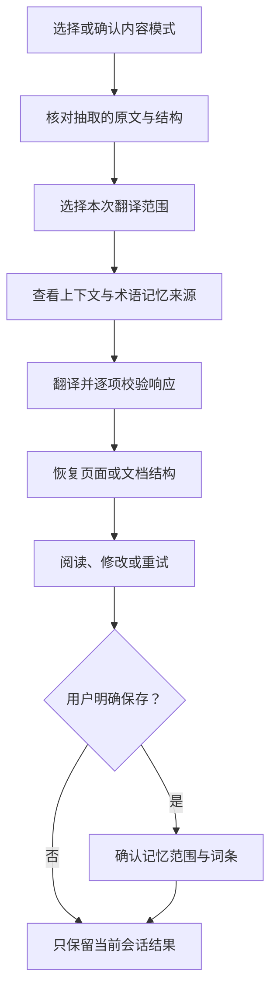

# 按内容类型的翻译流程产品规格 v1

日期：2026-11-16

更新：2026-11-20，加入 eLife 摘要上下文网页 UI 132 格矩阵；网页 UI 与公开 API 结果分开，人工评审、术语批准与质量评分仍暂缓。

更新：2026-11-19，加入 TypeScript Handbook Basics 与 Astro Routing 技术文档通用/专用提示对照及匿名评审候选池；模型译文尚未人工评分。

更新：2026-11-19，加入 Postext 漫画 84 格官方网页 UI 上下文矩阵，以及 Soldering Is Easy source-only 术语跨度候选；网页 UI 与 API 结果分开，人工评审、术语批准与质量评分仍暂缓。

更新：2026-11-20，加入 Postext 英文 MDX 全页网页 UI 矩阵（12/12 格模型 ID 匹配）。标题/链接/MDX 结构骨架与非注释代码负载 12/12 格匹配；行内代码项多重集在通用提示下 6/6 格匹配、显式结构契约下 4/6 格匹配，目标字符串在提示条件间各模型均变化 2/2，同条件重复变化为 2B 1/2、9B 2/2、35B-A3B 2/2；这些是敏感性观察，质量评审仍暂缓。

更新：2026-11-20，加入 Postext 漫画文字“仅目标区域/同页其余英文作上下文”网页 UI 矩阵及机器上下文敏感性审计。42 格均有非空输出且浏览器/本地哈希匹配；28 格响应模型 ID 符合请求，14 个请求 2B 的格均返回 9B ID，另有 1 次重复提交单独隔离。21/21 对照对输出字符串变化；16/21 个同页条件输出触发疑似范围扩张标记。另为 7 个区域准备 14 组去重后的盲态范围对照，未分配评审。这些是敏感性/格式候选，译文、区域标签与上下文效果仍待审，不作质量结论。

更新：2026-11-20，加入 Postext 五条 alt-description 文本翻译 UI sidecar：3 模型 × 5 源描述，共 15/15 非空输出且响应模型 ID 匹配 15/15。仅评测给定描述文本的翻译，不发送图片或像素，不测视觉理解；模型译文与页面中文候选均未人工评分。

更新：2026-11-21，为 FluentRead 原创漫画夹具增加单气泡文本对照：17 个冻结英文区域 × 3 个 Bilibili 模型，51/51 HTTP 200、51/51 路由匹配，图像未上传。严格 JSON 契约通过 41/51；2B 有 10 格尾随一个未匹配右花括号，9B/35B-A3B 各 17/17 通过。页级数组与单气泡条件的可比输出有字符串变化（2B 严格配对 4/6；2B 宽松前缀诊断 5/8；9B 9/17；35B-A3B 11/17）。这些仅为范围敏感性和格式信号，不作质量或上下文收益结论；盲评仍暂缓，质量分和排名为 0。[矩阵摘要与隔离审计](../../../workspace-data/evidence/translation-benchmark-manga-color-quality-bilibili-api-20261115/segment-only-matrix-v1/summary-v2.md) · [51 格台账](../../../workspace-data/evidence/translation-benchmark-manga-color-quality-bilibili-api-20261115/segment-only-matrix-v1/results-v2.json)

状态：产品设计候选；尚未实现，也没有用户收益验证。

评测工作台、盲审、仲裁、数据门槛和阅读端分工见[翻译质量评测产品设计](./translation-evaluation-product-design.md)。本文聚焦网页、论文、技术文档、漫画与扫描教育文档的阅读端工作流。

## 目标

同一个翻译入口按内容形态提供合适的原文核对、范围选择、上下文、术语和结果检查。系统可以提示内容类型，用户确认后才应用对应流程。每次请求都能查看实际发送的文本和上下文来源；质量、结构、识别和排版状态分别呈现。

译文“已完成”只说明选定内容已处理并恢复到阅读界面。准确、自然、术语合适和版式适配需要各自的评估证据。

## 共同流程

### 入口与模式

- 网页阅读保持一般网页作为默认模式。
- 论文、技术文档和漫画可以出现模式建议卡，说明识别依据并允许改选。
- 模式建议只改变本次可选流程。它不自动增加发送范围、启用图像输入或扩大术语作用域。
- 用户在任务开始前可改目标语言、模型、翻译范围和本次上下文策略。

### 原文核对

- 解析结束后显示标题、章节、段落、代码、表格、公式或漫画区域等已识别结构。
- 识别有不确定项时，直接定位原文、原页或原图；保存用户确认后的修订，再继续翻译。
- 抽取、OCR、语义翻译和排版分别记录状态，错误归到发生阶段。

### 本次依据与记忆

工具栏显示一行可展开状态，例如“章节上下文 · 学术词库命中 2 项 · 仅本文件”。展开后列出实际使用的源文上下文、术语条目、作用范围和词条类型。

- 词条类型至少区分翻译、固定保留和本次不使用。
- 默认只读取用户明确选定的作用范围：当前文档、项目、网站或全局。
- 未经双语确认的候选词条不进入产品记忆。
- 当前译文修改只影响当前文档。持久校订或术语记忆需用户显式保存、确认作用范围，并提供撤销和删除入口。

### 运行与恢复

- 长文档显示当前进度、已完成与待处理范围；取消后保存已完成段落，继续时只处理剩余项。
- 响应格式错误、区域关联缺失或结构恢复失败时，保留原文和原始响应，提供当前段落重试。
- 质量状态与运行状态分开显示。服务返回成功不表示语义质量通过。
- 高频且不要求用户操作的状态留在进度区域；错误、恢复动作和用户可选择项保持可见。

## 专用流程

| 模式 | 翻译前 | 本次上下文 | 必须保护 | 复核与产品指标 |
| --- | --- | --- | --- | --- |
| 科技论文 | 展示标题、摘要、目录和抽取风险；用户选择摘要、章节或全文 | 当前章节定义、邻段、用户确认术语；各项可单独关闭 | 公式、数值/单位、引用、表格标识、缩写 | 单列抽取错误、因果/否定、作者立场与缓和/增强语、方法与结果范围；允许评审对照立场实例和目标语 span；报告公式/引用/数值保真、段落覆盖、术语正确采用及立场保留/加强/弱化/遗漏/新增/范围变化 |
| 技术文档 | 识别产品、版本、标题和步骤；用户可选择版本、项目词库及关联页面上下文 | 当前步骤、同节说明和用户明确选择的关联页源文；显示页面/版本/块数，可单独关闭 | 代码块、行内代码、API、CLI、配置键、路径、版本号 | 核对前置条件、步骤顺序、警告和版本语义；报告标识符保留、结构完整、术语误用与跨页一致性 |
| 漫画 | OCR 后提供文字、区域、阅读顺序和识别置信度的本地预览；用户可改字和顺序 | 无上下文、同页已核对文字、用户选择的同作品前页上下文；图像输入是独立开关 | 区域 ID、说话者元数据、原图、气泡位置与透明度 | 分别复核 OCR、区域类型/顺序/说话者、语义/口吻、字数适配和溢出；图像未进入请求时不报告视觉理解 |
| 扫描教育文档 | 预览逐页 OCR、章节树、目录及脚注/图片说明关联；用户修订识别结果后再选择章节 | 当前页单独翻译，或显式加入目录、邻页及已确认章节定义；逐块显示页码与来源 | 标题层级、编号、跨页段落、引文/脚注、人名与组织名、图片说明 | 先评 OCR 覆盖、字词错误和阅读顺序，再评章节结构恢复、脚注/图注关联、含义和术语一致性；书目/出版信息/URL/鸣谢默认作为保留候选，需产品策略决定后才翻译 |

Kubernetes Service 的同提交双语页说明了技术文档的两层处理：HTML 注释可以帮助建立源块到目标区域的结构关系，译文是否准确仍需单独审定。候选目标区可能混有代码围栏、表格或 shortcode；在配对确认前，界面应保留原始块边界和结构标记，不自动拆成句级 gold，也不把重复源短语当作多个独立样本。[Kubernetes 结构配对候选和审计](../../../workspace-data/evidence/translation-benchmark-kubernetes-service-full-page-candidate-20261117/v1/comment-alignment-v1/summary-v1.md)

漫画评估还应把对白、拟声字和图像替代描述分成不同任务。Postext 固定来源包现有 5 条英中 alt-description 对、7 组英中旁白/对白/拟声词候选，以及 1 组整页 MDX 本地化候选，全部属于同一篇教程作品；没有图片输入，不能据此报告 OCR、面板理解、气泡排版或视觉理解能力，也不应计作自然漫画分布。对白需保留角色/区域元数据并区分单段与同页文本上下文；alt-description 用独立的简洁、信息完整和无依据增补维度；网页 MDX 检查标题、代码、组件与内部锚点。固定来源 v1 的对白 UI sidecar 已完成 84/84 格，84 格模型 ID 匹配；82 格可抽取单目标文本，2 格 2B 同页条件回显了整页七区内容。另有完整 MDX 正文 UI sidecar 12/12 格模型 ID 匹配；标题、链接目标、MDX 标记和排除行注释后的代码负载 12/12 格匹配；行内代码项多重集在通用提示下 6/6、显式结构契约下 4/6 格匹配。另一个独立的 alt-description 文本翻译 UI sidecar 为 15/15 非空、模型 ID 匹配 15/15；模型只收到文本和固定指令，没有图片、像素、asset ID 或页面元数据，不能据此报告视觉理解或 OCR。三类 UI sidecar 仍共属一个教程来源组，不计为三个独立作品；作者中文候选未审、译文未评分，质量分和排名为 0。对白 84 格与 MDX 12 格公开 API 计划未提交，alt-description 本轮也只做 UI，不混入 API 统计。[固定来源与 API 96 格计划](../../../workspace-data/evidence/translation-benchmark-postext-one-page-six-languages-candidate-20261117/v1/summary-v1.md) · [对白 UI 矩阵](../../../workspace-data/evidence/translation-benchmark-postext-one-page-six-languages-candidate-20261117/v1/web-ui-matrix-v1/summary-v1.md) · [MDX 全页 UI 矩阵](../../../workspace-data/evidence/translation-benchmark-postext-one-page-six-languages-candidate-20261117/v1/mdx-web-ui-matrix-v1/summary-v1.md) · [alt-description UI 矩阵](../../../workspace-data/evidence/translation-benchmark-candidate-manifest-v88-echarts-translation-20261119/postext-alt-description-web-ui-matrix-v1/summary-v1.md)

2026-11-20 新增同一 Postext 来源组的 42 格漫画文本上下文 UI sidecar：7 个目标区 × 3 个模型 × “仅目标区域/同页其余英文作上下文”两条件。42/42 有非空输出、哈希匹配 42/42；请求 2B 的 14 格实际返回 9B ID，只有 28 格响应模型 ID 匹配请求；另 1 次计划外重复提交已隔离，不纳入矩阵。机器比较显示 21/21 个同目标/同模型跨条件输出字符串变化；同页条件下 16/21 格触发疑似范围扩张信号（其中 15 格在 `<TARGET>` 标记外含中文，且出现多个区域标题；另 1 格按无标记长度启发式标记）。这是输出敏感性与范围候选，不是语义评分。另准备 14 组盲态输出范围 A/B 候选（7 个区域 × 两种已核实的实际响应模型）；刺激未透露模型、条件或机器风险标记，评审未分配。标注时须将区域标签视为未审源文标记；单独回显目标标记不自动判为内容越界。所有原文只含文本，不含页图/像素，也排除了作者简中、参考译文和术语候选。角色/区域标签未审定，不能据此主张上下文提升漫画翻译质量。UI 侧车独立于 API 与主清单运行计数；API 计划仍为 96 格未提交，双语评分、排名和术语记忆准入均为 0。[矩阵摘要](../../../workspace-data/evidence/translation-benchmark-candidate-manifest-v88-echarts-translation-20261119/postext-manga-context-web-ui-matrix-v1/summary-v1.md) · [机器敏感性/范围审计](../../../workspace-data/evidence/translation-benchmark-candidate-manifest-v88-echarts-translation-20261119/postext-manga-context-web-ui-matrix-v1/context-sensitivity-audit-v1.json) · [未分配的盲态范围池](../../../workspace-data/evidence/translation-benchmark-candidate-manifest-v88-echarts-translation-20261119/postext-manga-context-web-ui-matrix-v1/scope-review-pool-v1/summary-v1.md)

NASA《Adventures in Aeronautics》候选页把这条流程扩到“对白 + 科普旁白 + 环境标牌 + 受力/飞机示意图 + 拟声”：12 页共 125 条英中区域文本候选。评审界面应先分开确认源文识别、区域类型/阅读顺序和译文语义；页面上下文可以作为明确可选项，词库观察不能在审定前自动回填。当前 source-only 文件和隔离答案键已备好，扫描图、译文候选与答案键均未发送，外部模型处理权限仍待核；因此此候选不代表视觉翻译能力或模型质量。[NASA 漫画扩展 v2](../../../workspace-data/evidence/translation-benchmark-nasa-aeronautics-manga-candidate-20261117/transcript-expansion-v2/summary-v2.md) · [页面结构候选](../../../workspace-data/evidence/translation-benchmark-nasa-aeronautics-manga-candidate-20261117/transcript-expansion-v2/page-structure-candidates-v2.json)

Comixplain 数学漫画补充出图像内公式和网格关系。公式识别应保留 `M(s)`、`¬`、`∧`、`∨` 等符号及变量大小写；网格识别另记行列定义、T 标记和计分映射。界面先把原图、公式转录候选和可编辑旁白并列，再让用户确认；评测分别记录公式保真、结构关系恢复和问答证据，不把 OCR 当成翻译得分。第 5–6 页旧 image-only 输出有 5/6 次 HTTP 504；成功响应的 13 条读回字段中只观察到 3/8 个公式候选的精确字串，不能作为 OCR 准确率或质量分。[公式、图表与原始读回候选](../../../workspace-data/evidence/translation-benchmark-comixplain-math-thinking-bilibili-api-20261115/visual-math-expansion-v1/summary-v1.md) · [隔离输入与 rubric](../../../workspace-data/evidence/translation-benchmark-comixplain-math-thinking-bilibili-api-20261115/visual-math-expansion-v1/evaluation-rubric-v1.json)

对已存模型响应的格式恢复另设候选层：安全解析器只接受完整 JSON 对象，坏对象之后立即停止；即使前缀可读，原始 strict JSON/schema 状态仍保留。带精确区域 ID 的 115 条输出候选可进入待核队列；另 15 条无法回链到已有区域的输出留在 unmapped 队列。阅读端应同时显示“输出可恢复”和“区域/语义未核验”状态，不能把恢复成功算作格式合规或翻译正确；也不能通过文本相似度将未映射 OCR 与气泡自动关联。[旧响应恢复摘要](../../../workspace-data/evidence/translation-benchmark-comixplain-math-thinking-bilibili-api-20261115/visual-math-expansion-v2/response-recovery-v1/summary-v1.md) · [恢复审计与源区域映射](../../../workspace-data/evidence/translation-benchmark-comixplain-math-thinking-bilibili-api-20261115/visual-math-expansion-v2/response-recovery-v1/audit-v1.json)

后续盲评准备把候选拆成两条互斥队列：27 个源区域上的三模型 text-only 对比，以及 27 个其他区域上每模型一个 text-only/image-plus-transcript 配对。评审端首轮隐藏模型、条件和原格式状态，先看源句与匿名译文，再按阶段揭示同页图像与区域框。每项计划双人评审，但当前只准备了数据包，0 个评审者分配、0 个评审开始。[盲态队列和状态审计](../../../workspace-data/evidence/translation-benchmark-comixplain-math-thinking-bilibili-api-20261115/visual-math-expansion-v2/blind-review-preparation-v1/summary-v1.md) · [评审协议](../../../workspace-data/evidence/translation-benchmark-comixplain-math-thinking-bilibili-api-20261115/visual-math-expansion-v2/blind-review-preparation-v1/review-protocol-and-assignment-plan-v1.json)

## 评估对接

每条评估记录保存文档/作品 ID、模式、范围、分段版本、上下文策略、术语库版本、模型与提示版本、输出结构状态和人工评审分配。模型输入只包含本次请求所需的源文和经用户允许的上下文，不包含参考译文、评审意见或未来段落。

数据按“来源组—文档/作品—段落/区域”分层。分段与页面是定位单位，模型比较和置信区间以独立文档或作品聚合。论文、技术文档和漫画分别报告主质量维度；共同的运行与结构指标可并列展示，保留各自分母。

### 模式进入默认值的门槛

1. 每个新模式至少有独立来源组和可追溯的结构/许可记录。
2. 候选参考经过两位合格双语评审；分歧进入仲裁并保留原始标签。
3. 对同一模型、同一分段和同一翻译范围做盲态配对评审。
4. 语义质量、关键错误、结构覆盖、识别准确、延迟和费用分别报告。
5. 评审数据显示质量收益且关键错误未变差后，再考虑默认策略；阈值由试标后的实际方差和产品成本共同确定。

## 当前状态

v52-v54 的 Funmilayo 漫画候选覆盖连续 30 页、60 个目标文本区域；另有第 10 页和第 30 页仅用于相邻页上下文。2026-11-18，印刷页 11–40 的三模型 × 当前页/前页上下文 × 双重复矩阵已完成 360/360 次 Bilibili 调用，均为 HTTP 200 非空。288 次满足严格 JSON/ID/text 合同；另外 62 条文本只在唯一 ID 可验证时作为延后评审候选，25 次运行无法安全恢复，90 个预期翻译槽位保持空缺。合并盲态池含 630 条单译文刺激和 296 组完整 A/B 对照；模型、条件映射分离保存，评分与排名均为 0。v71 清单结构校验 0 issues，Funmilayo 来源组仍 unassigned。[30 页盲态池与限制](../../../workspace-data/evidence/translation-benchmark-funmilayo-comic-review-pool-v2-20261118/summary-v2.md) · [池完整性复核](../../../workspace-data/evidence/translation-benchmark-funmilayo-comic-review-pool-v2-20261118/pool-integrity-recheck-v2.json) · [v71 清单](../../../workspace-data/evidence/translation-benchmark-candidate-manifest-v71-funmilayo-comic-20261118/real-en-zh-hans-candidate-manifest-v71.jsonl) / [验证报告](../../../workspace-data/evidence/translation-benchmark-candidate-manifest-v71-funmilayo-comic-20261118/manifest-validation-v71.json)

v55 同书教育正文记录覆盖印刷页 41–50：目录两页仅作上下文，正文八页为翻译目标。第 44 页缺文本层并使用低置信度 Tesseract 回退；目录上下文消融计划 96 格仍未发送，须先校对源文和阅读顺序。v56 再登记印刷页 51 的书目和两个未编号尾页扫描帧，三个末尾单元均待 OCR/分页校对；由于书目和鸣谢可能需要保留原文，暂不安排模型请求。漫画、教育正文与尾页共用一个未分区来源组；24 个术语候选未审、没有目标语译法，不进入模型请求。[v56 尾页来源包](../../../workspace-data/evidence/translation-benchmark-funmilayo-end-matter-expansion-v1-20261116/summary.md) · [v56 清单、覆盖与校验](../../../workspace-data/evidence/translation-benchmark-main-manifest-v56-funmilayo-end-matter-pages-51-53-20261116/summary-v56.md) · [v55 正文 OCR 来源包](../../../workspace-data/evidence/translation-benchmark-funmilayo-educational-document-expansion-v1-20261116/summary.md) · [v54 漫画数据](../../../workspace-data/evidence/translation-benchmark-main-manifest-v54-funmilayo-pages-31-40-20261116/summary-v54.md)

现有计划已分别描述论文、技术文档和漫画流程，并记录相应的数据与消融候选。TypeScript Handbook 候选、术语候选、PLOS One 作者立场候选和技术 intake v7 仍未经过双语评审；立场标签目前是待试标的操作规范，不是已校准量表。[基准计划](./translation-benchmark-plan.md) · [人工标注指南](./translation-benchmark-annotation.md) · [文档上下文评估](./translation-document-context-evaluation.md) · [术语记忆评估](./translation-memory-evaluation.md)

2026-11-16 按当前主清单 v61 重做了漫画数据画像：69 页、8 个来源组、386 个文字区域；全部页面图像和来源记录哈希均通过核对。v51 的 39 页画像和 9 页试审队列保留为历史快照；v2 队列现覆盖全部 69 页。171 个参考区域全部来自 Pepper&Carrot 且未审定，30 页 UNESCO Funmilayo 同书页仍整体未分区；所有区域标注和双语评审仍为 0 完成。后续漫画评估先做盲态源图转录/区域审定，再单独评审翻译、口吻、顺序与排版，不把 954 条混合条件运行记录解释为模型质量。[v61 漫画数据就绪摘要](../../../workspace-data/evidence/translation-benchmark-manga-readiness-20261116/summary-v2.md) · [全页来源审查队列](../../../workspace-data/evidence/translation-benchmark-manga-readiness-20261116/annotation-queue-v2.jsonl) · [资产与哈希审计](../../../workspace-data/evidence/translation-benchmark-manga-readiness-20261116/validation-report-v2.json)

另发现 Postext Cookbook 的一页多语种教程漫画线索，官方页面含 `zh-Hans` 脚本并标注文字 CC BY 4.0；页面图像为生成图且单独权利未确认。它不是自然发布漫画，也没有本地内容哈希，当前只作为 challenge intake 线索，不并入主清单或漫画覆盖数。[intake 摘要](../../../workspace-data/evidence/translation-benchmark-postext-one-page-six-languages-intake-20261116/summary.md)

2026-11-17 新增 OpenTelemetry Observability Primer 技术文档来源组，固定到 website commit 并保留英语正文、中文漂移候选、链接目标、图像 alt 与独立术语位置。阅读端技术流程可在翻译前显示版本和结构块，翻译中保护 Markdown 表格、日志代码和锚文本；术语侧强调 observability/telemetry、trace/span、SLI/SLO 之间的定义关系。当前中文页明确标注漂移，不能当参考或词库；11 个词面观察只给评审者定位用。页面级通用/结构感知提示计划 6 格，Bilibili DNS `ENOTFOUND` 导致 0 次 HTTP；另有 10 个全文问答候选作为独立文档理解任务。2026-11-21 完成该问答的三模型 × 10 题 API 矩阵：30/30 非空且路由匹配，JSON 解析 25/30、完整 schema 20/30；结构通过只证明可解析与字段满足约定，不证明事实正确或证据充分。产品应分别呈现运行、结构、来源引用和语义评审状态，并保留原始响应；当前答案键未审、质量评分为 0。[全页源文与目标漂移状态](../../../workspace-data/evidence/translation-benchmark-opentelemetry-observability-primer-candidate-20261117/v1/summary-v1.md) · [术语候选位置](../../../workspace-data/evidence/translation-benchmark-opentelemetry-observability-primer-candidate-20261117/v1/term-observation-candidates-v1.jsonl) · [整页证据问答任务](../../../workspace-data/evidence/translation-document-understanding-opentelemetry-observability-primer-20261117/v1/summary-v1.md) · [执行与结构审计](../../../workspace-data/evidence/translation-document-understanding-opentelemetry-observability-primer-20261117/v1/runs-v2/opentelemetry-full-page-qa-20261121/summary-execution-v1.md)

2026-11-17 新增 PLOS One 生存率置信区间统计论文摘要：13 个句段、12 组只含源文位置的统计术语候选；官方论文页标注 CC BY 4.0 并保留作者、DOI 与许可归属。2026-11-18 已执行单句输入与完整摘要上下文对照：三种 Bilibili 模型、两种条件、双重复共 156 格，156/156 HTTP 200 且有译文；请求哈希与 source-only 隔离通过 156/156。盲态池准备 156 条单译文和 78 组同句/同模型/同重复配对，尚未分配双语评审、评分、仲裁或排名。12 个术语候选仍只有源语位置，没有目标译法，不进入产品记忆。[当前执行摘要与盲态池](../../../workspace-data/evidence/translation-benchmark-plos-survival-ci-abstract-20261117/v1/review-pool-v1/summary-v1.md) · [计划前状态快照](../../../workspace-data/evidence/translation-benchmark-plos-survival-ci-abstract-20261117/v1/state-snapshot-v1-before-bilibili-20261118/snapshot-manifest-v1.json) · [执行验证](../../../workspace-data/evidence/translation-benchmark-plos-survival-ci-abstract-20261117/v1/validation-report-v1.json)

2026-11-17 为 Pepper&Carrot Episode 26 建立双盲评审准备包，复用既有 6 页、56 个英中 SVG 文本 ID 对齐和 36 个现成 Bilibili 输出，不发新请求。逐行配对 336 个候选译文，单独保存官方中文参考和模型/条件揭盲键；另建 36 个整页包，供审核角色语气、重复词和跨格笑点的一致性。图像仅在人类审核的视觉阶段揭示，用来检查角色指代和气泡适配；当前仍无评审分配。作者关于 AI 衍生与译文/输出留存的限制继续保留，结果仅作内部候选，不能公开展示或作为质量排名。[双盲队列和审计摘要](../../../workspace-data/evidence/translation-benchmark-peppercarrot-ep26-bilibili-api-20261115/blind-review-summary-v1.md)

2026-11-18 新增 Episode 26/39 跨篇章候选复核包：从两集共同出现的 `Pepper`、`Sound`、`Writing` 标签汇集 101 条候选行，译者元数据均指向 Ran Zhuang。它用于后续判断角色声线、拟声词和画内字样是否跨篇章一致；同源组只包含两集，行数不能当独立漫画作品数。只有一个 `- FIN -` 完全重复源表面，且一集标为 Narrator、另一集标为 Writing；不自动把它注册为同义/固定记忆。来源文本、标签和简中候选均未审定，也未调用模型。[队列摘要与隔离状态](../../../workspace-data/evidence/translation-benchmark-peppercarrot-cross-episode-style-review-20261118/v1/summary-v1.md) · [行级候选](../../../workspace-data/evidence/translation-benchmark-peppercarrot-cross-episode-style-review-20261118/v1/cross-episode-review-rows-v1.jsonl) · [重复源表面审计](../../../workspace-data/evidence/translation-benchmark-peppercarrot-cross-episode-style-review-20261118/v1/normalized-source-overlap-candidates-v1.jsonl)

2026-11-17 在论文轨道增加 PLOS One 文档理解配方：一个统计学 DOI 来源组、14 个可引用证据块、12 个可答问题和 2 个拒答控制，覆盖方法设置、数值结果、示例范围、推断限制及证据边界。2026-11-18 对 3 个 Bilibili 模型完成 42 格首次尝试：40 个 HTTP 200 非空输出、2 个 HTTP 504；成功响应中 25 个满足 JSON/evidence-ID 合同，15 个格式失败。两格失败后均不重试。40 个匿名输出和 2 个不可用格已分开保存；答案键仍未审，正确率、证据质量、拒答准确率、评分和排名均为 0。该实验是选定摘录问答探索，不是全文理解或翻译质量结果。[执行摘要与限制](../../../workspace-data/evidence/translation-document-understanding-plos-survival-ci-article-20261117/v1/summary-v2.md) · [部分盲态输出池](../../../workspace-data/evidence/translation-document-understanding-plos-survival-ci-article-20261117/v1/qa-review-pool-v1/summary-v1.md) · [执行完整性审计](../../../workspace-data/evidence/translation-document-understanding-plos-survival-ci-article-20261117/v1/execution-integrity-audit-v2.json)

2026-11-17 扩展同篇 PLOS One 论文的证据问答：在既有 14 块上新增 11 个跨章节文字块与 12 道任务，总数 25 块、26 题；新增题含变换识别、截断区间、单篇模拟设置、数值结果边界与公式/表格拒答。新增 36 个 Bilibili 计划格完成请求哈希和输入隔离检查；本轮未重复 DNS 预检或发送请求。该包只覆盖选定正文文字，不含公式图像、图表和表格，不称完整论文理解；仍沿用同一 DOI 来源组，未审答案键、模型输出、人工分数和排名均为 0。[v2 摘要、证据块与审计](../../../workspace-data/evidence/translation-document-understanding-plos-survival-ci-article-20261117/v2-section-expanded/summary-v2.md)

2026-11-17 为科技论文数据新增一个独立 eLife 生态学来源组，围绕欧洲与北美蜻蜓目物种的地理范围和物候变化构建 16 个证据块与 18 个问答（16 个可答候选、2 个拒答控制）。专用检查聚焦范围/物候效应方向、76 与 66 个物种的分母差异、GLM 与 MCMCglmm 数值、抽样偏差检验、丰度和栖息地限制，以及不能把观察关联升级为因果结论。Bilibili 官方 README 明确列出 Index-Translate-35B-A3B 免费 API；同一 endpoint 的 2026-11-14 历史运行对 2B、9B、35B 都取得 HTTP 200。因此本包保留三模型 × 18 题的 54 格计划，请求哈希/输入隔离 54/54；当前 DNS `ENOTFOUND`，0 次新 HTTP，未合并主清单；人工答案键审定、评分和排名均为 0。[模型接入范围](../../../workspace-data/evidence/translation-document-understanding-elife-odonate-range-phenology-20261117/bilibili-model-access-scope-v1.json)。该自定义问答 API 配方与 FluentRead 内置翻译 provider 请求分开记录，不作为页面翻译性能结果。[eLife QA 数据与审计](../../../workspace-data/evidence/translation-document-understanding-elife-odonate-range-phenology-20261117/v1/summary-v1.md)

同一摘要还建立 11 句翻译上下文消融：仅目标句与完整摘要上下文成对比较，覆盖 Index-Translate 2B、9B、35B-A3B，每个模型/条件重复两次。公开 API 的 132 格计划经 DNS `ENOTFOUND` 阻断，仍未提交；分开的官方网页 UI v1 仅运行 6 格标签回显 canary 后停止，v2 则完成 132/132 次提交，模型 ID 和浏览器/本地哈希均 132/132 匹配。v2 机器旗标记录 4 格显式上下文标题、14 格目标标题、114 格未检出标题；旗标不是范围或语义审定。中文参考、术语候选、来源元数据和图像未发送。API 计划与 UI 输出不合并；双语评审按用户安排暂缓，当前 0 质量分、0 排名。[网页 UI v2 摘要与审计](../../../workspace-data/evidence/translation-document-understanding-elife-odonate-range-phenology-20261117/web-ui-context-ablation-v2/summary-v2.md) · [逐格 UI 结果](../../../workspace-data/evidence/translation-document-understanding-elife-odonate-range-phenology-20261117/web-ui-context-ablation-v2/ui-run-results-v2.jsonl) · [v1 标签回显 canary](../../../workspace-data/evidence/translation-document-understanding-elife-odonate-range-phenology-20261117/web-ui-context-ablation-v1/summary-v1.md) · [独立 API 计划](../../../workspace-data/evidence/translation-document-understanding-elife-odonate-range-phenology-20261117/translation-ablation-v1/bilibili-call-plan-v1.jsonl)

同篇论文另从 16 个选定文本块提取 24 组术语/词面观察、175 个块内跨度；坐标明确锚定规范化证据块。它们覆盖生态概念、统计模型和数据集名，不带目标中文形式，也不输入 QA 请求。候选类别和重复表面须由领域双语评审审定后，才可进入记忆实验。[术语观察摘要](../../../workspace-data/evidence/translation-document-understanding-elife-odonate-range-phenology-20261117/v1/term-observation-summary-v1.md)

漫画术语记忆候选另建独立观察队列：Episode 26 当前覆盖 9 组源词/口号/音效、17 个出现位置和 102 个已有模型输出行。阅读端可将其用于同页术语和角色声线复核；术语记忆端先判断项目术语、人物名、复现台词、音效和情节笑点，再确认译法及作用域。官方中译仍未审定、没有词级对齐，不能显示记忆命中率或把候选注入后续请求。[候选摘要和输出观察](../../../workspace-data/evidence/translation-benchmark-peppercarrot-ep26-bilibili-api-20261115/term-observation-summary-v1.md)

## 扫描漫画候选对流程的约束

UNODC San Servolo sidecar 显示扫描漫画至少要分成四层：原始页图；带框与置信度的机器 OCR 候选；人工核对后的文字、区域类别、说话者和阅读顺序；最后才是可送入模型并配对参考译文的翻译样本。OCR 置信度不能替代文字正确率，低置信或版面混杂的整页 OCR 不应直接进入 Bilibili 翻译矩阵。评测应分别统计转录、区域关联/顺序、译文语义与人物口吻、字数适配/排版，避免把前一阶段错误记到模型质量上。当前 San Servolo 仍停在原始 OCR 候选阶段，未产生模型输出或人工评分；此建议是产品流程规格，不表示已实现。[San Servolo 数据包](../../../workspace-data/evidence/translation-benchmark-unodc-san-servolo-comic-20261117/v1/summary-v1.md)

v2 在同一 96 张扫描页上建立 Tesseract 5.5.0 / OEM 1 的 PSM × 语言配置 2×2 候选矩阵：PSM 11 混合 9,318 行、PSM 3 混合 1,760 行、PSM 11 按版面语言选择 8,112 行、PSM 3 按版面语言选择 1,760 行。新增的两个配置格处理 192 次页图、生成 9,872 行候选，图像与 TSV 哈希校验通过。行数/置信度只体现输出覆盖与分割，不代表识别准确率；OCR gold 尚不存在。工作台应在同一原图下并列切换四种配置，保留配置/原框/raw TSV，再要求人工逐页确认文字、区域、说话者和读序后开放翻译；页配对和双语气泡对齐仍待核。[2×2 矩阵与边界审计](../../../workspace-data/evidence/translation-benchmark-unodc-san-servolo-comic-20261117/v2-ocr-engine-evaluation/factorial-comparison-v1/summary-v1.md) · [结构与哈希校验](../../../workspace-data/evidence/translation-benchmark-unodc-san-servolo-comic-20261117/v2-ocr-engine-evaluation/factorial-comparison-v1/factorial-matrix-validation-v1.json) · [双盲 OCR 标注协议](../../../workspace-data/evidence/translation-benchmark-unodc-san-servolo-comic-20261117/v2-ocr-engine-evaluation/factorial-comparison-v1/review-protocol-v1.md)

配套的 San Servolo 离线检查器支持按卷/页浏览两种扫描页及机器 OCR 框、置信度和候选文字；它只准备后续核对，不提供编辑保存、质量评分或模型身份，也不会发出外部请求。[离线页面检查器](../../../workspace-data/evidence/translation-benchmark-unodc-san-servolo-comic-20261117/v1/review-inspector-v1.html)

## 技术教学漫画：Soldering Is Easy

《Soldering Is Easy》展示了不同于扫描漫画 OCR 的另一条路径：英文和简体中文两版 PDF 都有可提取的文字层，因此可直接保存页面文本，同时用原始页图核对版面。现有数据从 7 个故事页扩成 42 个同页同位置 panel-region 候选对，按 PDFKit 文本行坐标归入共同格框；每个候选同时保留两种行顺序以便检查。该结构配对不代表气泡归属、读序或语义正确，已出版中文仍不是 gold。[42 格候选与几何审计](../../../workspace-data/evidence/translation-benchmark-soldering-is-easy-comic-20261118/v1/panel-region-v1/summary-v1.md)

离线检查器可逐格浏览英语/简中图块与两种行序；它只用于数据抽查，不提供编辑或评分，也没有在浏览器中完成视觉验收。[面板检查器](../../../workspace-data/evidence/translation-benchmark-soldering-is-easy-comic-20261118/v1/panel-region-v1/panel-region-inspector-v1.html) · [构建记录](../../../workspace-data/evidence/translation-benchmark-soldering-is-easy-comic-20261118/v1/panel-region-v1/panel-region-inspector-build-v1.json)

产品流程建议按以下顺序展开：

1. 记录作品、版次、译者/编辑、来源链接和许可版本；版本不明确时保留“再分发待复核”状态。
2. 抽取每页文字并保存哈希；逐页查看双语图像，只记录能从图像直接确认的面板布局事实。气泡归属、阅读顺序、逐句对齐另走人工核验。
3. 以页面文本建立 text-only 翻译基线，固定同一源文切片与提示；后续评估按单作品聚合，报告作品数，避免将相邻页面当作独立作品数。
4. 盲评时分别标注焊接术语、步骤/面板顺序、安全警告及否定、数量/单位、可读性与漏译/增译。页面 8 的 USD 到 RMB 改写应先判断本地化规范，再决定是否保留数值告警。
5. 视觉阶段再检查气泡文本长度、断行、面板阅读路径和图文一致性；不得把纯文本矩阵结果称为 OCR 或视觉翻译能力。
6. 只有完成稳定对齐后，才新增“页面上下文”和“已审术语记忆”消融；将上下文导致的变化、术语命中和翻译质量分别记录。

本候选三模型共有 21 个唯一请求，但并发执行造成 27 个 POST 事件，其中页 7–8 多出的 6 次请求不构成重复试验；两条页 7 输出因与最终留存响应不一致而暂扣。对界面而言，执行完整性/来源状态应与盲态译文评审分开显示。当前没有人工评审或模型评分。[Soldering Is Easy 数据与运行摘要](../../../workspace-data/evidence/translation-benchmark-soldering-is-easy-comic-20261118/v1/summary-v2.md) · [离线只读检查器](../../../workspace-data/evidence/translation-benchmark-soldering-is-easy-comic-20261118/v1/review-inspector-v1.html) · [逐格完整性审计](../../../workspace-data/evidence/translation-benchmark-soldering-is-easy-comic-20261118/v1/bilibili-output-candidate-eligibility-v1.jsonl)

补充的 panel-region baseline 为 42 格 × 3 个 Bilibili 模型，共 126/126 HTTP 200 非空输出、0 重试。匿名候选池与 0600 模型 key 分开保存；用户安排的双语评审仍未启动，分数和排名为 0。v69 已把这组 page/panel 结构和输出挂入隔离清单，7 页仍按单部作品聚类；来源组未分区。第 8 页第 5 格画面正文含 4 个 URL 字面量，已纳入 3 个模型请求；它们是页面文字，不是来源链接或许可元数据。专用 rubric 分别处理安全警告、技术术语、数字/单位、网址字面量与币种本地化，并将 OCR、气泡读序和版面适配留给独立阶段。[盲态输出池与运行审计](../../../workspace-data/evidence/translation-benchmark-soldering-is-easy-comic-20261118/v1/panel-region-v1/bilibili-panel-output-summary-v1.md) · [请求内容范围更正](../../../workspace-data/evidence/translation-benchmark-soldering-is-easy-comic-20261118/v1/panel-region-v1/bilibili-panel-request-disclosure-v1.json) · [评估 rubric](../../../workspace-data/evidence/translation-benchmark-soldering-is-easy-comic-20261118/v1/panel-region-v1/evaluation-rubric-v1.json)

对这 126 条输出另做文本长度参考诊断：78 条比已出版简中 PDF 文本层候选长、6 条相同、42 条较短；输出/候选可见码点长度比的分模型中位数为 1.004、1.028、1.049。产品可以把较长区域排序靠前，供本地渲染预览；界面只能称作“长度差异”，不能自动标记溢出或适配通过。该中文候选未审，字符长度也不含实际字形宽度、字号和气泡排版。[长度诊断摘要](../../../workspace-data/evidence/translation-benchmark-soldering-is-easy-comic-20261118/v1/panel-region-v1/panel-text-expansion-audit-v1/summary-v1.md) · [布局侧字段](../../../workspace-data/evidence/translation-benchmark-soldering-is-easy-comic-20261118/v1/panel-region-v1/panel-text-expansion-audit-v1/panel-model-output-length-audit-v1.json)

已从 42 个英文 panel-region 候选另建 source-only 术语跨度索引：17 个未审源语族、257 条匹配跨度，15 个候选族跨多个面板复现，跨 family 有 25 对跨度重叠。词面频率只用于定位候选；`lead`、`tip` 等歧义和 PDFKit 行序均待审，目标译法为空，0 条获准为记忆或进入模型输入。[术语跨度候选摘要](../../../workspace-data/evidence/translation-benchmark-soldering-is-easy-comic-20261118/v1/term-memory-source-inventory-v1/summary-v1.md) · [候选词族与位置](../../../workspace-data/evidence/translation-benchmark-soldering-is-easy-comic-20261118/v1/term-memory-source-inventory-v1/term-family-candidates-v1.jsonl) · [跨跨度校验](../../../workspace-data/evidence/translation-benchmark-soldering-is-easy-comic-20261118/v1/term-memory-source-inventory-v1/validation-report-v1.json)

## GOV.UK 公共安全网页：整页采集与结构保真

整页公共网页可以先以官方 Content API 响应作为可复核快照，再把响应内的 HTML 正文解析为稳定文本单元。对于洪水指南，产品数据层保留 H1/H2、逐项列表、联系方式卡内换行和锚文本/href；不跟随链接抓取外部页面。记录必须分别显示本地原始响应哈希、源站的更新时间字段和不可变 revision 状态。响应哈希固定的是本次采集内容，不等于源站提供了固定版本。

翻译输入保留标题、列表顺序、联系方式格式和每个链接目标；一般提示与结构感知提示只按预先定义的结构要求不同。评测分别检查安全警告、条件/否定、责任主体、电话/服务时间、联系卡行、链接标签与 href 保留。页面是公共安全材料，任何严重安全语义错误都要单独拦截；候选输出未经双语与安全审定，不能进入实际应急指导。当前 v2 只有 6 个模型计划格，0 次 Bilibili 提交、0 个输出和 0 个评分。[GOV.UK v2 数据摘要与来源](../../../workspace-data/evidence/translation-benchmark-govuk-flood-page-capture-20261116/v1/summary-v2.md) · [结构化正文与链接](../../../workspace-data/evidence/translation-benchmark-govuk-flood-page-capture-20261116/v1/content-api-curl-v1/content-api-page-body-v2.json) · [专用安全 rubric](../../../workspace-data/evidence/translation-benchmark-govuk-flood-page-capture-20261116/v1/page-structure-evaluation-spec-v1.json)

## Wikivoyage 旅行指南整页双语候选

北京大兴旅行指南提供另一种整页输入：页面是 MediaWiki 内容，源页有目录、正文列表、地名链接和交通信息，中文关联页采用 zh-cn 转换。采集流程固定两边 revision 后再调用 `action=parse`，将 API 原始响应、渲染正文、链接表和解析器版本分别存档。翻译基线输入只用英文正文与其 href，不把关联中文页、页面 URL、许可元数据或图片交给模型。

阅读产品应先显示语言关联、revision 时间差和两边结构覆盖，允许数据维护者标出“同主题、章节未对齐”。盲审中保留地名、轨道线路、站点名、费用、营业时间、距离、日期和链接目标；新鲜度核对与翻译正确性分开记录。图片未进入输入时，只评页面文字、结构和链接，不报告图像理解或替代文本质量。当前模型矩阵已尝试 6 个唯一 arm，全部 HTTP 504，0 个译文；不把提供方网关错误计为模型质量。段落对齐、人评和评分仍为 0。[Wikivoyage 当前摘要](../../../workspace-data/evidence/translation-benchmark-wikivoyage-beijing-daxing-20261118/v1/summary-v2.md) · [revision/结构对照](../../../workspace-data/evidence/translation-benchmark-wikivoyage-beijing-daxing-20261118/v1/page-pair-structure-comparison-v1.json) · [专用评估规格](../../../workspace-data/evidence/translation-benchmark-wikivoyage-beijing-daxing-20261118/v1/evaluation-spec-v2.json) · [Bilibili 执行审计](../../../workspace-data/evidence/translation-benchmark-wikivoyage-beijing-daxing-20261118/v1/bilibili-execution-audit-v1.json)

离线只读检查器已生成并通过哈希校验，可浏览两边正文与 href，不载入模型输出，也没有编辑和评分控件。[检查器](../../../workspace-data/evidence/translation-benchmark-wikivoyage-beijing-daxing-20261118/v1/review-inspector-v1.html)

## Apache ECharts Handbook Data Transform 技术文档流程候选

新增的 ECharts Handbook 独立来源组适合检查模型对代码型 Markdown 文档的处理：页面按五个 H2 节拆分，每节保留代码围栏、行内标识符、链接和宏占位符。当前已准备“通用技术翻译”与“结构感知翻译”两种条件；结构感知模式需要显式保留可执行代码、API/配置名、字符串字面量与链接目标，只翻译说明文本。

这不是已验证的产品收益。Bilibili 矩阵仅第一格返回 HTTP 200，第二格 HTTP 504 后停止；28 格未发送。产品上应把条件标签、请求状态、结构保真诊断和双语评分拆开呈现；目标中文页与术语观察仍待审定。[来源、部分执行和完整性摘要](../../../workspace-data/evidence/translation-benchmark-apache-echarts-handbook-data-transform-20261118/v1/summary-v2.md) · [结构配对与术语观察](../../../workspace-data/evidence/translation-benchmark-apache-echarts-handbook-data-transform-20261118/v1/section-pair-candidates-v1.jsonl) / [术语](../../../workspace-data/evidence/translation-benchmark-apache-echarts-handbook-data-transform-20261118/v1/term-observation-candidates-v1.jsonl) · [评估 rubric](../../../workspace-data/evidence/translation-benchmark-apache-echarts-handbook-data-transform-20261118/v1/evaluation-rubric-v1.json)

同一手册的 Dataset 英中网页文本快照作为关联页 intake 候选：英文 13 个 H2、简中 12 个，暂不自动对齐，仓库修订号与快照关系未核实。可先在本地准备术语观察和证据问答；模型发送、跨页上下文配对与术语记忆需等待修订/许可绑定，并在用户安排的双语评审后再启用。[来源、版本状态与问答候选](../../../workspace-data/evidence/translation-benchmark-echarts-dataset-web-snapshot-20261118/v1/summary-v1.md) · [结构与许可 provenance](../../../workspace-data/evidence/translation-benchmark-echarts-dataset-web-snapshot-20261118/v1/capture-provenance-v1.json)

## Vite Features 跨仓库英中技术文档配对流程

Vite Features 候选由两个独立仓库提供：英文源码固定到 `vitejs/vite` 的 commit，中文候选固定到 `vitejs/docs-cn` 的翻译合并 commit。产品要保留 source/target 的各自修订、仓库路径、blob 与许可；只对确有文本的 7 个段落做片段级映射，不能把整页标成同步版本。上游机器人同步说明不等同于独立人工审校，参考状态保持“候选、未审”。

翻译请求只发送英文目标段；reference、许可、URL 和术语候选与输入隔离。专用 rubric 检查 bare-module、HMR、转译/类型检查的否定和职责边界、静态分析与 Vite pipeline 的区分、API 名与代码字面量、链接目标及 `50ms` 数值。参考型自动指标必须等参考候选和许可通过双语审查后才能启用；否则只保留盲态译文供单译文评估。21 格计划仅尝试首格：Bilibili DNS 解析失败（curl exit 6），0 HTTP、0 译文，20 格未提交且无重试；这是传输状态，不是质量判断。评审与评分仍为 0。[v66 来源与对齐](../../../workspace-data/evidence/translation-benchmark-candidate-manifest-v66-vite-20261118/extension-summary-v1.md) · [v67 执行记录](../../../workspace-data/evidence/translation-benchmark-candidate-manifest-v67-vite-bilibili-20261118/extension-summary-v1.md) · [版本与许可证 provenance](../../../workspace-data/evidence/translation-benchmark-vite-features-reference-candidate-20261116/source-provenance.json)

## FastAPI 错误处理整页文档流程候选

FastAPI Handling Errors 适合测试 Web API 教程中的错误语义：区分 HTTPException 与 RequestValidationError，保留状态码、异常处理器注册、请求/响应类型、否定、include 指令、Markdown 层级和链接。整页方案比较通用翻译与显式技术结构契约，产品应把页级完整度、代码/状态码保真、目标参考可用性和模型运行状态分开显示。

当前英文/中文 Markdown 同提交且结构相同，但 `docs_src` include 文件没有展开，不能显示成浏览器里的完整页面；简中页有 AI/人工协作且可能有误的提示，所以只显示待审参考。2026-11-21 按冻结计划执行整页 Bilibili API 矩阵：12/12 格有终态记录，2B 返回 4 条非空 HTTP 200，9B 与 35B-A3B 的 8 格为 HTTP 504，0 自动重试；这只说明整页 API 运行可用性按模型不同，不是质量结果。单独的 24 格分块网页 UI sidecar 仍与 API 运行分开。文档理解另列 6 题，不与翻译得分混合；9 个术语观察家族只有候选位置，没有获批译法或记忆收益结论。[FastAPI v3 来源/运行摘要](../../../workspace-data/evidence/translation-benchmark-fastapi-handling-errors-candidate-20261117/v1/summary-v3.md) · [v90 主清单与验证](../../../workspace-data/evidence/translation-benchmark-candidate-manifest-v90-response-state-20261121/summary-v1.md) · [FastAPI 来源包与 rubric](../../../workspace-data/evidence/translation-benchmark-fastapi-handling-errors-candidate-20261117/v1/summary-v1.md) · [翻译评估量表草案](../../../workspace-data/evidence/translation-benchmark-fastapi-handling-errors-candidate-20261117/v1/evaluation-rubric-v1.json)

## React 状态技术文档跨页理解与上下文候选

React 状态指南摘录包可用于技术文档跨页理解流程：在一个来源组里组合 state snapshot、update queue、state structure 与 object mutation 四篇页面的选段，并要求对每项解释返回可定位的证据 block ID。阅读端的关联页上下文应由用户显式选择，逐页展示版本和摘录范围；本试验的 44 个英语块不是全文，不能在界面中标为整篇文档已载入。

翻译流程与问答流程需分开：翻译视图保留代码标识符、API 名和 Markdown 结构；问答视图评估跨页证据检索、技术主张覆盖和拒答边界。当前 10 道题、30 格模型计划与术语观察均未审定/未运行，不能显示跨页检索收益或质量排名。翻译上下文对照使用已有的 144 格三条件计划（target-only / 同页 / 关联页），本 QA sidecar 不重复生成请求。[excerpt packet 摘要](../../../workspace-data/evidence/translation-document-understanding-react-state-guides-cross-document-20261118/v1/summary-v1.md) · [来源版本清单](../../../workspace-data/evidence/translation-document-understanding-react-state-guides-cross-document-20261118/v1/source-document-manifest-v1.jsonl) · [未校准评分量表](../../../workspace-data/evidence/translation-document-understanding-react-state-guides-cross-document-20261118/v1/document-understanding-rubric-v1.json) · [已有上下文计划](../../../workspace-data/evidence/translation-document-context-react-cross-page-candidate-20261116/context-plan-v1.json)

## 科技论文：PLOS Biology 摘要与公众作者简介

同一论文中并列了正式摘要和面向公众的 Author Summary。输入、提示和评分要分别标注文体：摘要核对假设范围、统计数字、机制和学术语域；作者简介核对可读性，同时保留相同数据的准确性和限定强度。两段重复出现的 SOD1、蛋白聚集与生存比例可形成未来的跨文体术语/一致性检查候选，但当前 baseline 没有提供文档上下文或记忆。

2026-11-18 再从官方全文页增建独立的 source-only QA 摘录包：从引言、结果、图注和方法选 8 个证据块，设计 10 个可答候选与 2 个拒答控制，覆盖 fALS/SOD1 分母、H46R/A4V 相对 hazard、Figure 1 样本量、Figure 2 参数筛选、加权与未加权结果，以及 ALSOD 来源排除。产品应把它标成“选段理解任务”，不混入摘要/Author Summary 翻译矩阵，也不将题数当作独立样本量；临床指导、当前个体预后与 treatment effect 由拒答边界保护。候选答案未审、文章历史许可版本未核，未生成模型调用。[证据块、问题与隔离答案键](../../../workspace-data/evidence/translation-benchmark-plos-biology-als-candidate-20261118/v1/document-understanding-v1/summary-v1.md)

PLOS 页面列有作者署名的中文摘要 PDF，但该文件未下载；英语原始 HTML 也未保存。首个 Bilibili 请求在本地 DNS 失败、0 次 HTTP，其余计划格未提交。该候选不支持中英句段对齐、医学建议、模型质量或术语记忆结论。[来源与执行摘要](../../../workspace-data/evidence/translation-benchmark-plos-biology-als-candidate-20261118/v1/summary-v1.md) · [双文体 rubric 草案](../../../workspace-data/evidence/translation-benchmark-plos-biology-als-candidate-20261118/v1/evaluation-rubric-v1.json)

## Wikivoyage Beijing/Daxing v64 清单接入状态

完整英文页以 source-only 记录纳入 v64 staging copy：33 个文本单元、13 个链接锚点，单独记录 href；中文关联页未作为参考。页面顶部的 outline 状态提示、机场与交通专名、数量/日期、链接保真和旅行信息新鲜度应分别进入评估视图。6 个历史模型请求均为网关 504，因此不能给翻译质量评分。由于与 Beijing 2022 dev 样本处于同一 topic cluster，此记录必须保持未分区；界面需把 topic-cluster 阻断与普通的来源哈希去重状态分开显示。[来源与页面状态](../../../workspace-data/evidence/translation-benchmark-wikivoyage-beijing-daxing-20261118/v1/summary-v2.md) · [v64 清单摘要](../../../workspace-data/evidence/translation-benchmark-candidate-manifest-v64-wikivoyage-20261118/extension-summary-v1.md) · [topic overlap 审计](../../../workspace-data/evidence/translation-benchmark-candidate-manifest-v64-wikivoyage-20261118/wikivoyage-v63-import-eligibility-audit-v1.json)

## 技术文档：Astro Routing 第二来源组配方

v86 对同一 Astro Routing 固定版本的 6 个段落完成 3 个 Bilibili 模型 × 通用/技术专用提示，共 36 格。每个请求只发当前段落，不含官方中译、来源 URL、许可元数据或邻段上下文。36/36 HTTP 200 非空，原始响应与规范化译文逐条核对通过，0 自动重试。盲态池保留 36 条单译文和 33 组成对任务；21 个精确相同译文配对不进入偏好题，但保留单条候选。这个来源组只有一篇 Routing 页面，不作为跨文档技术排名。[执行与候选池摘要](../../../workspace-data/evidence/translation-benchmark-astro-routing-reference-candidate-20261116/v2/summary-v2.md) · [盲态匿名审计](../../../workspace-data/evidence/translation-benchmark-astro-routing-reference-candidate-20261116/v2/blind-review-pool-v1/independent-audit-v1.json) · [v86 主清单](../../../workspace-data/evidence/translation-benchmark-candidate-manifest-v86-astro-routing-20261119/summary-v1.md)

## 技术文档：TypeScript Handbook Basics 双提示流程

固定版本的 TypeScript Handbook “The Basics” 选出 15 个带行内代码的段落。对照条件为通用忠实翻译与 TypeScript/JavaScript 开发文档专用流程；后者要求保护代码标识符、Markdown/链接、类型系统行为及编译期/运行时边界。3 个 Bilibili 模型各运行两种条件，共 90 格、90/90 HTTP 200 非空。请求只包含当前英文段，不带未审中文参考、未审词表和邻段上下文；不是整页翻译或 FluentRead 浏览器 provider 流量。

后续人工 rubric 分开检查语义/教学主张、术语一致性、代码字面量、否定与范围、Markdown 链接和简中开发者文档可读性。当前参考译文未审、8 条术语候选均未准入，评分和模型排名为 0。盲态池准备 90 条单译文与 134 组成对比较；一组完全相同输出已排除成对题。该来源仅为一篇手册文档，现有矩阵不测量 glossary/context 收益。[执行及盲态池摘要](../../../workspace-data/evidence/translation-benchmark-typescript-basics-reference-candidate-20261116/v2/summary-v2.md) · [v85 主清单和校验](../../../workspace-data/evidence/translation-benchmark-candidate-manifest-v85-typescript-20261119/summary-v1.md) · [TypeScript 术语候选](../../../workspace-data/evidence/translation-benchmark-typescript-basics-reference-candidate-20261116/term-candidates-v1.jsonl)

## 技术文档：Ant Design Form 重复属性的上下文一致性准备

用同一 MIT 固定提交内的 8 个英中候选段，选择 5 段检查 `dependencies` 与 `shouldUpdate` 在目标段和其他段落上下文中的稳定表达。冻结矩阵为 3 个 Bilibili 模型 × 目标单独/其他 7 个选段上下文 × 双重复，共 60 格；上下文排除目标段，且模型输入不含简中候选、13 条未审术语、页面 URL、许可元数据或图像。它是选段上下文，不是完整页面翻译。

冻结计划和物化请求哈希均为 60/60 通过。本机 shell 的 DNS 查询失败；官方翻译页可浏览，但 API POST 尚未从本机验证，0 HTTP、0 译文。该试验暂不能测术语表记忆；API 标识符复现或表面一致只作为之后的审阅线索，需与语义正确性分开。盲审、质量分与排名均为 0。[预注册计划](../../../workspace-data/evidence/translation-benchmark-ant-design-form-reference-candidate-20261116/context-ablation-v1/summary-v1.md) · [物化完整性](../../../workspace-data/evidence/translation-benchmark-ant-design-form-reference-candidate-20261116/context-ablation-v1/execution-v1/materialization-report-v1.json) · [Bilibili 页面与 API 路由对账](../../../workspace-data/evidence/translation-benchmark-ant-design-form-reference-candidate-20261116/context-ablation-v1/execution-v1/provider-route-status-v1.json)

