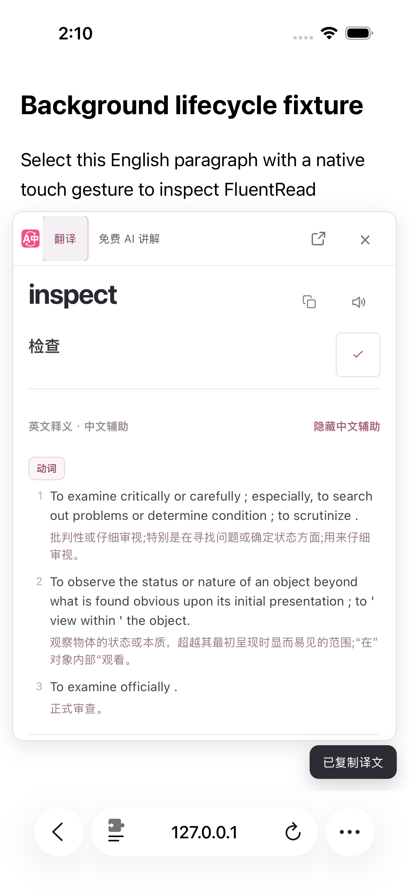
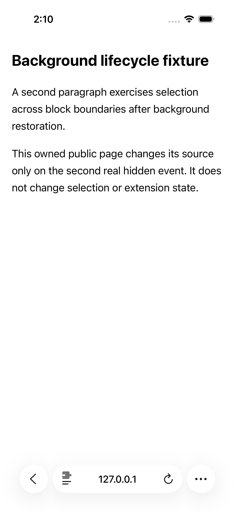
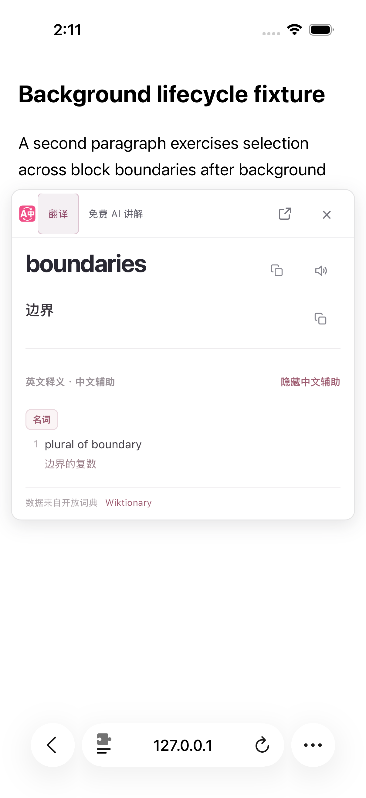
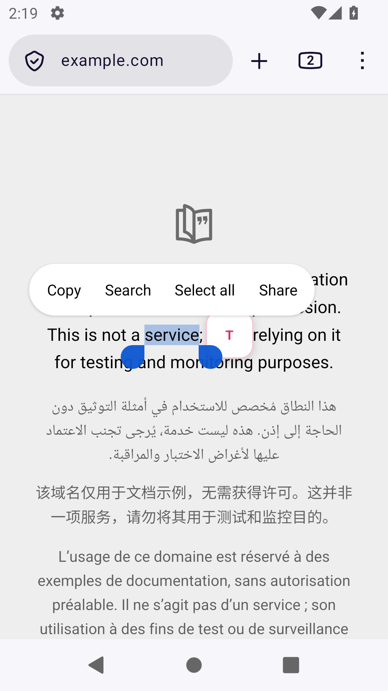
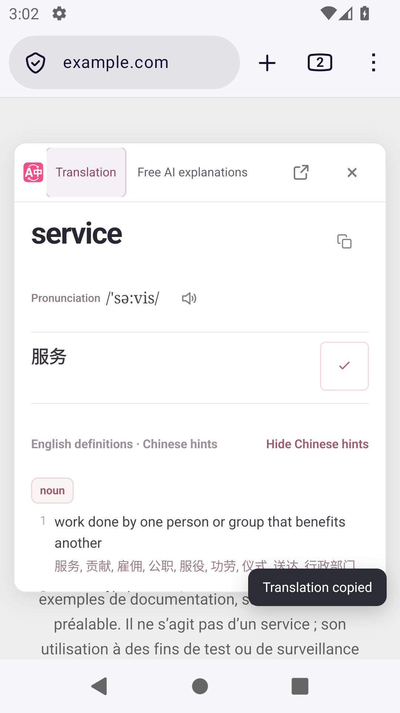
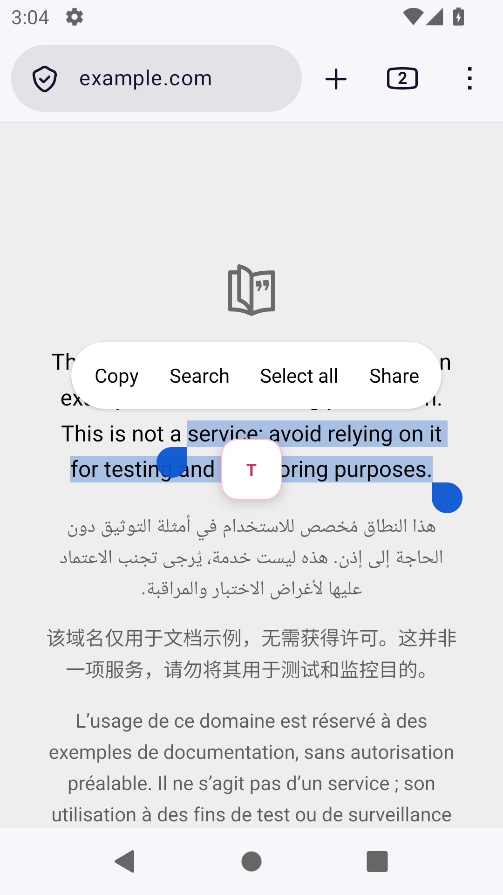
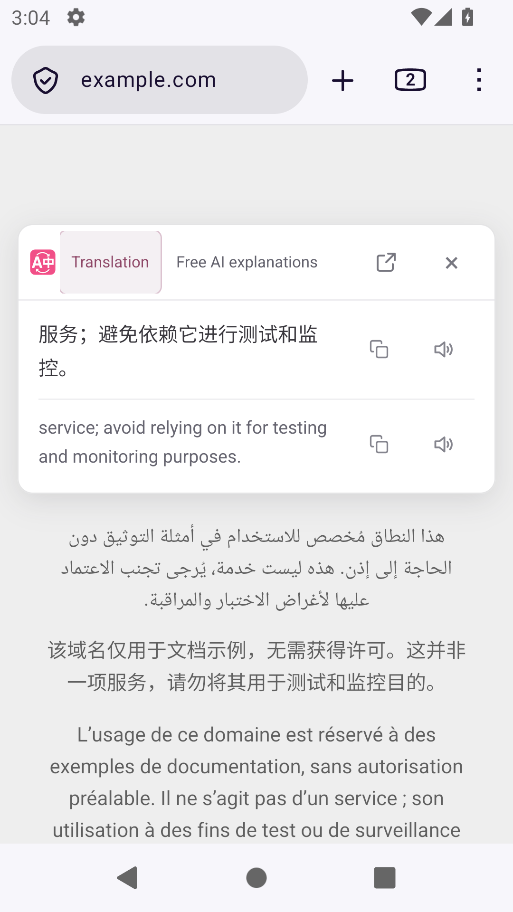
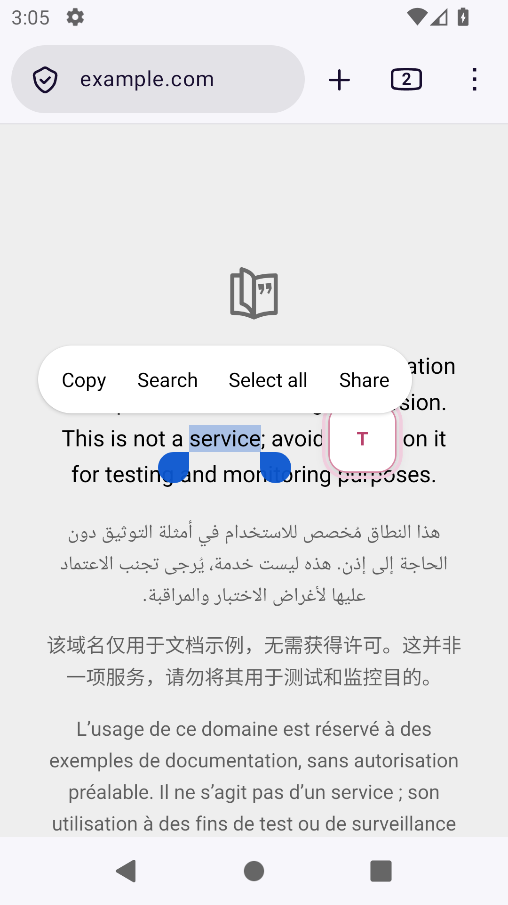
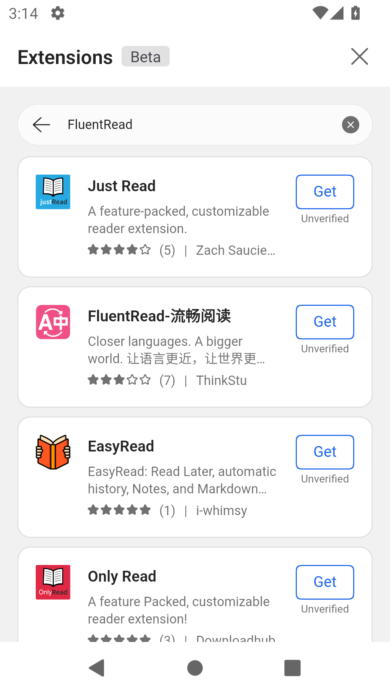

# 移动端后续验收（2026-10-16）

本轮基于已合并的 [PR #995](https://github.com/FluentRead/FluentRead/pull/995)，基线提交为 `16f185a8338dc34c1c3abfb4a19d8c8cadf2c454`。先使用此前生产产物补充实际移动环境证据，再修复 Android Firefox 原生选区手柄影响入口触摸的问题。iOS 后台结果属于下述 `117` 安装包，Firefox 修复另行构建和验收。

源码、产物、测试范围与原图摘要见本目录 `verification.json`。前一轮的版本化结果和失败记录保留在 [2026-10-15 验收记录](../mobile-safari-20261015/acceptance.md)。

## 合并前最终产物与检查

提交 `f233726a60b0fe6e210229f373dc5a4295454ef2` 的 [质量 CI](https://github.com/FluentRead/FluentRead/actions/runs/38774714069) 已通过：748 个测试文件、25,177 项测试通过，5 项跳过；类型、Chrome/Firefox 构建、manifest 和 userscript verifier 均通过。这是该提交的代码与构建证据。

最终 `117` Safari 产物已完成 macOS、iOS Simulator、iPhoneOS 三个目标的无开发者签名编译。467 个 Web 资源在源包、包装与编译产物中逐文件一致，完整摘要为 `2370a210fd9d816fcbfe569a9470406866342b0b2f7da9343a045beeab22de7c`。iPhoneOS 编译未用于真机安装。

同一包更新至专用 iOS 26.2 Simulator 后，485 个安装文件一致。真实键盘下的搜索、清除、返回、关闭和连续遮罩已有实际操作与截图；这些服务控件实测为 46 点。连续遮罩的结论限于完整画面与目标控件操作，本轮未做原生背景命中测试。配置保留、空正文诊断打开和关闭的独立用例通过，诊断入口与关闭按钮均为 45 点。原来两条较长用例分别在旧 AX Switch 与 Button 选择器断言处失败，原始结果仍记为失败；独立复验没有改写它们。

## iOS 实际后台返回

在专用 iPhone 16 Pro / iOS 26.2 Simulator 上，使用同一安装包和仅本机可访问的公开测试文字，执行一个 47.929 秒的 XCTest 用例，1 项通过、0 失败。

1. 原生长按 `inspect`，点击划词入口打开结果；随后按真实 Home 键，再激活 Safari。页面经历约 3.2 秒的真实隐藏，同一 document 返回后卡片仍在，实际复制译文出现勾选和“已复制译文”反馈。
2. 第二次 Home 后，测试网页在真实 `visibilitychange: hidden` 回调中替换自己的原文 DOM。约 3.1 秒后返回 Safari，旧卡清除。夹具没有改写扩展状态，也没有构造 Selection 或可见性事件。
3. 对新原文中的 `boundaries` 原生长按并开卡，显示新词和“边界”，随后实际关闭。

两次往返的 document 身份相同，`pagehide` 次数均为 0；第一次卡片打开后，系统 Selection 已清空，因此恢复结果来自组件保存的来源快照。测试验证了已有来源复核机制在实际 Home 往返中的行为，没有为使测试通过而修改产品。

下列原图均已完整查看，文件保持原始像素。返回过程中的一张转场画面保留在原始证据中，未作为稳定界面的证明。

本轮没有测试锁屏、长时间挂起、进程终止、系统内存回收、故意延迟的供应商响应或音频恢复。现场的来源身份与界面结果也不能证明具体联网供应商的归属。测试后仅停止任务 Safari、模拟器和本机服务器，保留 App 与设备数据；焦点守护未记录违规。

## Firefox 原生选区触摸修复

专用 Android 12 / Firefox 158 在公开页面原生长按 `service` 后，复制菜单和选择手柄保持可见。旧入口中心距选区端点仅 28 CSS px，44px 控件的近侧边仅相隔 6px。一次正常时长的触摸未开卡，也没有到达页面的 pointer/click 监听；真实选区与菜单均保持。这轮明确记录为未通过。

独立研究探针只用浏览器检查器将入口横坐标增加 44 CSS px，保持纵坐标、原生菜单与选区不变。同样的单次原生触摸随后到达页面并打开卡片，支持入口与原生触摸区域重叠的判断。探针不是生产验收；其卡片仍被原生复制菜单遮挡。触摸命令请求 100ms，页面事件记录的按下至抬起为 15ms，未把命令参数当作实测持续时间。

生产修复为 Firefox 触摸入口分别设置选区侧距和屏幕边距：侧距为 72×缩放系数，屏幕边距保持 28×缩放系数。一侧不够时换至另一侧；满行时选取远离两端的行内位置，避免把较大侧距夹回原生手柄旁。极窄且无足够空间时只保证控件可见，不声称保留相同侧距。Safari/Chrome 触摸与鼠标的原有定位保持。

用户明确打开卡片后，Firefox 复用已有的 Safari 触摸处理：仅在成功开卡、当前快照仍有效且原生选区仍与它相同的情况下清空原生选区。卡片保留独立原文快照；较新的选区不清除，迟到的空选区事件不关闭当前结果。自动开卡和鼠标路径保持原行为。

第一版生产包的实际验收中，`service` 和 `domain` 两个原生选词均可开卡、清除菜单、复制并关闭；随后用真实手柄将选区扩展为两行，形成两侧均无足够空间的行内入口。该入口收到了可信 pointerdown/up，实际间隔 105ms，但 Firefox 没有发出 click，卡片仍未打开。这条失败保留在 `attempt9`，没有用两个单词的成功替代满行验收。

第二版补齐 Firefox 的触摸抬起路径：只有入口自身开始的可信主触摸、同一指针和同一来源，且未发生超过 8×缩放系数的移动或取消，才会在抬起时开卡；执行前同时复核保存来源与当前原生选区。拖动、离开、系统 contextmenu、多指、后台隐藏或来源变化会取消；稳定按住再松开没有任意时限。兼容 click 不重复开卡，键盘和新鼠标操作继续可用。其他构建目标不执行这段 Firefox 手势逻辑。

最终完整生命周期专项 315 项通过，包含缺失 click、拖动取消、来源变更、重复触发和非 Firefox 事件传播。修复过程中的失败测试与第一版 290 项结果保留，未重复计数。核心与验证归属的另 88 项在第一版运行通过；第二版没有修改核心模块和注册配置。这些受控测试不代替实际生产包验收。

最终代码的类型检查、Chrome/Firefox/Safari Web 构建、清单和 Safari 资源校验、userscript 构建与 verifier、测试注册审计均通过。userscript 为 2,093,095 字节，沿用原体积预算。独立代码与操作逻辑审查未发现阻断问题。未为这项 Firefox 专属行为重新生成 Apple 原生包装；上面的 iOS 结果仍绑定原 `117` 安装包。

第二版生产包在 Android `attempt10` 中，`service`、`domain` 均以单次原生触摸打开正确词卡。对相同两行选区 `service; avoid relying on it for testing and monitoring purposes.`，实际可信 down/up 间隔为 101ms，仍无 click，但完整原文的卡片成功打开；原生选区变为 0，稳定截图中系统菜单和手柄均已消失。三次开卡后的实际复制反馈与关闭均通过。检查器只读核对完整原文，没有修改样式、构造 Selection 或预先按 Back 收起菜单。

另外执行一次起止均在入口内的横向拖动，可信 pointermove 实测最大位移约 15.33 CSS px，超过 8px 阈值。抬起后卡片未打开，原生选区和菜单仍在，符合取消行为。它没有产生兼容 click；取消后 click 不绕过保护的分支由专项测试覆盖。

这些结果属于 Android 12 / Firefox 158 的专用模拟器，使用原生选区与触摸输入。产物前后双摘要相同，任务进程与端口已清理，设备数据保留，焦点守护无违规。物理手指、多指实际操作、其他系统版本及任意网页布局仍需分别验证。

## Userscripts 权限说明

中英文安装说明改为先授权正在阅读的网站，额外访问按管理器或所选服务的实际提示处理。需要跨多个网站持续使用时，用户可选择较广的授权。依据是 [Userscripts 官方使用说明](https://github.com/quoid/userscripts/tree/release/4.x.x#usage)中的推荐设置；网页注入权限与脚本依赖、跨域请求及翻译服务访问分别说明。这项文档修正没有代替实际 Safari Userscripts 管理器验收。

## 仍需验收

完整目标继续保留：物理设备安装更新、Android Edge 扩展的实际安装与运行、Safari Userscripts、其他布局的系统选区和多行句柄、横竖屏与放大字体、视频切换和后台冻结、音频、禁用卸载，以及 VoiceOver/TalkBack。

[Apple 明确要求在物理设备上测试 VoiceOver](https://developer.apple.com/documentation/accessibility/performing-accessibility-testing-for-your-app)，Simulator 的 AX 元素查询只能提供补充证据。专用 Android API31 模拟器的实际包和服务查询确认未安装 TalkBack，已安装无障碍服务数为 0，辅助功能开关为关闭。本轮未安装或启用它；实际辅助技术验收仍须覆盖焦点导航和语音输出。

Android Edge 已完成官方安装和目录入口核验：从[微软官方下载页](https://explore.microsoft.com/zh-cn/edge/download?form=MA13FJ)追溯移动跳转及 Android 分发端点，取得 ARM64 Stable `155.0.4283.48`，包名为 `com.microsoft.emmx`，最低 SDK 29，APK 签名完整性检查通过。它已在专用 Android 12 模拟器安装并启动；跳过登录和设为默认浏览器，关闭可选诊断，默认浏览器前后均为 Chrome。

普通菜单中的 Extensions（Beta）可直接打开，搜索 `FluentRead` 显示 9 条结果，其中有“FluentRead-流畅阅读”、发布者 `ThinkStu` 和 Get 按钮，同时标注 `Unverified`。本轮没有点击 Get 或安装扩展，当前页面也未显示条目 ID 和版本。因此确认的是移动目录提供该名称的安装入口；与仓库官方条目的 ID 核对、实际安装、翻译和更新仍待验收。

首轮启动命令失败与随后按系统解析结果正常启动的记录均保留。结束时发现任务设备中出现 Firefox 后台进程，未归因其来源，也未操作其界面；随后关闭整个任务模拟器。Edge、任务模拟器与专用 ADB 进程及端口均已清理，默认浏览器未改变，焦点守护无违规。

Userscripts 源码包含 Simulator 目标，但[上游开发说明](https://github.com/quoid/userscripts/blob/8b743e37dd7dfc8a510aff4e5e2ab8b1cc9210df/docs/dev.md)要求 Developer Team ID，并说明缺少它时 App Groups 功能无法正常工作。因此尚未证明无账号、未签名的管理器能够正常运行；本轮未配置开发团队或安装管理器。

Safari 原生版继续保持开发预览；本轮结果不足以宣称移动端与 Safari 整体目标完成。
