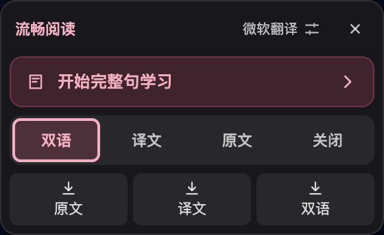
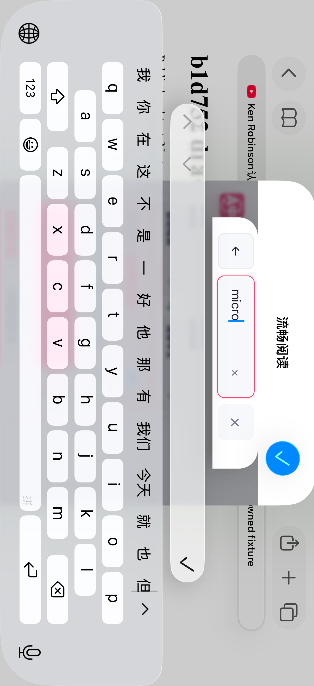
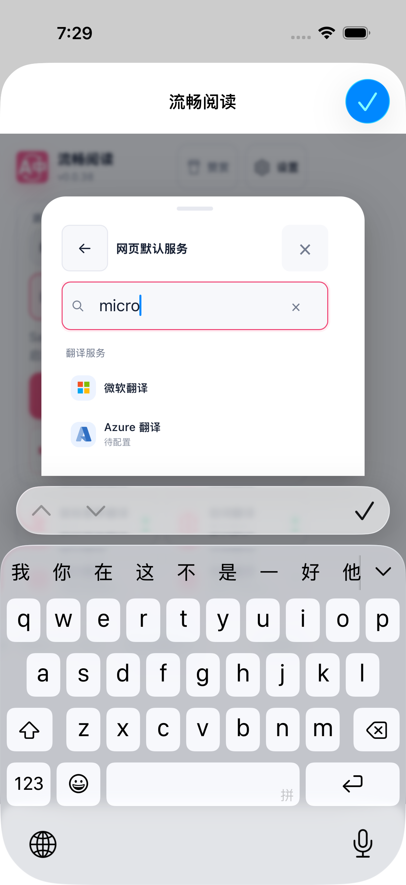
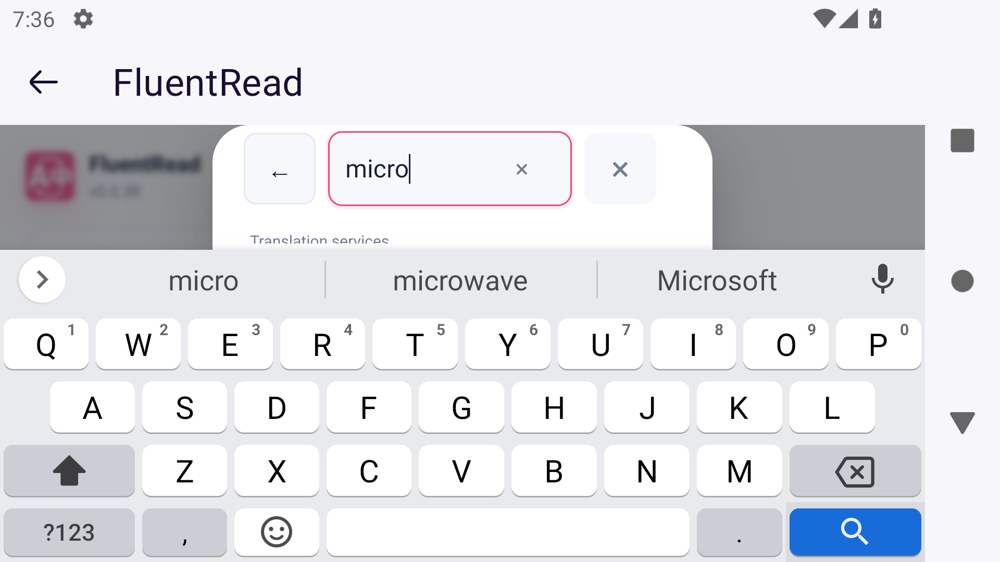
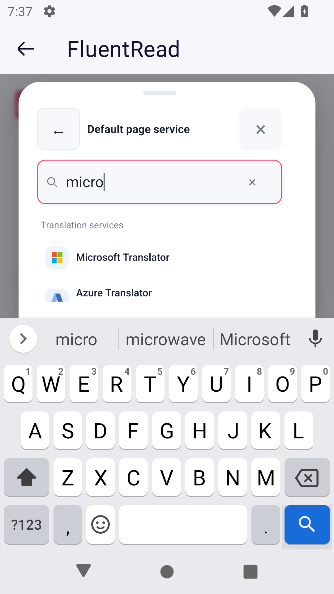
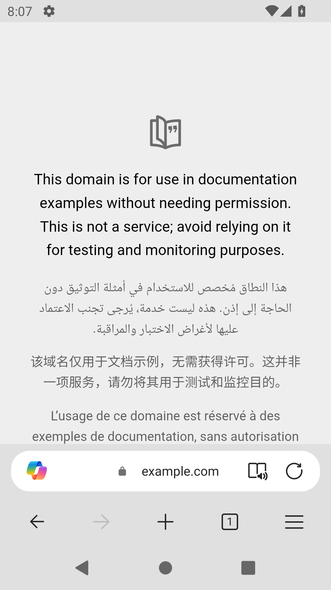
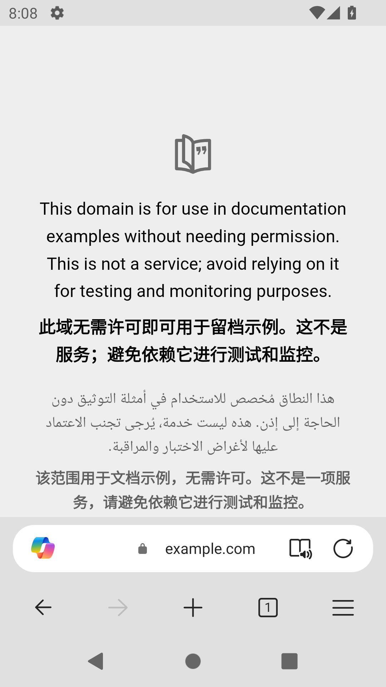

# 移动端修复与主分支整合（2026-10-16）

本文保留 `34e317046` 及此前产物的验收记录；后续主线整合、d9 生产菜单与原生运行结果见[后续验收](./main-followup.md)。不同版本的证据分别记录。

2026-10-18 最新补充：`7e504c21` 修复极矮视口中服务列表空间及回程搜索框可见性；146 项组件专项、Edge 生产 UI 和三目标本地原生编译通过。专用 iOS Simulator 的 R7 实际键盘／横屏单次滚动／完整服务行／竖屏恢复／清除返回关闭流程为 **1 PASS / 0 SKIP / 0 FAIL**；各轮旧 SKIP 保留。范围与原图见[短视口滚动与高度恢复补充](./services-short-viewport-followup.md)，不代表字幕、供应商或物理设备验收。

此前服务概览可见标题已提交为 `a41dddd`，55 项组件专项、类型检查、测试审计、三份生产 Web 构建及四格 320×480 Edge 视口检查通过。旧 `8274d0c` 的活动软键盘横竖屏单流程另为 1 PASS / 0 SKIP / 0 FAIL；它不含新标题，横屏列表仍被键盘遮挡。版本与证据边界见[标题与旋转补充](./services-title-rotation-followup.md)。下文保留各阶段当时的记录。

2026-10-17 的 `8274d0c` Safari 触摸 Popup 快捷入口改用受限定的两列 flex 布局，保留各皮肤间距及奇数末项半宽。103 项专项、三份生产 Web 构建、三目标本地原生编译、30 项桌面 Edge CSS 夹具通过。默认中文竖屏 sheet 展开场景与七动作服务抽屉／键盘场景分别为 1 PASS / 0 SKIP / 0 FAIL；后者选定测试耗时 51.294 秒，确认搜索、清空、Back 和关闭的实际结果。普通收起态下缘仍有裁剪，原生 sheet 展开不等于 DOM 滚动；旋转仍待验收；视频全屏 prefix 本次 0 PASS / 1 SKIP / 0 FAIL，目标闭包未通过，未进入播放或全屏，结论为 UNVERIFIED。详见 [快捷入口布局与分范围验证](./popup-feature-layout.md) 及 [公开验证摘要](./popup-feature-layout-evidence/verification-summary.json)。

2026-10-17 的 `461c2fb` Safari 触摸 Popup 竖屏填宽与有限键盘流程见[竖屏填宽补充](./portrait-touch-width-followup.md)。选择器“返回”和关闭已通过；焦点保持／返回未单独验收，旋转等范围按独立场景记录。

本次修复服务选择器在软键盘下的控件裁切，以及恢复高度后搜索框顶部边框被遮挡的问题。最终生产包已通过 Safari 和 Firefox 的真实键盘流程；视频字幕入口另修正为菜单按钮语义，但真实 Safari 菜单点击仍未通过，详见当前边界。

以主分支 `5cf8f97aac1e5ea40b5d2af39f77b21f1d3c25b0` 为基础整合 [PR #1007](https://github.com/FluentRead/FluentRead/pull/1007)。旧 PR 和分支保留。

## 整合范围

主分支已经包含此前的 Firefox 触摸入口、选区恢复及 Safari 阅读卡键盘保护。合并时保留这些实现；`SelectionTranslator.vue` 及其生命周期测试与本次主分支基线逐字节一致。Popup 的权限、撤权、延迟语言资源和配置保存逻辑沿用主分支。

本次 Popup 净变化是：实际可见高度小于 224px 时复用原有返回、搜索、清除和关闭控件，形成同一条操作行；58px 可见高度下收回外间距，保留完整边框。关闭和卸载清理紧凑标记。此前 Android Firefox 与 iOS Simulator 的实际键盘结果见[对应产物的验收记录](../mobile-safari-landscape-20261016/acceptance.md)，这些结果不会自动转记为本次整合产物的原生验收。

整合候选 `7a93912c4` 的六项桌面几何检查通过后，逐图审阅又发现恢复到 263px 高度时搜索框顶部缺边。追加的生产包复现测得：搜索外框为 y=70–118，吸顶标题下缘为 y=72，抽屉滚动位置为 22px；上边缘命中了标题，其余三边命中搜索框。原有检查只测输入元素，遗漏了外边框；旧候选、失败截图及完整构建身份已保留。

最终修复 `34e3170465a798f79524c56ce11024622734b862` 复用同一可见视口订阅，仅在高度扩大、当前搜索仍聚焦且外框被标题部分遮挡时，调整该抽屉的滚动位置。上述场景只需从 22px 回退到 20px，让外框上缘与标题下缘同为 72px。查询、输入节点、焦点和宿主页滚动均保留。配置、面板或焦点归属改变时，排队中的调整失效；没有新增全局观察器或改变原有 CSS 间距。

生产复验还纠正了测试模型：标题在解除吸顶后会随正常文档流移动，因此不能靠额外滚动把紧邻标题的焦点阴影分开。最终断言要求完整外边框及四边实际命中，不把四面焦点阴影完整列为通过；消费者的标题矩形也按实际 sticky 行为随滚动变化，避免原固定矩形模型掩盖多余位移。

同一窄屏恢复场景的原始截图：

| 修复前：顶部边框被标题遮住 | 修复后：外框四边完整 |
| --- | --- |
|  |  |

以下为显式模拟 58px 可见高度的生产包截图，真实软键盘结果单独记录：

## 视频入口语义

播放器中的流畅阅读入口实际打开或关闭菜单，之前却使用 `aria-pressed` 表示字幕启用状态。iOS Simulator 的真实控件树因此把它暴露为开关。现在入口保留按钮角色、菜单声明及展开状态，启用状态继续由名称、视觉样式和菜单选项呈现；更新时也清理复用节点上的旧 `aria-pressed`。YouTube 自身的字幕开关及真正的切换按钮不受影响。

这遵循 [WAI-ARIA 菜单按钮模式](https://www.w3.org/WAI/ARIA/apg/patterns/menu-button/)；该修复本身不能证明此前一次原生触摸未打开菜单的原因。消费者回归从真实挂载入口覆盖 X 和 YouTube，检查开关菜单不保存配置、关闭字幕的精确保存、配置与语言刷新、卸载重建，以及站点字幕开关的语义保留。

## 验证记录

视频、绑定、原生桥与 Popup 的第一轮专项为 6 个文件、280 项通过，另有 6 项 CLI 专项通过；类型检查及测试审计通过。首次新增视频消费者因夹具未注册英文资源失败，已修正夹具；两项 CLI 进程归属检查在沙箱内握手超时，在允许查询自建进程的环境中复验通过，期间没有改动代码。原始记录均保留。

`7a93912c4` 的 Chrome、Firefox、Safari Web、userscript 构建及对应校验通过。隔离生产包的菜单专项确认 Enter 打开、模式启停保存、Escape 关闭、实际点击重开和具名关闭均可用；菜单开关不改配置。实际 Chromium AX 暴露唯一 Button，带菜单声明和展开状态，没有 pressed 属性。首次 AX 断言误用了 CDP 属性名大小写，纠正后同产物复验通过。该专项没有供应商请求，也没有验证真实网站或辅助技术语音输出。菜单内部无裁切；展开时仍会覆盖夹具中部分站点控件，不能据此声称全播放器没有重叠。

最终外框恢复修复的两个 Popup 消费者文件共 141 项全部通过，类型检查与测试审计再次通过。早期自建测试节点未接入 Linkedom 焦点端口的失败及过强阴影断言均保留，并与实际外边框缺失区分。没有运行本地全量回归，也没有声明四维覆盖率 100%。

`34e317046` 最终代码的 Chrome、Firefox、Safari Web 构建、manifest 及 Safari 资源校验通过。最终 Chrome 生产包的 6 项 Popup 场景和 24 张完整截图全部通过并逐图审阅，覆盖桌面、窄屏、亮暗主题、极矮视口及高度恢复。恢复场景实际测得抽屉滚动位置为 20px，搜索上缘和标题下缘均为 72px，四边命中搜索框且输入焦点保留；58px 场景保留完整 48px 搜索边框和 46px 操作控件。这些视口变化由夹具显式模拟，不代表原生键盘或物理设备验收。浏览器按不抢焦点的隔离方式运行，已关闭并删除临时 profile。

最终包再次执行视频菜单专项，DOM 与实际 Chromium AX 结果通过，4 张截图逐图审阅，未发现菜单自身裁切；页面错误、控制台错误、意外网络请求、翻译和 AI 请求均为零。该测试覆盖实际操作及保存边界，不用于评价在线翻译质量。

提交、源文件与产物摘要、几何结果及截图摘要见 [verification.json](./verification.json)。

## 最终 Safari 原生构建与界面

最终 `34e317046` 的 macOS、iOS Simulator、iPhoneOS 三目标顺序编译通过，三个目标中的 467 份 Web 资源与 Safari 生产包逐字节一致。macOS 与 Simulator 为链接器 ad-hoc、无开发者团队，iPhoneOS 未签名；没有账号、证书、发布或物理设备操作。macOS 和 iPhoneOS 仅完成编译与资源核对。

在专用 iPhone 16 Pro / iOS 26.2 模拟器上执行一次同 bundle 更新，完整 485 份安装文件与编译产物一致。App 私有目录的 17 份文件内容摘要保持，界面中的目标语言、免费服务、服务池数量和划词模式也保持；这不代表检查了全部扩展存储。

实际 Safari Popup 键盘流程 1 项通过、0 失败、0 跳过，13 张完整原图全部审阅。真实输入 `micro` 后旋转横屏，58pt 抽屉内的返回、搜索、清除、关闭控件均完整，原生 AX 中四个控件高度为 46pt；再转回竖屏时输入与焦点保持，搜索框上、下和两侧边框完整。清除、返回、关闭、重新打开及系统键盘完成操作均通过。没有注入模拟视口、样式或滚动；50pt 内容区高度由现有样式推算，不冒充原生 DOM 读数。极矮视口的完整服务列表与 VoiceOver 语音未在这一流程中验证。

| 真实横屏键盘 | 保留输入并转回竖屏 |
| --- | --- |
|  |  |

专用模拟器已恢复原始 Shutdown 状态，所属测试、Safari 和本地夹具进程已清理，焦点监控未发现抢占。

## 最终 Firefox Android 真实键盘

在独立 Android API 31 模拟器的 Firefox 158 中临时加载最终生产产物，真实 Gboard 服务选择流程 1 项通过，18 张完整截图全部审阅。实际可见高度为竖屏 263px → 横屏 80px → 竖屏 263px，同一 Popup 文档的 `micro` 查询和焦点保持；四个控件在原生 AX 中高度均为 46 CSS px，48px 搜索外框四边完整且命中所属元素。实际清除、返回、紧凑关闭、重新打开和竖屏关闭均通过。

该设备的抽屉滚动位置始终为 0，因此它验证的是原生零滚动恢复路径，不能替代 Chrome 中 22px → 20px 的滚动修复证据。测试只操作服务选择界面，没有发起翻译意图或修改服务、语言、权限；没有覆盖物理 Android 设备或 TalkBack。关闭后保留的缓存 modal 节点符合组件设计，其视口标记、紧凑标记及四个 CSS 变量已释放；早期要求缓存节点彻底不存在的过强只读断言已纠正并保留原始记录。

| 真实横屏 Gboard | 恢复竖屏且保留输入 |
| --- | --- |
|  |  |

产物和六份源码摘要在结束后再次核对一致。测试已恢复原旋转锁定，清理所属 Firefox、模拟器、ADB、端口和转发；原测试数据保留，焦点监控没有事件。

## Edge 商店版安装与网页操作（0.0.37）

用户明确授权后，在专用 Android API 31 / Edge 155 测试配置中沿正常商店目录打开 ThinkStu 的 FluentRead 详情，核对可见版本 0.0.37，接受同名安装提示中的全站读写权限。商店显示 Installed / Remove，实际 Popup 显示 v0.0.37，安装与中文首次设置通过。这是发布版的独立验收，不属于本地 0.0.38 / `34e317046` 的回归结果。检查的公开 UI 没有暴露扩展 ID，不将事先已知 ID 记为本次实际观测值；商店的移动端未验证提示也保留在证据中。

同一实际 example.com 页面完成“翻译 → 还原 → 再次翻译”单场景，37 张完整原图均已审阅。原页面本来含多种语言，新增中文译文在原始页不存在、翻译后出现、还原后消失、重译后再次出现；原有六种语言段落在还原后保留。此流程可确认安装与页面操作可用，但不能将原网页已有中文计为翻译结果。

| 还原后的原始页面 | 再次翻译后的新增中文 |
| --- | --- |
|  |  |

另有新增离屏 AX 文本异常，原始页与还原态没有，翻译与重译态均出现。该文本含乱码，未取得 DOM 与供应商的逐段对应证据，不能确定具体原因或供应商；公开记录只保留摘要与 hash，原始异常文本留在受控 XML 中。因此整页翻译质量未判为通过，第二次翻译是否使用缓存也未判断。

安装和权限仅保留在专用测试环境。Edge、任务模拟器与专用 ADB 已关闭，端口清理完成，默认浏览器仍为 Chrome，原测试数据保留；此前安装授权不足的阻塞已解除。

## 当前边界

旧 `f6380c3` 产物的最新视频观察已经看到真实英文与中文字幕；一次短按及另一次普通 tap 均未打开菜单，未进入原生全屏场景。没有确定事件未送达、按钮副本、重建或遮挡中的哪项造成问题。新主分支的按钮副本观察修复与本次 ARIA 修复是独立变量，后续整合包结果不能单独归因于 ARIA。

最终 `34e317046` 的真实 Safari 视频入口在 XCUI 控件树中为唯一具名 `Other`，不是 `Switch`。第一轮测试错误地强制要求 `Button`，因此在点击前跳过；保留该记录并改用实际具名 AX 控件定位。随后独立场景确认唯一入口可见、位于播放器内且 hittable，正常 `.tap()` 一次后菜单仍未打开，原生全屏流程未到达。这是未通过的操作验收；raw 的 1 SKIP / 0 FAIL 不等于通过。该流程仍观察到自然播放中的真实英中字幕，不能据此扩大为菜单或全屏可用。

点击前站点有“点按取消静音”提示，点击后提示消失、Safari 地址栏出现蓝色音频图标。这是已观察到的状态变化，但未读取 DOM 的静音和音量值，也未采集实际事件命中、传播路径与菜单节点变化，因此不能确定首个手势是否被站点消费，或将原因归为 ARIA、克隆绑定或旧脚本。实际音频状态没有单独恢复证明；退出时已终止测试 Safari 并关闭专用模拟器。后续需在明确处理站点提示后进行最小事件取证；VoiceOver 语音和物理设备仍未验收。

Userscripts 已通过正常系统目录选择器重新选择测试 App 自身的 Demo 目录。后续测试修正了默认“询问”行可能不存在、导航完成必须确认等研究工具假设，并修正一处日志格式函数的 Swift 编译兼容问题，失败记录均保留。最新单场景已从实际页面菜单进入精确的 Userscripts-Debug 扩展，并按既有授权仅为同一 127 测试站点允许一天；但 Popup 实际显示首次使用的 “Open Userscripts App” 初始化提示，原生 AX 中 “Open save location” 与 “Refresh view” 均为 Disabled，因此没有执行这些点击，也没有取得重新读取 Demo 的结果。不能判定 App Groups 根因或宣称 FluentRead userscript 可用。

该场景结束时已在正常系统 UI 中将 127 权限恢复“询问”并核对。Userscripts 47 份安装文件、FluentRead 485 份安装文件、检查的 17 份 App 私有文件及 Demo 内容保持，专用模拟器和所属进程已清理；没有重复选择目录或修改 App Groups。

`7a93912c4` 的三目标本地原生编译与 467 份 Web 资源校验通过；因随后发现恢复态外框瑕疵，该包没有更新安装或执行原生 UI，保留为构建基线。物理设备、VoiceOver/TalkBack、长期后台回收及 Edge 的完整移动交互矩阵仍有未覆盖项。移动端与 Safari 的整体目标仍在进行中。
