# 移动字幕控件与 Safari 后续验证

以下字幕与原生历史验收对应产品源码 `f5a82d11a5b6b6a5de2f2ea726065a56cdb2e6ca`；随后新增的触屏入口修复见下节，历史结果不转记为新包。受控生产 Edge 的动作检查和 18 张原图复核在声明范围内通过；真实 Safari Simulator 已在**暂停状态**完成菜单正常打开、关闭和入口焦点返回，播放中菜单、滚动与双语同帧仍未验收。f5a Firefox 已完成既存文档翻译、Home 返回、恢复和重译，但暴露了法文、阿文输出质量问题。对应共享修复单独提交为 [PR #1014](https://github.com/FluentRead/FluentRead/pull/1014)；其 d6b135e 生产包已在另一轮 Android 翻译—恢复—重译中显示对应中文，范围及供应商来源限制见下文。[PR #1009](https://github.com/FluentRead/FluentRead/pull/1009) 的检查状态不能代替移动端视觉和触摸验收。此前服务选择与主线整合记录见[主线整合报告](./main-followup.md)。

后续字幕菜单修复及其独立证据见[字幕菜单滚动与键盘焦点修复](./menu-scroll-followup.md)。该分项的受控浏览器结果、旧测试预期更正、三目标本地编译及真实 Safari 单次观察分别记录；历史 a2 SKIP 与后续入口出现但菜单未建立的 SKIP 均保留，不能替代下文的历史版本身份或原生验收。

## 触屏悬浮入口的能力判断修复

F32 的专用 Android Firefox 实际入口只有 40px，折叠变换使右侧主体超出 360px 可见视口。F33 在同一阅读文档连续三次读到 `maxTouchPoints=5`、`pointer:coarse=false`、`any-pointer:coarse=false`，原有粗指针媒体查询不足以覆盖这个实际触屏环境。现在组件在首次渲染前读取硬件触摸能力：触屏主体及紧凑、漫画模式保留完整 44px 入口，不再沿边缘平移或裁切；同时由 `any-pointer:coarse` 支持浏览器报告的粗指针。没有触摸能力的桌面呈现保持原规则。

五份定向文件共 106 项、类型检查和测试审计通过，Chrome、Firefox、Safari Web、userscript 生产构建及 userscript 校验通过。受控 Edge 首次挂载前开启触摸能力，并实际断言硬件 class、计算样式、可见视口与五个圆内命中点。14 项功能检查通过，包括取消迟到响应、翻译—恢复—重译、拖动、刷新、横屏、深色设置与卸载后重挂载；但关闭测试浏览器时观察到一次前台激活，整轮仍判失败，未作为完整验收通过。六张未经修改的原图均已查看。随后仅修正本任务浏览器脚本的正常退出：在原归属校验器清理前请求 CDP 正常关闭，焦点事件继续监控至进程消失。第二轮同一生产产物的 14 项检查全部通过，页面与 worker 错误为零，未记录前台激活，精确归属清理成功并删除临时 profile；第一轮失败原件保留。见[实际报告](./current-touch-edge/report.json)和[原件复制索引](./current-touch-edge/provenance.json)。

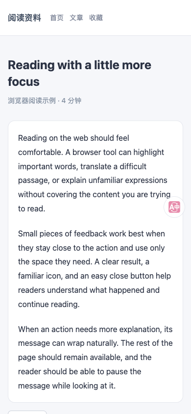

Edge 使用本地翻译响应和明确标记的可见视口夹具，不能证明原生软键盘或在线供应商。F33 的原始 cleanup 保持失败；随后 F34 已用新修复的生产包完成下述限定原生复验和历史目标 Off 恢复，不回写历史结果。

## Android Firefox 触屏能力复验与关闭恢复

F34 使用运行源码 `a2ecda302d3a0199ffe9f0222ee2998a37bd7d5d` 的完整 478 文件 Firefox 生产包，在专用 Android API 31 模拟器、Firefox 158 中复验。实际页面仍报告 `pointer:coarse=false`、`any-pointer:coarse=false`、`maxTouchPoints=5`；首次呈现已有硬件触摸 class，主体为 44×44，完整位于 360×504 可见视口内。计算样式为无平移、无裁切、透明度 0.7，五个圆内采样点均命中自有节点。这个结果验证了此前媒体查询遗漏的实际能力组合。

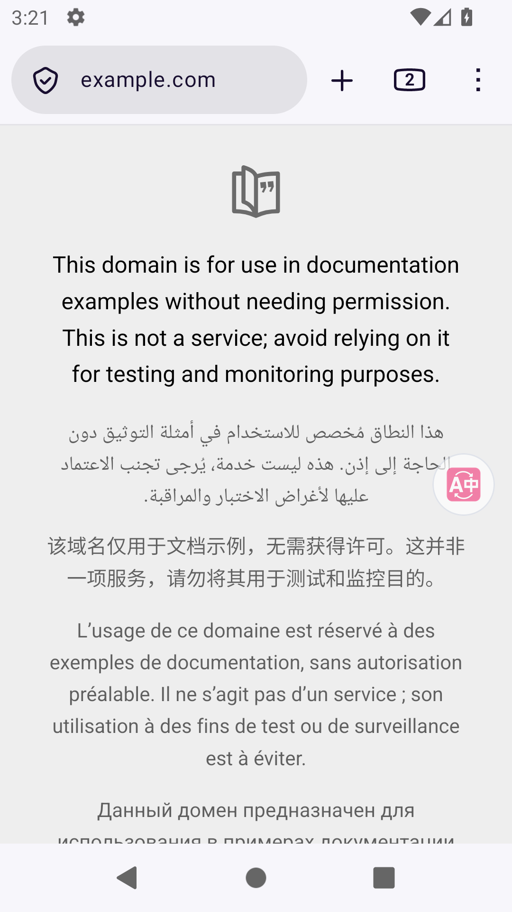

通过正常扩展菜单新建本轮设置页后，仅执行一次条件关闭操作；实际开关由 true 变为 false。返回原阅读页后，自有悬浮节点为 0，六段原文、无译文与空选区均保留，滚动仍为 `(0, 73)`。只关闭本轮确认新建的设置页，原生标签数由 3 恢复为 2；未知旧错误标签没有操作，旧 F32 设置页是否关闭仍未观察到。恢复目标来自 F32 的已留存 Off 记录，未冒充本轮初始状态。

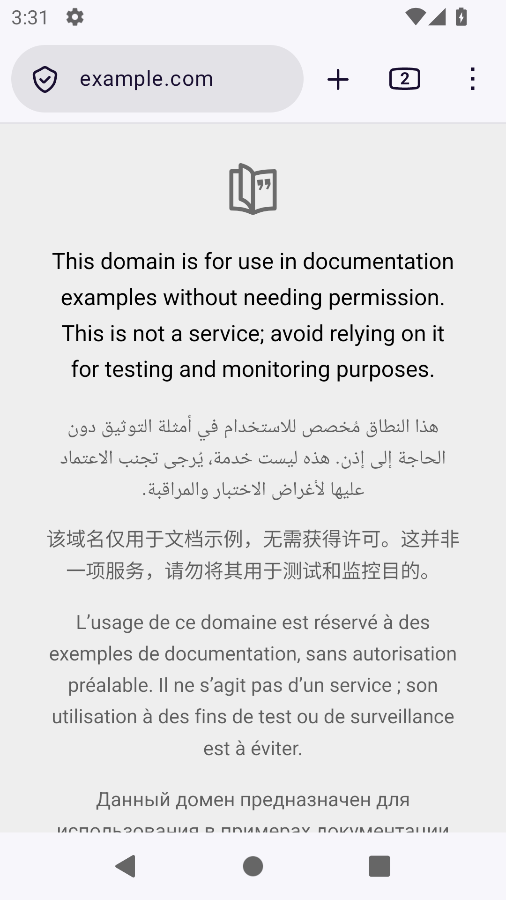

[限定结果与动作计数](./current-touch-firefox/root-outcome-summary.json)、[独立原图与原始记录复核](./current-touch-firefox/outcome-review.json)、[原始恢复断言](./current-touch-firefox/restoration-verified.json)、[选取的六张原图及复制哈希](./current-touch-firefox/provenance.json)。运行结束后清理 PASS，五个所属进程与四个专用端口均释放，未记录前台激活或归属违规，主机密钥仅核对元数据且保持不变；产物前后两种完整哈希相等。这个场景没有触摸悬浮球、拖动、旋转、重挂载或唤起软键盘，不能作为这些交互或完整移动矩阵通过的证明。

## Android Firefox 单次原生拖动观察

F35 保持同一 `a2ecda302` 生产包，通过正常设置开启悬浮球，并执行一次 600ms 原生拖动。44×44 主体从右侧中心 `(326, 252)` 移到左侧 `(34, 328)`；拖动后仍完整位于可见视口内，五个圆内采样点均命中自有节点。为独立观察拖动，临时将点击行为从“翻译”改为“仅拖动”（内部值 `none`），随后已实际恢复“翻译”。关闭开关后，最终阅读页自有悬浮节点为 0，六段原文、空选区和滚动 `(0, 73)` 保持；只关闭本轮新建的设置页，原生标签数恢复为 2。

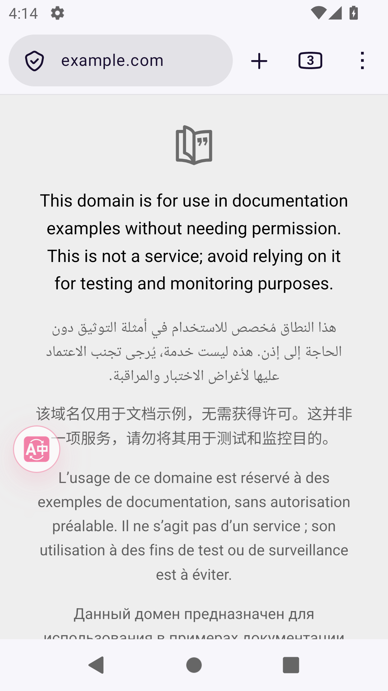

这些是已观察到的局部行为，**本轮完整验收未通过**。返回常规设置时，实际原生选项标签比 DOM 文字多一个前导 TAB；经独立审阅，另用一次窄范围恢复脚本匹配该实际标签，并将该已打开菜单的等待上限从 120 改为 600 秒，全局截止不变。原 28 个冻结文件未修改。最终阅读页观察距关闭开关的读回约 247 秒，超过预设 120 秒窗口，因此没有创建最终恢复证书，原始 `cleanup.status=FAILED` 保留。清理记录同时确认所属进程及端口已释放；随后独立资源检查也确认没有运行中的测试模拟器、重型构建或遗留监听。

[局部观察与未通过边界](./current-touch-firefox-drag/root-outcome-summary.json)、[独立原图与输入复核](./current-touch-firefox-drag/independent-outcome-review.json)、[原始清理结果](./current-touch-firefox-drag/cleanup.json)、[独立资源释放检查](./current-touch-firefox-drag/root-fresh-post-release.json)、[原件复制索引](./current-touch-firefox-drag/provenance.json)。前后完整 478 文件双哈希一致。新吸附位置只保留在专用测试配置中，未证明重启后持久化；未执行最终旋转状态读回、原生键盘、旋转、进度层或翻译整链验收。脚本的时限与标签匹配问题不作为产品失败的证据，也不据此重复同一次拖动。

## 最新 Safari 本地包装与三目标编译

同一 `a2ecda302` 运行源码已在新目录生成 Safari 双平台工程，并顺序完成 macOS、iOS Simulator、arm64 iPhoneOS 编译。三个命令均退出码 0；每份实际产物内的 Web 467 文件逐项长度及哈希匹配，源 Web 前后双哈希保持不变。新工程四个 target、八份配置及实际 App/Extension 的 bundle ID 均已核对。

| 本地产物 | 完整 App 文件数 | 实际 App 与 Extension 签名状态 |
| --- | --- | --- |
| macOS | 482 | 链接器 ad-hoc，无开发者团队 |
| iOS Simulator | 485 | 链接器 ad-hoc，无开发者团队 |
| arm64 iPhoneOS | 485 | 未签名 |

App ID 为 `org.example.FluentReadDevelopment`，Extension ID 为 `org.example.FluentReadDevelopment.Extension`。三份完整 App 均另经独立磁盘双哈希复核。iOS appex 的原生可执行文件和 `Info.plist` 不计入 Web 467 文件；没有其他额外资源或 provisioning profile。Apple 模板仍为 native `1.0 / build 1`，本轮不改版本，也不构成安装更新身份验收。

[执行摘要](./current-touch-native/execution-summary.json)、[完整产物与原生诊断](./current-touch-native/compiled-artifact-identities.json)、[独立磁盘复核](./current-touch-native/root-independent-compiled-review.json)、[原件复制索引](./current-touch-native/provenance.json)。本轮没有安装、启动模拟器或 Safari、签署开发者证书、发布或操作真机；仅接受包装、编译和资源一致性。既有原生 Safari 运行结果仍对应下文的历史版本。

## 当前已确认的范围

真实移动 YouTube 将部分原生控件放在 `movie_player` 外。修复仅在已验证、只含当前视频的同视频容器内查询控件，并按顶部、中部、底部和进度区域避让。长字幕保留字号，以自有卡片滚动；字幕、菜单和学习面板使用受约束的渲染宿主，避免外部暗罩和相互遮挡。菜单或学习面板关闭后恢复同句滚动与入口焦点，换视频、Off 和卸载时清理自有节点及监听器。

学习面板保持原 Vue 实例和逻辑播放器归属。可用高度不超过 240px 时采用整卡滚动、固定顶栏，正文不再被导航挤成窄缝；正常高度仍由正文区滚动。粗指针下相关操作目标至少 44px。

f5a 的受控 Edge 使用生产扩展、移动 YouTube 拓扑夹具和细/粗指针 CSS 条件。动作报告为 `success=true`，15 张报告图与 3 张清理图均逐张查看原图，限定结论如下：

- 中文、俄文自动贴底标签与复选框完整同排；短、中、长双语字幕避让控件，长句首尾可读。
- 唯一菜单入口可正常打开、关闭；菜单和字幕位于暗罩上方。原生播放、设置、全屏按钮中心命中及正常点击通过。
- 学习面板细、粗指针首屏均有完整首行及后续正文；滚到底部后顶栏、关闭、导航和底部操作可见。六个粗指针目标均达到 44px 且中心命中，末句“下句”按预期禁用。
- 短→高→短的滚动归属切换通过；正常关闭菜单、细/粗指针学习面板后，焦点返回入口，同句字幕滚动位置均保持 `2720`。
- Off 撤回自有字幕与入口。夹具原生超长字幕仍会溢出，因此只接受自有 UI 清理，不接受整页原生字幕的 Off 视觉效果。

[动作报告](./current-controlled-edge/report.json)、[18 图逐张复核与范围限制](./current-controlled-edge/visual-review.json)。该轮未出现页面或控制台错误；独立 profile 已删除，4 个已知所属进程退出，无抢焦点记录。

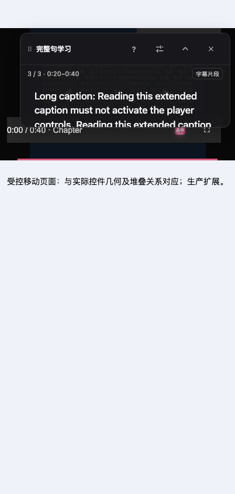

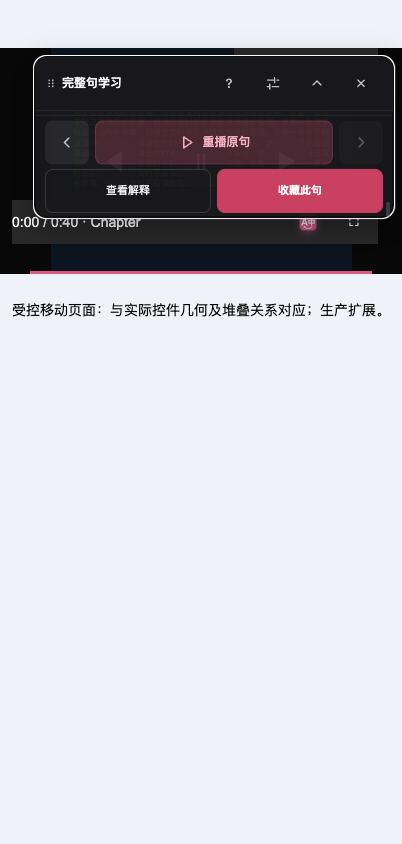

这些是 Edge/Chromium 受控夹具结论，不能转记为真实 YouTube、Safari、真机触摸或惯性滚动通过。解释、收藏按钮的可达性不证明其后端功能完成；本轮未写入收藏。

## 当前 Safari 菜单分项结果

最新更正脚本保持 f5a / `3f3df2dc…` / 完整 485 文件的同一生产包。在专用 iPhone 16 Pro / iOS 26.2 Simulator 中，实际入口和关闭控件均为 44×45、在当前播放器内且可命中；正常点击各一次后菜单打开、关闭，关闭控件消失，原图显示蓝色焦点返回 FluentRead 入口。入口在 Safari AX 中是 `Other`，关闭控件是 `MenuItem`；HTML 按钮的测试定位不能预设它们一定映射为 `Button`。

这一轮**只能接受暂停状态的菜单开关**。首次播放器触摸后的快照已经是 Play=1、Pause=0，菜单及最终快照的视频值均停在 4 秒，最终原图显示大播放键和 `0:04`。随后未观察到双语字幕，原始 XCTest 为 **0 PASS、1 SKIP、0 FAIL，62.307 秒**；不能把片头暂停时未出字幕归因于翻译服务。菜单标题、服务、关闭、学习入口和模式文字清楚，但时间行位于下边缘并被截断，尚未执行内部滚动，不能宣称全部内容可达。

[原始计数](./current-safari-menu-close/runtime-summary.json)、[真实菜单动作记录](./current-safari-menu-close/A9-menu-result.json)、[逐图验收及播放限制](./current-safari-menu-close/runtime-acceptance-visual-review.json)。三张原图由主 Agent 和子 Agent 分别查看，下列两张是未经修改的原件。

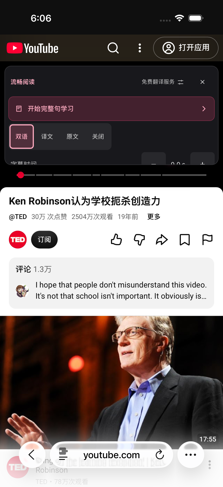

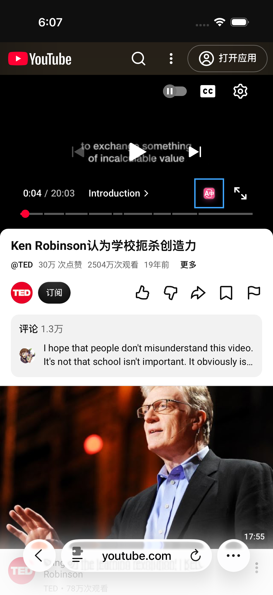

结束后恢复原 d9 完整 485 文件，核对 Userscripts 47 文件、Demo 和所查 App 私有 17 文件；专用模拟器关闭，116 个已知所属进程退出，focus、violations、cleanupErrors 均为 0。此边界不等于全部扩展设置或缓存的恢复证明。[清理记录](./current-safari-menu-close/fresh-release.json)。

前置诊断保留原始失败与跳过，不覆盖为通过：

| 轮次 | 实际观察及边界 |
| --- | --- |
| [A5](./current-safari-a5/runtime-acceptance-visual-review.json) | 一次当前播放器中心触摸后观察到原生控件；CC 的 AX 查询失败，原始 1 FAIL，未进入菜单。 |
| [A6](./current-safari-a6/runtime-acceptance-visual-review.json) | 原图显示原生控件和 FR 入口，完整 AX 入口为 Other、44×45；测试仅筛 Button，原始 1 SKIP。 |
| [A7](./current-safari-a7/runtime-acceptance-visual-review.json) | 同一 TED 标题由英文变中文，组合前提停止；原始 1 SKIP、无中心或菜单触摸，不能断言实际几何移动。 |
| [A8](./current-safari-a8/runtime-acceptance-visual-review.json) | 正常点击已打开菜单；关闭控件的 MenuItem 类型被测试筛选漏掉，原始 1 SKIP、未关闭。 |
| [A9 原稿](./current-safari-a9-setup/runtime-acceptance-visual-review.json) | 测试编号的全局替换误改了内部设备 ID，setUp 阻止全部 Safari UI 动作，原始摘要 1 FAIL。随后直接检查完整原始差异，同时恢复被误改的排除身份哈希，并增加构建前常量断言；原稿和失败证据完整保留。 |

A8 的内部排除身份字符串也受编号替换影响；外部运行 guard 的生产身份、完整文件校验和排除值一直保持正确。更正仅用于独立新测试副本，没有修改产品或历史证据。完整选取及原件 SHA-256 见[复制索引](./runtime-followup-provenance.json)。

## 当前 Android Firefox 文档循环

f5a 生产扩展通过既有官方临时加载路线运行于专用 Firefox 158 / API 31 AVD。正常 Translate→Home→返回→Restore→再次 Translate 后，译文节点数为 `0→5→5→0→5`；同一文档 timeOrigin 保持，六段原文完整恢复，未重复插入译文。Home 与返回动作相隔约 25.9 秒，观察到 hidden→visible；这不是系统回收、杀进程或长后台验收。

[动作与逐段证据](./current-firefox-f21/runtime-acceptance.json)、[恢复断言](./current-firefox-f21/functional-checks.json)。本轮没有导航或重载，文档 URL 为 example.com，但六语内容的最初来源和网络／缓存路径未知，因此不能称新鲜公网来源验收。实际供应商和缓存来源也没有被动证据。

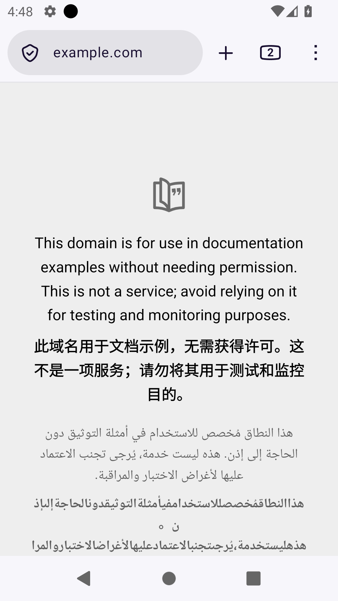

法文结果混合中文，阿文结果仍是阿文且丢失空格，**整页质量不通过**。后续离线证明这两组值会通过原共享校验及 broker 缓存读取，两条中英专用线路也会把 auto 法文、阿文按英文请求；不能反推现场一定使用了这两条线路或命中了持久缓存。PR #1014 修复这些已证明的契约缺口，已通过 815 项相关测试、两模块四维 100% 覆盖及四目标 Web 构建；其实际设备复验单独记录。

本轮 21 张原图均由执行子 Agent 查看，主 Agent 另查看关键页面、Popup、恢复与返回图。官方 APK、服务、语言和权限未改变，Edge 无操作。所属 Firefox runner、端口转发、AVD/ADB 进程均已退出，专用数据保留，focus/violations 为 0。[来源边界](./current-firefox-f21/source-provenance.json)、[异常逐段记录](./current-firefox-f21/quality-diagnostic.json)、[清理记录](./current-firefox-f21/cleanup.json)。

## PR #1014 独立 Android 复验

F22 使用 d6b135e 生产 Firefox 包（478 文件，raw SHA-256 `9d2ed18771f174ddc5ceee4d9c39fc28f28fc83926c98e49e2b404160dd398f6`），沿相同专用 Firefox 官方临时加载路线进行一次正常翻译、恢复、再次翻译。默认免费服务、自动源语言和简体中文目标保持不变，未导航、重载、清缓存或改动权限。

实际译文节点为 `0→5→0→5`，六段原文精确恢复，中文原段没有重复译文。两轮完整就绪分别在操作后约 53.43 秒、23.11 秒观测到，均在 90 秒预算内；法文和阿文两轮均显示对应中文，F21 的异常输出未重现，两轮结果逐段一致。[单场景摘要](./current-firefox-f22/summary.json)、[操作断言](./current-firefox-f22/functional-checks.json)、[逐段对应](./current-firefox-f22/paragraph-correspondence.json)。

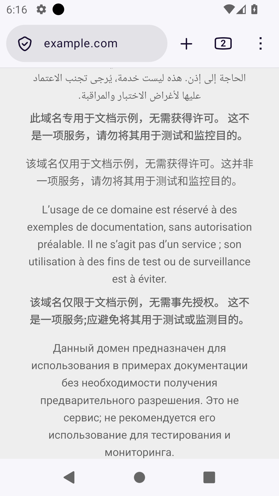

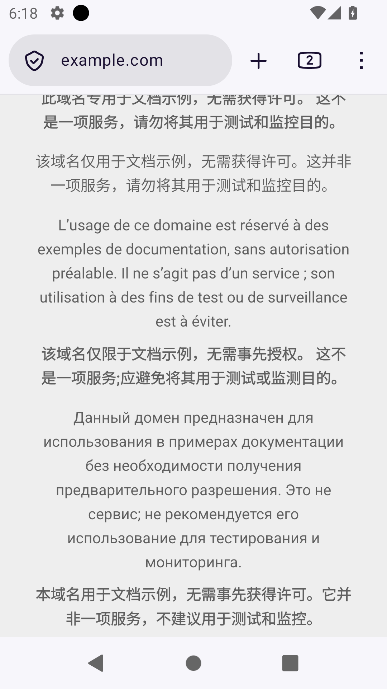

23 张原图由执行 Agent 逐张查看，主 Agent 另查看首次译文、恢复及再次翻译的四张关键原图。该轮是限定文档循环通过，尚未覆盖整页语义质量、横屏、键盘或真机辅助功能。测试内保持同一文档，但初次网络来源、实际胜出供应商及旧坏缓存是否被读取或拒绝仍未知，不能从输出变化反推这些机制已经现场证明。[视觉复核](./current-firefox-f22/visual-review.json)、[原始验收范围](./current-firefox-f22/runtime-acceptance.json)。

10:20:58 UTC 清理完成，6 个已知所属 PID/进程组及专用 5048、5580、5581、60540 端口均退出；AVD 数据保留，Edge 未操作，focus、violations、cleanupErrors 为 0，产物两种完整哈希复核一致。[清理记录](./current-firefox-f22/cleanup.json)、[产物复核](./current-firefox-f22/postflight-identity.json)。

PR #1014 后续提交 `ec9d9192ddf8c32dd67ef8e0daf115eeeb162e44` 已修复六项 slot 回归，并补齐完整字面量标记不应被误算作外语正文的边界。当前直接专项 208/208、六文件严格专项 870/870 通过，两模块四维覆盖均为 100%；两个测试集合存在重叠，不累加计数。Chrome、Firefox、Safari Web、userscript 构建与对应校验通过，远程[代码质量](https://github.com/FluentRead/FluentRead/actions/runs/38889217443/job/116934356640)和[文档构建](https://github.com/FluentRead/FluentRead/actions/runs/38889217441/job/116934356359)均已成功。上述 Android 实际复验仍只对应 d6b135e，不能转记为 ec9 的设备结果；共享修复也未混入 PR #1009 的 f5a 产品包。

## A3 / A4 历史记录

A3 在专用竖屏 iPhone 16 Pro / iOS 26.2 Simulator A407 上使用 f5a 生产包，完整 App 身份为 `3f3df2dc7993788676427a6544e5cd17937f2a7da8d8e4a5f6c1d215417679dd`，Web raw SHA-256 为 `1040bd47a0d9b907d30a91fa7d27e7aa46b7c5c1e258bb6e3223ba4082838705`，完整文件数 485。

原始 XCTest 用例 108 因 `Current player normal touch target unavailable` 跳过：正常导航并点击一次站点取消静音后，初次控件准备的即时触摸前提未满足，尚未开始双语等待、控件几何或菜单测量。后续 AX 中播放器为 `402×226`，另有隐藏位置的 `12×12` 显示控件按钮；它们不是失败瞬间的原子快照，无法确定当时具体哪项前提为假。不能归因于产品、权限或翻译服务，也不能把未生成的菜单记录写成 `entryCount=0`。原图仅显示真实 TED 片头、控件隐藏，没有可验收的双语字幕或菜单。

[A3 原始计数](./current-safari-a3/runtime-summary.json)、[A3 验收边界与恢复记录](./current-safari-a3/runtime-acceptance-visual-review.json)。结束后已恢复原 d9 完整 485 文件，核对 Userscripts 47 文件、Demo 和所查原生 App 私有 17 文件，设备 Shutdown、75 个已知所属 PID 退出，focus、violations、cleanupErrors 均为 0。这不是全部扩展设置、存储或缓存的恢复证明。

A4 保持同一 f5a 产品包，仅使用独立测试脚本和编译目录增加最多 8 秒无动作等待。原始用例结果仍为 **0 PASS、1 SKIP、0 FAIL（26.734 秒）**。四次顺序采样位于等待后的 1.57、3.47、5.23、7.03 秒：已知 TED 页面存在，唯一播放器为 `(0, 110, 402, 226)` 且位于 App 内，但四次 `isHittable` 均为 false；显示控件按钮为播放器外的 `12×12` 区域，四次 `isHittable` 也均为 false，原生全屏按钮数量为 0。Safari 保持前台且没有系统弹窗，等待结束未执行显示控件触摸。

[四轮就绪记录](./current-safari-a4/preparationControlReveal-readiness.json)、[原始计数](./current-safari-a4/runtime-summary.json)和[验收摘要](./current-safari-a4/runtime-acceptance-visual-review.json)保留了这一限制。实际原图为 TED 片头，尚无可验收的扩展字幕或菜单；主 Agent 与负责验收的子 Agent 分别查看了原图。菜单入口记为 `NOT_MEASURED`，不能写成不存在。本轮最多 8 秒等待未使触摸前提成立。`isHittable` 表示 XCTest 能否计算合成事件命中点，不等同于已确认页面存在触摸遮挡；仍不能确定产品、站点或测试框架的因果。没有放宽条件或反复重试。

A4 结束后再次核对原 d9 完整 485 文件、Userscripts 47 文件、Demo 与所查 App 私有 17 文件；专用模拟器关闭，76 个已知所属进程退出，focus、violations、cleanupErrors 均为 0。详情见[清理记录](./current-safari-a4/fresh-release.json)。新测试编译产物只用于本轮，未改动或覆盖 A1–A3 的原始结果。

## 保留的失败基线与版本边界

| 产品版本 | 已有证据与不可转记的边界 |
| --- | --- |
| `c5aedabc2` | 真实 Safari 动作用例 1 PASS，但字幕遮住中心暂停按钮，视觉失败。独立竖屏 AVKit 用例曾实际选择 FluentRead 轨道并显示双语；系统字幕菜单同时出现键盘，原因未定，整体菜单体验未通过。两者均不能算 f5a 结果。 |
| `84189a30e` | 真实 Safari 一组双语与中心/底部控件避让通过，但遮罩使字幕变暗；边缘透明点击框、真实长句滚动未验证。真实 Safari 和受控夹具均未找到扩展菜单入口，受控报告整体 `success=false`。该版 Simulator 身份为 `39dfaa29…`，不能替代新包。 |
| `65d4cec78` | 菜单入口、层级和尺寸更新通过；关闭菜单使同句滚动 `2720→0`。第二轮只开关菜单仍复现，整体失败。后续修复在最终挂载和滚动 CSS 就绪后恢复位置。 |
| `061d0f32b` | 菜单/学习关闭、焦点和滚动恢复动作通过，但 15 张原图暴露 162px 学习卡片正文被挤成窄缝，学习及整体视觉失败。f5a 的短高修复随后在上述受控 Edge 范围闭环。 |

对应历史原图：[c5 中心遮挡](./images/c5-mobile-center-control-overlap.png)、[841 Safari 控件避让](./images/841-safari-caption-controls.png)、[c5 AVKit 双语](./images/c5-avkit-bilingual.png)。旧截图只用于相应版本。

## 工程验证及剩余缺口

布局、入口、菜单、学习、滚动恢复和短高修复分别已有 `91/91`、`171/171`、`145/145`、`37/37`、`100/100`、`61/61` 等直接消费者专项通过，相应报告中的布局/范围/绑定/placement 模块取得四维 100%。**所有专项存在重叠，不能合计为唯一用例数，也不能替代真实绘制与操作。** 类型检查、测试审计及 diff check 已通过；未以本地全量回归名义报告这些专项。

Safari 包装修复沿实际 native target 和 Debug/Release 配置校正 App/Extension 标识，并回读验证；未知结构明确失败、已有工程不覆盖，交付契约专项 52 项通过。同一 f5a Safari Web 的三个本地目标现均编译通过：macOS 完整 482 文件、iOS Simulator 485 文件、arm64 iPhoneOS 485 文件，各目标中的 467 份 Web 资源均与 raw `1040bd47…8705` 精确一致，App/Extension 实际标识已分别核对。macOS 与 Simulator 为链接器 ad-hoc，iPhoneOS 未签名，均无开发者团队或配置描述文件。macOS/iPhoneOS 在独立研究目录生成，新阶段未重建 Web/Simulator，也未安装或运行 App；91 个已知构建进程已退出，未记录焦点或清理异常。见[macOS/iPhoneOS 构建核对](./current-native-build/desktop-device-acceptance.json)、[Simulator 构建核对](./current-native-build/simulator-acceptance.json)及[完整身份文件索引](./current-native-build/provenance.json)。编译通过不代表各平台运行验收，研究包未用于发布或真机安装。

早期 userscript 词典引用曾指向固定远程提交中不存在的文件，该产物不可交付；后续恢复已发布投影及原 hash，并通过语言与产物校验。历史构建记录保留，不用其替代当前 CI。受控 runner 的启动、清单名和夹具文本错误也与产品失败分开记录。

Userscripts 专用未签名测试包仍停留在首次引导，目录与刷新控件禁用，原始结果 1 SKIP、0 FAIL；未读取 Demo，也未验证 FluentRead 脚本运行，无法归因于 App Groups 或签名。临时站点权限已恢复为“询问”。

f5a 当前尚未验收真实 Safari 播放中菜单、菜单滚动、学习触摸与长句滚动、新版系统全屏、横屏、后台恢复、完整安装更新矩阵、物理设备、VoiceOver/TalkBack；不同旧版本的已测场景保留在主线整合报告中；此前 Android Edge 商店版页面质量异常仍未闭环。本轮未借用参考仓库实现。

## 同播放器入口副本后续修复

本轮新增修复、最终构建及平台边界见[同播放器重复入口修复补充](./clone-entry-followup.md)。该报告保留旧包失败和真实 Safari 跳过结果，不将本地编译或受控 Chromium 通过转记为真实平台验收。
