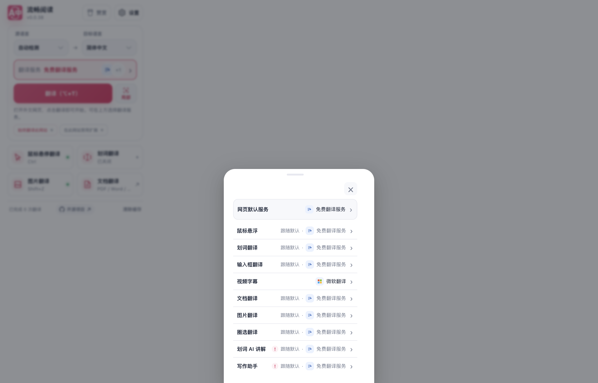
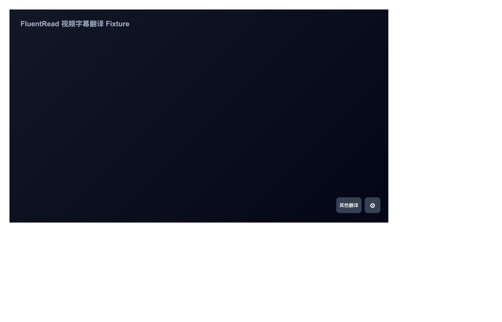
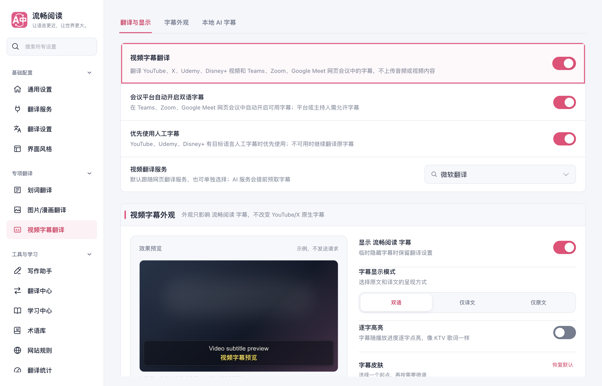

# 主线视频开关整合与后续验收

本记录补充[此前的移动端验收](./acceptance.md)，区分已经执行的 `d9d4c9189` 原生包与随后整合主线的 `47f105aed`。旧版本的键盘、旋转和商店结果保留原身份，不转记为新包验收。

## 代码与操作路径

`d9d4c9189` 保留主线 #1004 的行为：关闭视频字幕翻译会移除播放器入口和菜单。恢复路径是从扩展面板打开“设置”，进入“视频字幕翻译”并重新开启开关。菜单入口继续使用 `aria-haspopup` 和 `aria-expanded`，不使用 `aria-pressed` 表示字幕开关。

`47f105aed2456b644b83da79692d4b9d815a97bb` 进一步合入固定主线 `877ee77b5e3c905f6cc016db63633342dceb2419`，保留 #1013 的两站初始关闭、媒体事件后不复活、重复开启和扩展总开关保持等回归。测试脚本沿用已经实测的完整设置页恢复路径，避免访问已关闭的 Popup；旧 live 脚本的初始化检查也改为当前服务分配入口，不再等待已经移除的视频卡片。

三份相关消费者文件共 103 项通过；CLI 契约文件实际运行 145 项，全部通过。命令中的名称筛选未传入 Vitest，因此按整份文件记录，不将它记为六项专项。测试审计和类型检查通过，未运行本地仓库全量回归。CLI 使用受控浏览器端口，不能替代真实网站或在线供应商验收。

47f 的 Chrome、Firefox、Safari Web、userscript 构建及相应校验通过。使用新的 Chrome 生产产物复验，菜单关闭、真实设置重新启用、重开与实际 Chromium AX 通过，关闭和开启各有 22 次稳定取样。新增 Popup 服务分配与实际 Settings→视频设置路径也通过，检查的配置字段保持。

第一次服务分配截图处于抽屉入场过程，视频行在视口外，独立视觉审查将其保留为未通过。随后只补验入口，不重跑菜单：等待真实几何连续三帧稳定、过渡类消失，确认视频行完整位于可见视口内且中心命中其自身或子元素后取图。最终视频行矩形为 `(496, 582, 264, 36)`，可见视口为 `1272×816`；原图和真实 AX 均确认“视频字幕 · 微软翻译”可读。这是正常入场完成后的结果，没有关闭动画、修改样式或强制滚动。第一轮 11 张、补验 5 张原图均已审阅；清理图不额外计为用例，长列表的完整滚动矩阵不在本专项范围。

两次隔离调用均已清理浏览器、监视器、临时 profile 和本地服务，未抢占前台。菜单使用受控站点和媒体，未发起翻译或 AI 请求，也不代表真实网站、移动设备或辅助技术语音验收。

## d9 生产菜单与 Safari 包

在隔离桌面 Edge 中，d9 生产包的菜单专项通过：真实 Enter 打开，选择“关闭”后节点移除；在实际 Options 开关中重新启用后，新入口恢复且菜单初始折叠，随后正常打开、Escape 关闭及再次点击均可用。关闭和开启各有 23 次稳定取样，实际 Chromium AX 没有 `pressed`。八张原图均已审阅，菜单内部未见裁切；展开时覆盖部分夹具控件的现象仍保留。

该专项使用受控站点和媒体，翻译、AI 及意外网络请求为零，不代表真实 YouTube、移动设备或辅助技术语音通过。

d9 的 Chrome、Firefox、Safari Web、userscript 构建及校验通过。Safari 的 macOS、iOS Simulator、iPhoneOS 三目标顺序编译通过，467 份 Web 资源一致；前两者为链接器 ad-hoc、无开发者团队，iPhoneOS 未签名。专用模拟器完成一次同 bundle 更新，完整 485 文件匹配；检查的 17 份 App 私有文件内容保持。这些文件不是全部 Safari 扩展存储，也不替代更新后的配置与权限 UI 验收。更新收尾曾在 Shutdown 状态额外调用容器查询而失败；成功的安装核验和后续独立清理与该辅助失败分别保留。

## 原生运行边界

d9 的 Safari 页面菜单与免费服务预检已实际通过，也观察到真实英中双语字幕。播放器入口触摸仍未验收通过：一次操作后的旧名称查询发生竞态，XCTest 原始结果为 1 FAIL；采证前截图中入口也已不明显，不能仅凭更早的 AX hittable 值证明点击时可见，不能确定产品根因。

独立系统全屏场景与扩展菜单触摸分别验证。第一轮因“显示播放器控件”在实际控件树中的位置不可点击而跳过。第二轮通过当前播放器中心的一次正常点击，已经显示暂停与全屏按钮；随后测试在约 1.1 秒后的首次存在性轮询未再找到暂停按钮，结果为 1 SKIP / 0 FAIL，仍未进入系统全屏。额外等待可能错过了控件自然隐藏前的窗口，尚无 DOM 事件证据确定内部隐藏原因。原始截图与时间记录保留，这些研究工具失败不能替代系统字幕轨道验收，也不能证明原生功能失败。同一张控件展开截图中，双语字幕与站点时间、章节及进度区域重叠，移动控制条的安全间距适配仍需核对。本记录不宣称 #992 已解决。

Userscripts 的正常“Open Userscripts App”链接确实弹出了指向测试 App 的系统确认框。研究脚本只匹配原生 Alert，遗漏实际 `SFDialogView`，因此该轮为 1 SKIP，未打开 App 或读取 Demo。修正定位后的下一轮在系统打开本地测试页时超时，实际用例为 0，不能据此评价新定位、初始化、App Groups 或脚本兼容性。最后实际执行的临时 127 授权已在 UI 恢复为“询问”；后续未执行任何新授权。测试 App、FluentRead 安装文件、所检查私有文件及 Demo 的前后身份保持，所属进程和专用模拟器已清理。

原生运行身份始终为 d9/177，后续工作树合入 47f 不改变已安装的包。六份相关 Popup/视频源码虽然逐字一致，其他主线模块已经变化，不能据此宣称 47f 的原生验收通过。物理设备、VoiceOver/TalkBack、Safari Userscripts 脚本读取及完整安装、后台恢复矩阵仍有未覆盖项。完整摘要与证据索引见 [main-followup-verification.json](./main-followup-verification.json)。
