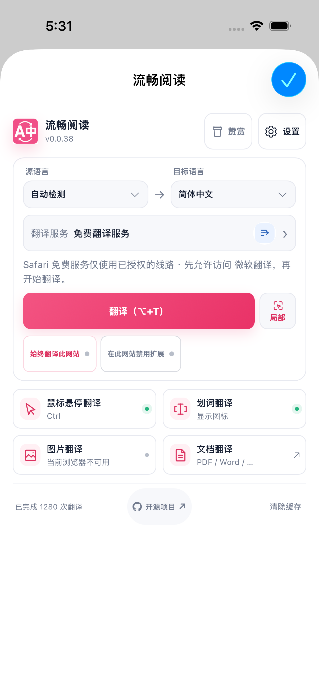
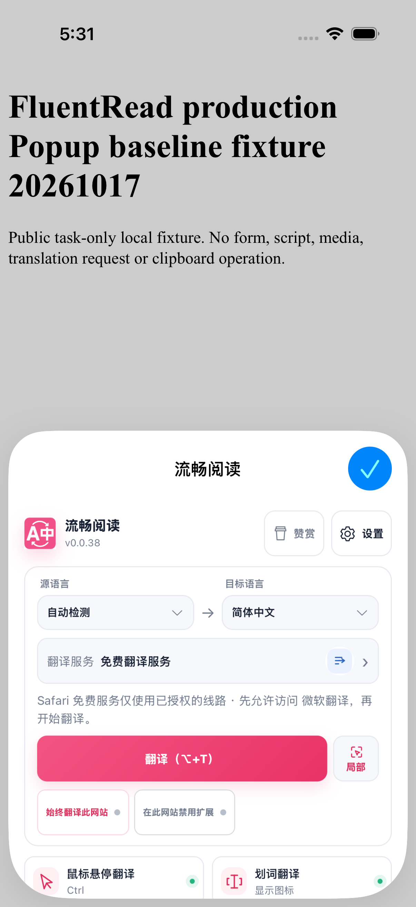
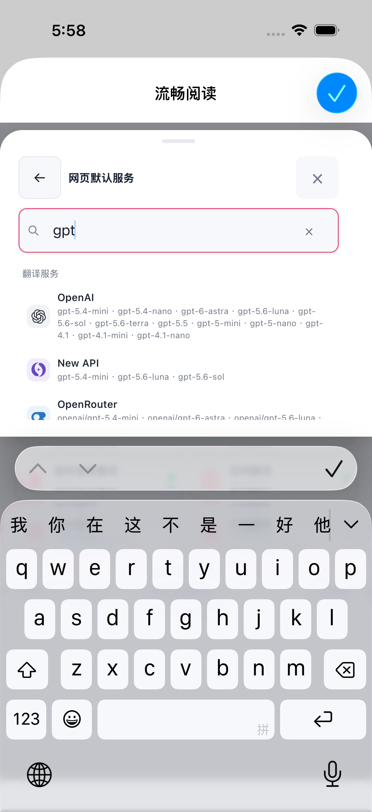
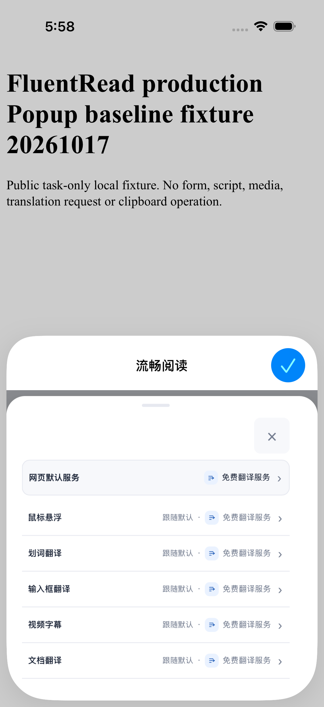

# Safari 触摸 Popup 快捷入口布局

Safari 触摸独立 Popup 的快捷入口改为两列换行，卡片按内容确定行高，奇数末项保留半宽。外层间距与卡片宽度共用局部变量，默认、紧凑、简约皮肤分别保留 8px、4px、5px。卡片内部网格、字体、最小高度及滚动规则保持原值，其他浏览器和页内嵌入 Popup 沿用网格布局。

在同一专用 iOS Simulator 的研究包中，非零视口采样均为 402×400。仅移除原生 appearance 没有改变高度；仅取消外层拉伸后卡片收缩，但外层仍有多余空间。替换外层布局后测得：

| 默认皮肤研究对照 | 首卡高度 | 入口区高度 | 内容滚动高度 |
| --- | ---: | ---: | ---: |
| 原网格 | 127px | 230px | 655px |
| appearance:none | 127px | 230px | 655px |
| 网格 align-items:start | 50px | 230px | 655px |
| 两列 flex 换行 | 50px | 108px | 533px |

这些是单次研究采样，样式、辅助功能读取和截图并非原子快照；没有证明 WebKit 内部机制、最终稳定界面、其他皮肤或完整生产包验收。这张表只记录研究阶段；正式生产产物的有限验收结果另见下节。

## 正式产物验证（8274d0c）

代码提交 `8274d0c76bead3f1f76a04f5f71e2d58475d4551` 的 3 个专项文件共 103 项通过，测试注册审计、类型检查与文档构建通过。Chrome、Firefox、Safari 三份生产 Web 构建通过；Safari 的 macOS、iOS Simulator、iPhoneOS 三目标顺序编译通过，各目标中的 467 份 Web 资源与生产包一致。未使用开发者签名：macOS 与 Simulator 为链接器 ad-hoc、无团队，iPhoneOS 未签名。macOS 与 iPhoneOS 只完成编译和资源核对。

隔离桌面 Edge 的生产 CSS 夹具共 30 项通过：24 项显式 Safari 标记夹具覆盖默认／紧凑／简约皮肤、320／402px、亮／暗主题及 3／4 张卡片；另有 6 项普通及 embedded 标记对照。两列间距保持 8／4／5px，奇数末项保留半宽，记录中没有根节点横向溢出或文案区溢出。11 张原图均已审阅。这些是手动标记的 CSS 兼容夹具，不代表真实 Safari 各皮肤或真实页内嵌入启动流程，详见 [Edge 派生报告](./popup-feature-layout-evidence/edge/report.public.json)。

## 原生 sheet 展开与收回

同一生产原生包在专用 iPhone 16 Pro / iOS 26.2 Simulator 上完成一次默认皮肤、中文、竖屏场景，官方结果为 **1 PASS / 0 SKIP / 0 FAIL**，选定测试耗时 33.615 秒。上划后 Safari 原生 sheet 从 386×450.973 的 WebView 展开为 402×812，四张紧凑功能卡片和页脚完整可见；清除缓存控件的 AX/live 框为 46×46、唯一、hittable 且完整包含在 Popup 中，未点击。下划后回到较小 sheet，页脚再次移出可视区域，随后点击一次原生“完成”关闭。没有权限选择、配置写入、翻译、抽屉或页脚操作。

| 上划前的小 sheet | 上划后的展开 sheet | 下划后的小 sheet |
| --- | --- | --- |
|  |  |  |

这里证明的是原生 sheet 展开／收回及展开态的可见布局，没有证明 DOM 内部滚动。WebView 宽高同时改变，锚点相对坐标的约 +17px 不能当作文档位移；下划后框相同也不能证明文档位置或焦点恢复。“开源项目”的 AX 匹配数为 2，未认定唯一或点击。原始 35 份 JSON、3 张 PNG 与额外导出清单见 [sheet 附件清单](./popup-feature-layout-evidence/native/attachments/manifest.json)，官方结果见 [sheet 原始测试摘要](./popup-feature-layout-evidence/native/official-summary.json)。

## 竖屏服务抽屉与软键盘

同一 `8274d0c` 生产包另完成一次七动作场景：打开按功能选择服务、进入网页默认服务、聚焦搜索、输入 `gpt`、清空搜索、返回概览、关闭概览。七项动作各执行一次，最后再点击一次原生“完成”关闭 Popup，回到同一已知本地测试页。官方结果为 **1 PASS / 0 SKIP / 0 FAIL**，选定测试耗时 **51.294 秒**。Root 与独立审查分别完整读取 44 份原始 JSON、查看 8 张原始 PNG。

搜索 `gpt` 后有对应筛选结果；清空后的空值由 JSON 和已审 live 检查记录确认，没有单独的清空后截图。清空后键盘仍在，返回概览后键盘消失，关闭概览后回到普通 Popup。返回、关闭、搜索及清除控件在各自记录阶段均位于已命名 WebView 内，键盘出现时位于键盘上方；这些记录不代表列表全部可达或焦点恢复。

| 搜索 `gpt` 与软键盘 | 返回概览，键盘消失 | 关闭概览后回到普通 Popup |
| --- | --- | --- |
|  |  |  |

普通收起态的下方卡片仍有部分裁剪；本场景没有新增 DOM 滚动、完整页脚可见性或配置加载正确性的证明。没有出现原生权限提示，也没有执行授权选择，已有 localhost 权限仍记为 UNKNOWN。没有配置写入、翻译请求或剪贴板操作。Overlay 中 tab UUID 未暴露，连续性依据已审原生标识与固定动作链，最终已知测试页才有精确 owner 核对。AX、live 检查、动作与截图是顺序观察，并非原子快照。

44 份原始 JSON、8 张原始 PNG 与导出清单见 [抽屉与键盘附件清单](./popup-feature-layout-evidence/portrait/attachments/manifest.json)，官方结果见 [原始测试摘要](./popup-feature-layout-evidence/portrait/official-summary.json)。含本机绝对路径的内部报告继续保留在研究目录；公开包提供附原件 SHA256 的 [Root 结果派生摘要](./popup-feature-layout-evidence/portrait/root-runtime-outcome.public.json) 和 [独立审查派生摘要](./popup-feature-layout-evidence/portrait/independent-runtime-review.public.json)。

两个场景结束后均已恢复原 D9 包、核对限定的保留数据，专用模拟器为 Shutdown，所属资源已释放。这仅覆盖固定的原生 FluentRead 数据 13 文件、Userscripts 包 47 文件和 Demo396，不代表全部扩展设置、存储或缓存保存。

本次只确认上述默认中文竖屏场景；旋转、其他原生皮肤或语言、VoiceOver、物理设备、实时供应商和全量回归仍未验收。原生视频全屏 prefix 本次为 **0 PASS / 1 SKIP / 0 FAIL（UNVERIFIED）**，选定测试 13.076 秒，运行 guard 60.880 秒。单次导航后 owner 精确匹配，已知 Player／TED 各 1，但唯一目标闭包未通过；尚未进入 currentURLExposure，不能确认精确当前 host 或页面完全加载。未执行 Play、全屏、AVKit Close 或 cue 观察，也没有授权动作或截图。源记录未区分具体哪个闭包条件失败，因此不推断根因。D9 已恢复，专用模拟器 Shutdown，资源释放；只读 known-node closure 诊断正在准备，尚未执行。见 [本次停止摘要及 10 份原始 JSON](./popup-feature-layout-evidence/video-prefix-stop/summary.public.json)。本稿没有声明 CC／Off／重新选择或完整视频目标通过。公开包不含 SDK 日志、App、私有完整文件清单或进程记录。各项范围与逐件大小／SHA256 见 [验证摘要](./popup-feature-layout-evidence/verification-summary.json) 和 [复制索引](./popup-feature-layout-evidence/copy-index.json)。

## 后续标题与键盘旋转检查（2026-10-18）

旧 `8274d0c` 新增完成一条保持软键盘的横竖屏流程，1 PASS / 0 SKIP / 0 FAIL；`gpt` 保留并完成清空、返回、关闭。横屏列表被键盘遮住，未选择服务商。服务概览标题随后以 `a41dddd` 补充，已通过四格桌面 Edge 320×480 视口检查；法文桌面壳固有 380px 宽度按夹具边界记录，新标题尚无原生编译或界面结果。历史记录保留，详见[标题与活动键盘旋转补充](./services-title-rotation-followup.md)。
