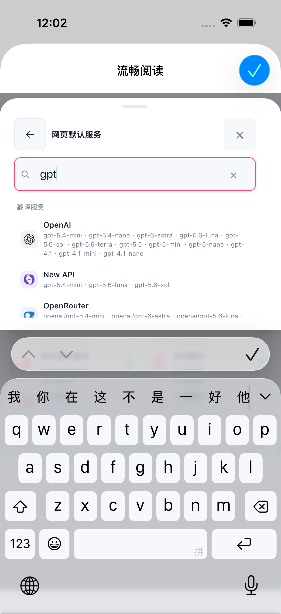
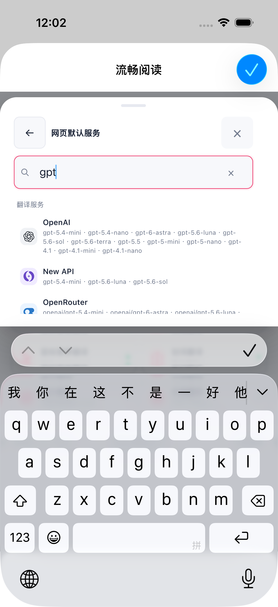

# 服务概览标题与活动键盘旋转补充（2026-10-18）

> 后续记录：本报告保留当时的版本与验收范围。7e504c21 短视口修复的编译、Edge 验证、原生 R7 键盘／列表／回程通过及此前各轮 SKIP 见[短视口滚动与高度恢复补充](./services-short-viewport-followup.md)。

服务概览在原关闭工具行左侧补充本地化“翻译服务”标题，没有增加额外标题行。标题样式允许长文案换行，关闭按钮沿用触摸态至少 46×46 CSS px 的规则，选择器、返回、关闭与保存逻辑保持。标题源码已提交为 `a41dddd9d0baef8973f666b308433ff53e7c596b`。

| 范围 | 当前结果 |
| --- | --- |
| 标题补丁的组件专项 | 55 项通过；类型检查与测试注册审计通过 |
| 标题补丁的生产 Web 产物 | Chrome、Firefox、Safari Web 构建及 manifest 校验通过；构建基于干净的 `c78604d` 加这一项源码补丁 |
| 标题四格 Edge UI 专项 | 第 4 次运行退出 0，**4 PASS / 0 issues**；中文／法文 × 亮／暗，实际视口截图均为 320×480 |
| 原生活动键盘旋转流程 | 旧生产提交 `8274d0c` 的一次 iOS Simulator 流程 **1 PASS / 0 SKIP / 0 FAIL**；不包含标题补丁 |

Edge 四格均实际开启触摸仿真并确认 coarse 媒体查询为真。概览标题与 Close 同处原工具行，Close 为 46×46，抽屉与工具行在视口内，标题文字 Range 无裁剪；内部滚动存在，末行完整可见，滚动后标题与 Close 仍可见。实际滚动位置如下：

| 语言／主题 | 内部 scrollTop | 原始视口截图 |
| --- | --- | --- |
| 中文／亮 | 0 → 94 | [截图](./services-title-rotation-evidence/edge/services-title-zh-CN-light-320.png) |
| 中文／暗 | 0 → 94 | [截图](./services-title-rotation-evidence/edge/services-title-zh-CN-dark-320.png) |
| 法文／亮 | 94 → 329 | [截图](./services-title-rotation-evidence/edge/services-title-fr-FR-light-320.png) |
| 法文／暗 | 329 → 329，沿用已有滚动位置，无新增位移 | [截图](./services-title-rotation-evidence/edge/services-title-fr-FR-dark-320.png) |

中文亮色格还通过真实交互完成默认服务选择器、输入 `gpt`、Back、Close、重新打开与 Escape；其余格检查 Close。四格服务分配与模型均未改变，没有执行服务选择或翻译操作。法文桌面文档及外壳仍有固有 380px 宽度，本专项确认的是实际 320px 抽屉及内部布局，不能据此声称根页面无横向溢出。更多范围见 [Edge 专项摘要](./services-title-rotation-evidence/edge/summary.json)。

早期记录保留：第 1 次在抽屉滑入动画结束前采样，并错误假定工具行必须贴齐滚动区顶边；第 2 次因重开时正常取消动画导致 `finished` Promise 的 AbortError；第 3 次四格断言通过，但法文 full-page 截图为 380px 宽；第 4 次改用视口截图并继续四格通过。这些测试脚本与截图方式修正不作为产品回归结论。

Edge 专项是隔离桌面浏览器的视口与触摸仿真，不能记作 Safari、移动端启动或真实软键盘验收。标题补丁尚无新的原生编译或验收。

旧 `8274d0c76bead3f1f76a04f5f71e2d58475d4551` 原生流程完成输入 `gpt`、保持软键盘转横屏、返回竖屏、清空、Back、关闭概览、原生 Done，并回到同一已知 localhost 页面。16 个已登记动作各执行一次；所选测试方法耗时 **65.105 秒**，整轮 **82.529 秒**。结束后，固定基线及限定保留数据已核验恢复，模拟器 Shutdown，所属运行资源已释放；这不等于全部扩展存储恢复。

横屏时 `gpt`、Back、清空与 Close 仍在，但服务列表被原生键盘遮住，没有选择服务商。因此该结果仅接受这一条已记录流程，不代表横屏完整列表可见、供应商翻译、全部布局、物理 DOM 节点身份、真实焦点或真机验收。坐标归一化属于测试 harness 修正，不能认定为产品 CSS 修复或普遍 OS 规则。

公开原生材料仅包含两张逐字节保留的竖屏原图：

| 旋转前 | 横屏后返回竖屏 |
| --- | --- |
|  |  |

原图未裁切或重新编码；版本、结果与摘要哈希见[原生流程摘要](./services-title-rotation-evidence/native/summary.json)和[复制索引](./services-title-rotation-evidence/native/copy-index.json)。这些截图来自标题补丁应用前，不能用作新标题验收。横屏图不纳入本次公开材料。
