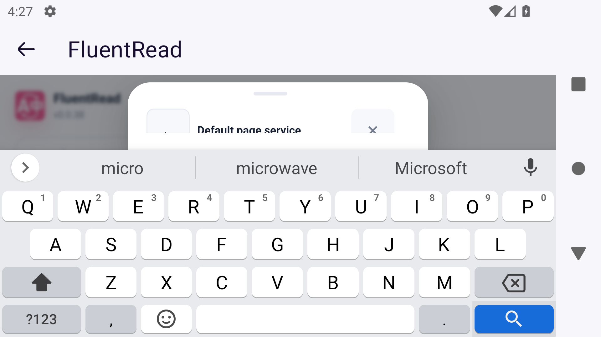
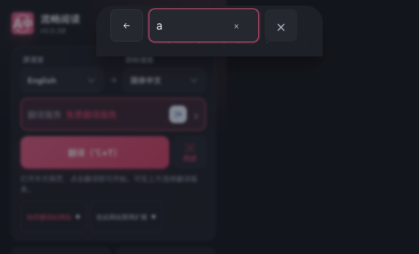
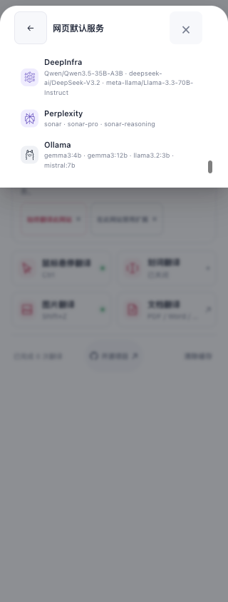
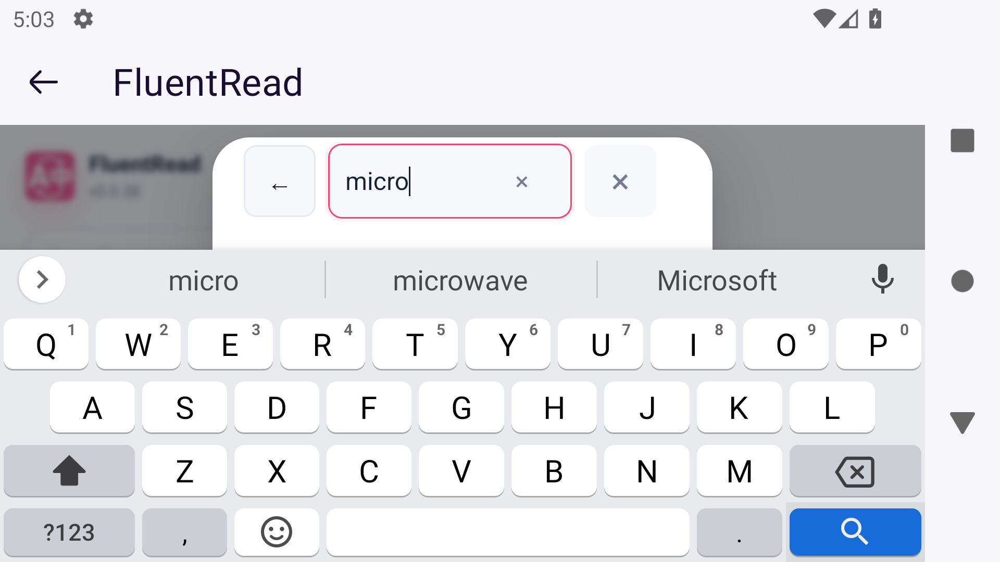
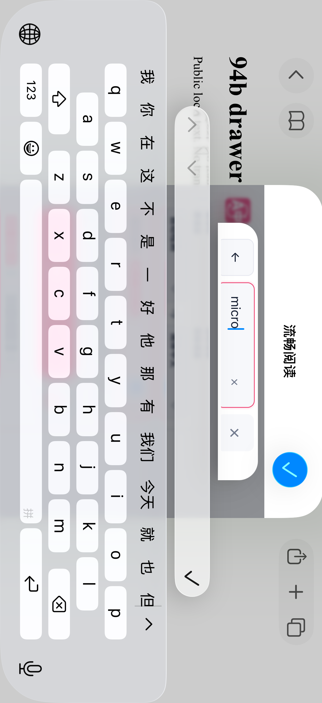
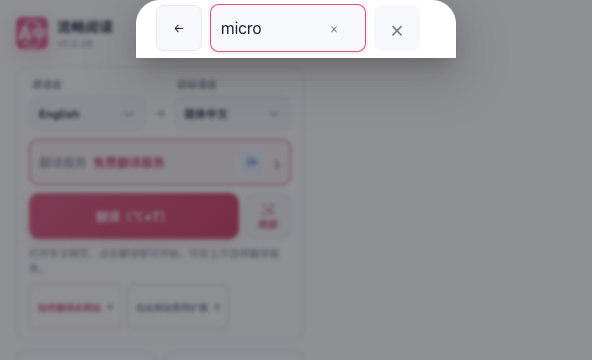
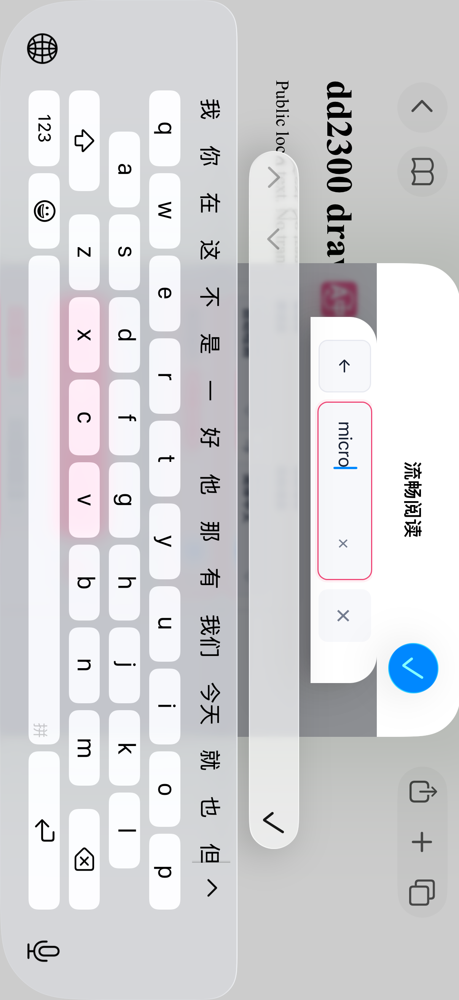
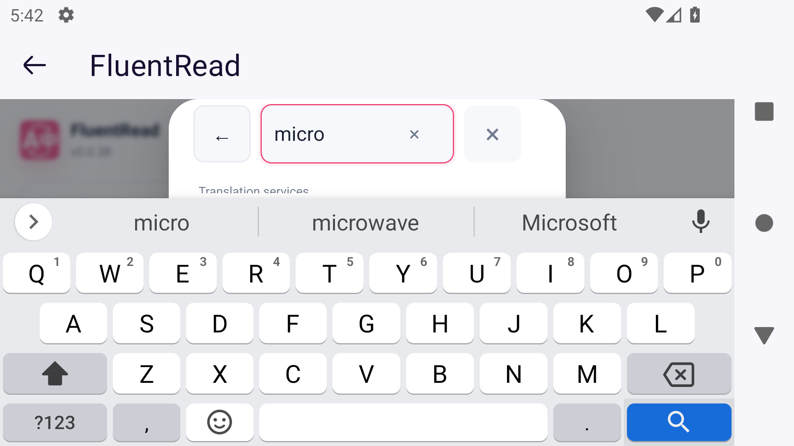

# 横屏键盘与服务选择器验收（2026-10-16）

本轮延续已合并的 [PR #995](https://github.com/FluentRead/FluentRead/pull/995)，并包含 [PR #1006](https://github.com/FluentRead/FluentRead/pull/1006) 的 Firefox 触摸入口修复。来源提交为 `60ba5302c52880610ad843ebe3af9487380d2467`；各轮源码、构建产物、截图摘要及验证边界见本目录 `verification.json`。此前版本的结果保留在 [10 月 16 日验收记录](../mobile-safari-20261016/acceptance.md)。

## 实际发现的问题

Android 12 / Firefox 158 的专用模拟器在服务搜索框输入 `micro`、真实 Gboard 保持打开时，从竖屏旋转至横屏。相同 popup 文档中的 VisualViewport 从 360×263 变为 592×80 CSS px，键盘没有进入全屏提取模式。旧抽屉的正文下缘为 62px，而搜索和清除位于约 93–139px，返回与关闭位于 36–82px。完整画面确认标题和按钮被裁切，搜索框无法操作。这是实际原生键盘结果，没有修改样式或模拟视口。

同轮另两项实际场景通过：划词卡在竖屏、横屏、竖屏往返后保留相同原文和 document，复制反馈与关闭可用；通过真实 Popup 关闭再开启划词，界面宿主数量为 1→0→1，旧卡不复活，新选区仍可开卡。它们绑定旧产物，不能替代服务抽屉失败项。

## 修复方式

沿用实际抽屉的 VisualViewport 订阅，在可见高度小于 224px 时显示紧凑服务控件。返回、搜索、清除与关闭共用一条 48px 操作行，按钮保持至少 46px，输入字号保持 16px；装饰把手和标题不再占用有限高度。完整遮罩继续拦截背景，普通高度的标题吸顶、列表滚动和桌面固有宽度保留。

输入框、事件与查询会话始终复用同一节点。旋转不清空输入、不重新聚焦，也不改变服务选择。关闭、缓存失活或卸载会清理所属遮罩的视口状态。

第一版紧凑布局的视觉和实际触摸操作通过，但 Firefox 的完整原生无障碍树在服务选择页漏掉返回、关闭等控件，因此没有接受该候选。最终方案恢复标题栏与搜索框各自的布局盒子，通过明确的 48px 行高和对应边距共用一行；没有使用 `display: contents`，也没有增加重复控件或一套新的交互状态。

## 专项验证

最终候选的 Popup 实际组件生命周期专项为 2 个文件、118 项通过；类型检查通过。Chrome、Firefox、Safari Web 构建、扩展清单校验、Safari 资源校验、userscript 构建及 verifier 均通过。测试注册审计通过；这是所选范围的检查，不是本地全量回归，也没有新增严格覆盖率目标的四维 100% 声明。

隔离桌面 Edge 加载实际 Chrome 生产包，在明确标注的 VisualViewport 几何夹具下完成 6 项检查。21 张完整原图已逐张审阅：桌面中英文固有宽度、长列表滚底后的返回和关闭、80px 中的四控件尺寸与四边命中、深色与 320px 窄屏、输入和焦点保持、原有 Tab 顺序、清除和关闭清理均通过。无匹配查询时四控件仍可操作；没有把极矮区域内结果提示正文的完整可读性计为已验证。

实际 Chromium 无障碍树中，四控件均有对应的非忽略节点、名称和角色。这仍不是 Android Firefox、Safari、TalkBack 或 VoiceOver 的验收。

首轮研究脚本误将移动端最小尺寸套用于桌面概览的 28px 关闭按钮，该原始失败保留。修正了这条测试断言的适用范围后，桌面原尺寸仍检查完整可见与四边命中，紧凑行和触屏控件的 46px 条件保持。

## 最终原生复验

首次通过 Android 原生验收的代码提交为 `88598df9567ed2765b26c9078a7f124a8d01d214`，源码与构建及现场验收的四份文件摘要一致。Android `attempt16` 的一项专项通过，使用冻结的 Firefox 生产包：478 个文件、62,272,314 字节，资源摘要为 `089b87538e304d6579ff0e1d79eedf8a9187e8033f74f93e9270603cf9922c9e`。

真实 Gboard 打开时，竖屏 360×263 与横屏 592×80 的完整 Android 控件树都包含唯一的返回、关闭、清除按钮和 `micro` 输入框，均为可用、可聚焦、可点击且位于可见 WebView 内。三个按钮为 46×46 CSS px；输入框高度为 46px，横屏宽度为 86px。相同 popup 文档保留了输入及焦点，没有使用模拟 viewport 或样式探针。

根据现场控件树的位置实际点击清除后，查询变空且焦点保留；返回概览后键盘收起。重新进入选择页，在同样 80px 可见高度下实际关闭成功；恢复竖屏后重开得到 360×512，旧紧凑标记没有残留，最终关闭清理了视口变量。原图和实际几何确认遮罩连续，这轮没有追加原生背景点击测试。

此前裁切和第一版控件树缺失的失败均保留。最终产物双摘要前后一致，原旋转状态恢复，任务 Firefox、模拟器、ADB 与调试端口已清理，焦点守护无违规。原生控件树恢复不等于完成 TalkBack 语音或焦点导航验收。

新 Safari Web 产物已完成原生包装，以及 macOS、iOS Simulator、iPhoneOS 三目标顺序编译。三者的 467 份 Web 资源均与本轮冻结产物一致；App 与扩展的实际签名和 Mach-O 已检查。Simulator 和 macOS 二进制带链接器生成的 ad-hoc 签名、没有开发者 Team；iPhoneOS 产物未签名。本轮未使用开发者账号、证书或 provisioning，也未发布或操作真机。

专用 iOS Simulator 的同包更新安装成功，485 个文件与新编译产物一致。系统迁移了应用数据目录编号，最初测试脚本的路径相等断言失败；只读核对显示更新前后 17 个 App 私有文件的内容摘要全部一致，实际界面也确认原有配置保留。没有卸载、清数据、回写旧数据或重复安装；该结果不等于核验了扩展全部独立存储。

原生 `107` 场景的搜索、清除、返回、关闭和重开操作通过，但完整原图审阅发现横屏仍有约 5pt 的底部裁切，因此该候选没有通过 Safari 视觉验收。实际抽屉为 50pt 高，上下各 4pt 内距只剩 42pt 正文；46pt 的控件超出了正文下缘。AX 中有完整 frame、能够点击，并不能证明所有边缘都可见。

进一步修复提交为 `f6380c330ca576cdeda7ad9e4cf166517853927e`，仅让极矮服务抽屉使用完整可见高度，收回原有 8px 顶部外间距；58px 可见高度下，正文由 42px 增至 50px，容纳原有 48px 操作行。

这次仅改 CSS，重新完成 Chrome、Firefox、Safari Web 构建及清单、Safari 资源校验。独立生产包几何复验 6 项通过，24 张完整原图已审阅，其中新增明确标记的 58px 视口场景：搜索外边框完整可见，四控件的裁切交集、四边命中、无障碍树、空结果和恢复高度均通过。原有 80px 与 263px 场景继续通过。这些结果属于桌面 Edge 几何夹具；原生复验单独记录。

最终候选再次完成三个原生目标的编译及资源校验。专用 iOS Simulator 的 `108` 场景通过；实际横屏抽屉为 `(277,72,320,58)` pt，上下内距后可见正文为 y=76–126、50pt 高，四个控件均位于 y=77–123、46pt 高。完整原图确认有查询和清除后的搜索框底边、按钮下圆角均可见；返回、关闭、重开及收起键盘后的布局恢复也通过。遮罩完整性由实际截图确认，本轮没有追加原生背景点击测试。

同包更新前后的 485 个安装文件分别与所属编译产物匹配，17 个 App 私有文件内容仍一致；实际界面确认简体中文、免费翻译服务及划词模式保留。任务 iOS Simulator 已关闭，所属服务器、Safari 与测试进程已清理。

最终 Firefox 包的 `attempt17` 单场景复验也通过，资源摘要为 `c6ccf02edce4df1b41fd7d66b66d26b6d09e0dcb6355aa7447ad50be6165aaf7`。真实 Gboard 横屏仍为 592×80 CSS px；抽屉使用完整 80px，正文为 y=4–76，搜索外框为 y=4–52，按钮为 y=5–51。`micro` 与清除后的状态均确认完整底边、圆角及原生控件树可达；实际清除、返回、极矮区关闭、恢复竖屏后重开及最终关闭通过。产物与源码摘要前后一致，原旋转锁定恢复，任务 Firefox、模拟器、ADB 及端口均已清理。极矮区域中列表正文的完整可读性没有计为通过。

最终包的视频补验未获得新的原生全屏通过结果。首轮测试在 Safari 尚未启动时查询键盘，因测试准备错误提前失败，没有进入视频流程；该失败保留。独立修正取证顺序、明确建立竖屏基线后，第二轮成功导航一次到既定 TED 视频，但在限定的 8 秒准备窗口内没有观察到所需的真实双语字幕 AX 节点，因此按前置条件跳过（1 skip、0 fail）。没有进入原生全屏、字幕菜单或旋转场景，也没有通过注入字幕、改缓存或追加供应商请求来满足前提。

测试记录初始方向读数为 unknown；结束时回到本轮明确建立的竖屏基线，不声称还原未知的初始方向。此前 `228` 包的原生视频结果以及 `117`、`94b` 包的其他结果各自保留，不转记为最终候选的通过。

## 其他移动路径与未覆盖项

Userscripts 官方固定源码已在无开发者账号及签名身份的条件下完成 Simulator 编译、App 安装启动、默认 Demo 创建及 Safari 扩展注册。仅对本机测试站点临时选择“允许 1 天”后，真实面板显示 `failed to get matches`，没有读出 Demo。依据相同官方源码，这一错误对应保存目录未取得或目录枚举失败；没有确定具体 App Groups 根因，也没有验证脚本注入或 FluentRead userscript 翻译。测试站点已恢复“询问”，原有 FluentRead 安装与 App 私有数据摘要保持。

Android Edge 的实际移动目录已显示 FluentRead 0.0.37，实际扩展安装与翻译仍未验收。物理设备安装更新、真实辅助技术、其他系统版本、长时间后台回收及完整视频生命周期仍保留为未完成项。Safari 原生版继续保持开发预览，移动端与 Safari 的整体目标尚未完成。
