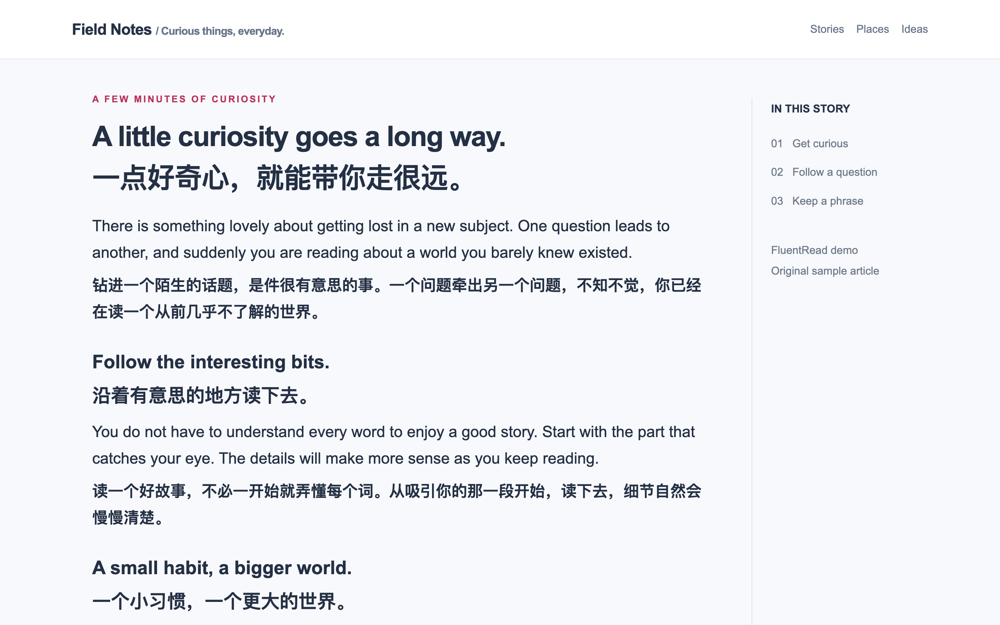

# 流畅阅读

**让语言更近，让世界更大。**

一款开源的浏览器双语翻译插件。

[安装](#安装) · [官网](https://read.thinkstu.com/) · [使用指南](https://read.thinkstu.com/guide/) · [赞助合作](#企业与项目赞助) · [隐私政策](https://read.thinkstu.com/guide/privacy) · [English](../README.md) · [LINUX DO 社区](https://linux.do) · [GPL-3.0](../LICENSE)

流畅阅读是一款开源、注重隐私的全场景浏览器阅读、翻译与语言学习工作台。除在原网页中对照阅读原文与译文外，还完整覆盖本地离线 AI 模型、PaddleOCR + LaMa 漫画与图片翻译、17 种格式文档翻译（含扫描版 PDF OCR）、视频与会议双语字幕（支持本地 Whisper / Qwen3-ASR 离线转写）、离线词典与 AnkiConnect / 「再次遇见」复习闭环、写作助手、端到端加密云同步以及全局命令面板。

我们从 2024 年 1 月开始开发流畅阅读。从那时起，流畅阅读始终保持开源，并免费向用户提供。

[▶ 观看 56 秒介绍视频](https://read.thinkstu.com/videos/fluentread-promo-zh.mp4)

想进一步了解流畅阅读，可以[观看完整官方介绍片（4 分多钟 · B 站）](https://www.bilibili.com/video/BV1qhHJ6uEiF/)。

<table align="center"><tr><td>

</td></tr></table>

## 主要功能

| 功能 | 说明 |
| --- | --- |
| 网页翻译与智能高亮 | 全文双语对照与仅译文模式、悬浮/划词/局部区域翻译、原文恢复、网站专属适配规则，以及基于信息意外度的智能高亮。 |
| 全局命令面板与场景引导 | 在任意网页按 `Alt+K`（可自定义）打开命令面板，支持中文、英文与拼音模糊检索；内置 5 大使用场景预设（学术科研、程序员/技术文档、语言学习、追剧与漫画、跨境办公）一键无损配置。 |
| 本地离线 AI 与丰富引擎 | 支持免费引擎、DeepL、OpenAI / Claude / Gemini / DeepSeek、本地 Ollama / LM Studio 与浏览器端离线模型；提供术语库、自定义提示词、译文样式与 8 种界面语言（简体中文、繁體中文、English、日本語、한국어、Français、Русский、Español）。 |
| 漫画、图片与圈选翻译 | 集成 PaddleOCR 文字检测与 LaMa 背景修复，支持漫画连续翻译、网页图片翻译以及屏幕区域圈选识别与复制。 |
| 17 种格式文档翻译 | 支持 PDF（含扫描版 PDF OCR 识别）、ePub、DOCX、PPTX、Markdown、HTML、TXT、SRT/VTT/ASS 字幕等 17 种格式，支持双语对照阅读、逐段校订与多格式导出。 |
| 视频与会议字幕 + 本地 ASR | 支持 YouTube、X、B 站及在线会议双语字幕；无原生字幕时可调用本地 Whisper 或 Qwen3-ASR 模型离线生成 AI 字幕。 |
| AI 阅读卡片与学习闭环 | 结合段落语境解释含义、拆解句式并连续追问；内置离线词典、单词本、AnkiConnect 同步与「再次遇见」网页重现复习机制。 |
| 写作助手与隐私脱敏 | 在网页输入框内直接翻译、润色与改写，并在发送云端翻译前自动识别与脱敏敏感隐私内容。 |
| 端到端加密云同步与多端生态 | 支持 Google Drive 与 WebDAV 端到端加密配置备份；覆盖 Chrome、Edge、Firefox、Safari、油猴脚本，并提供 Obsidian、Zotero、Thunderbird [第三方集成](../integrations/)。 |

各功能的使用方法与支持范围见[使用指南](https://read.thinkstu.com/guide/)。AI 讲解需要配置可用的 AI 服务；第三方服务的费用与可用性由服务商决定。

## 安装

[Chrome](https://chromewebstore.google.com/detail/djnlaiohfaaifbibleebjggkghlmcpcj) · [Edge](https://microsoftedge.microsoft.com/addons/detail/kakgmllfpjldjhcnkghpplmlbnmcoflp) · [Firefox](https://addons.mozilla.org/zh-CN/firefox/addon/%E6%B5%81%E7%95%85%E9%98%85%E8%AF%BB/) · [Safari](../docs/maintainers/releases.md#本地打包) · [油猴脚本](https://greasyfork.org/zh-CN/scripts/482986) · [第三方集成（Obsidian / Zotero / Thunderbird）](../integrations/)

1. 安装扩展并刷新需要翻译的网页。
2. 打开流畅阅读，选择界面语言（支持含简繁中文在内的 8 种语言），可按需一键应用使用场景预设（学术科研、程序员、语言学习、追剧与漫画、跨境办公）。
3. 点击“翻译页面”，或随时按 `Alt+K` 呼出全局命令面板快速操作。

各浏览器商店的版本更新可能存在时间差。油猴脚本提供核心网页翻译能力；完整支持范围见[安装指南](https://read.thinkstu.com/guide/getting-started)。

## 企业与项目赞助

项目目前主要由个人支持，每月投入数百美元用于项目维护。我们相信，流畅阅读能为世界带来更多美好。

感谢 [**哔哩哔哩 Index-Translate**](https://index-translate.bilibili.com/) 成为流畅阅读的首位赞助伙伴。

[成为赞助伙伴](https://read.thinkstu.com/guide/support#sponsorship) · [邮件联系](mailto:a1914493943@gmail.com?subject=FluentRead%20sponsorship) · [添加微信](https://read.thinkstu.com/support/wechat-contact.jpg)

## 本地开发

按 `.nvmrc` 和 `package.json` 的 `packageManager` 字段分别安装 Node.js 和 pnpm。首次运行 `pnpm install --frozen-lockfile` 安装依赖。

- `pnpm dev` 启动本地开发。
- `pnpm zip` 构建并打包 Chrome 扩展。

[扩展源码](../src/) · [第三方集成](../integrations/) · [文档源码](../docs/) · [组件预览](../docs/development/storybook/) · [测试](../tests/)

[其他浏览器打包](../docs/maintainers/releases.md#本地打包)

## 贡献与反馈

欢迎通过 [Issue](https://github.com/FluentRead/FluentRead/issues) 报告问题或提出建议，并通过 Pull Request 改进代码、文档、界面翻译及[网站适配](../docs/contributing/site-adaptation.md)。

## 设计系统

运行 `pnpm storybook` 可在本地查看真实 Vue 组件、界面皮肤与交互状态。详见[设计系统与组件预览](../docs/guide/design-system.md)。使用 `pnpm docs:build:site` 可一起构建文档与组件展示站。

## 支持项目

流畅阅读是一个开源项目，其持续开发离不开社区的慷慨支持。可以通过微信赞赏或 Ko-fi 自愿赞赏。

<table>
<tr><th>微信赞赏</th><th>Ko-fi · 国际支持</th></tr>
<tr>
<td align="center"> 使用微信扫码，点击图片可查看原图。</td>
<td align="center"><a href="https://ko-fi.com/thinkstu"><strong>通过 Ko-fi 支持 thinkstu ↗</strong></a>  ko-fi.com/thinkstu</td>
</tr>
</table>

## 致谢

流畅阅读的成长离不开开源社区。感谢以下项目及其贡献者的开放与分享：

- [陪读蛙](https://github.com/mengxi-ream/read-frog)
- [简约翻译](https://github.com/fishjar/kiss-translator)
- [Duo Translator](https://github.com/linuxscreen/duo-translator)
- [InfoLens](https://github.com/dqy08/InfoLens) —— 智能高亮的设计参考了它的意外度热力图思路（Apache-2.0）

<!-- contributors:start -->
<a href="https://github.com/FluentRead/FluentRead/graphs/contributors">
  <table>
    <tr>
      <th>
         
         
         
      </th>
    </tr>
  </table>
</a>
<!-- contributors:end -->

感谢每一位为流畅阅读做出贡献的朋友，包括许多未能在此一一列出的人；也感谢每一位用户包容这个仍不完美的产品。希望与你们一起，为这个世界带来更多美好。

## 许可证与隐私

流畅阅读按 [GPL-3.0](../LICENSE) 开源发布，第三方组件的来源与许可见[第三方声明](../public/third-party-notices/)。

设置和学习记录默认保存在本机，云端翻译由所选服务处理。云同步备份支持 Google Drive（Chrome 测试功能）与 WebDAV，可将完整配置（含服务凭据）加密备份到你自己的云盘或服务器，不包含单词本、聊天记录和用量统计。权限、加密及删除方式见[隐私政策](https://read.thinkstu.com/guide/privacy)。

## Star 历史

<table align="center"><tr><td>

</td></tr></table>
